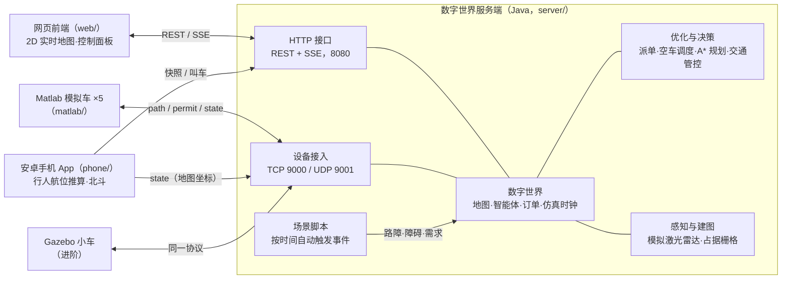
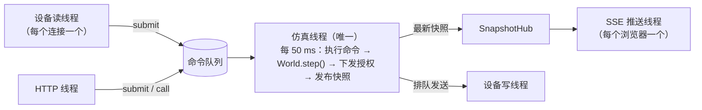
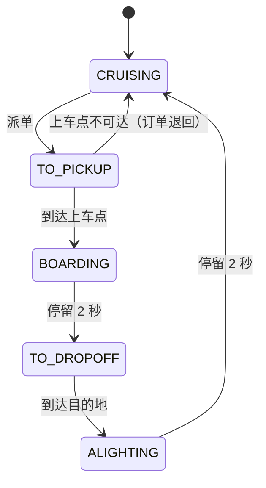
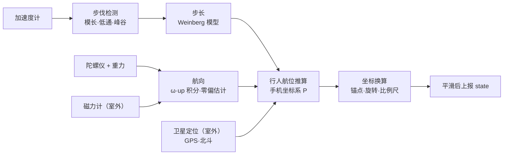
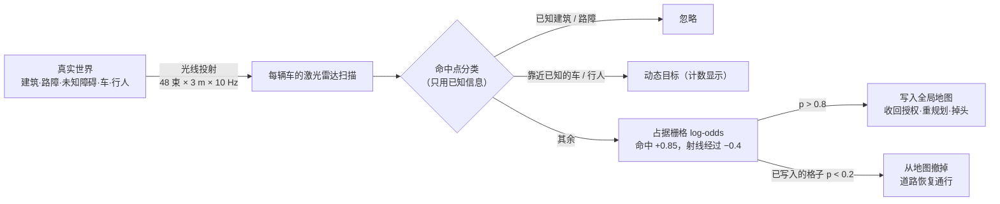

# 系统架构设计说明

## 1. 系统组成

MiniDiDi 是一个缩微无人出租车系统。城市里随机出现叫车的乘客，"系统超脑"（数字世界服务端）派车、规划路径、管控交通。车辆既可以由服务端自己仿真，也可以由外部设备驱动，例如 Matlab 模拟车、手机或 Gazebo。外部设备驱动时，服务端里的数字车就是它的**数字孪生**。

与 PPT 第 14 页"完整的服务端程序"中各模块的对应关系：

| PPT 模块 | 代码位置 | 内容 |
|---|---|---|
| 数字世界模块 | `world/`、`map/`、`sim/` | 地图管理（含静态、动态障碍）、智能体管理、仿真时钟、各设备状态记录；场景脚本；环境感知与辅助建图 |
| 设备接入模块 | `device/`、`world/DeviceBridge.java` | TCP/UDP 服务、注册绑定、状态同步、心跳与断线接管 |
| 优化与决策模块 | `dispatch/`、`plan/`、`traffic/`、`world/Rebalancer.java` | 订单派单（贪心/匈牙利）、空车调度、A* 路径规划（含掉头脱困）、移动授权交通管控 |
| 可视化与人机交互模块 | `web/`、`api/` | 实时地图、统计面板、配置与管理界面 |
| 图像处理加速模块 | （预留） | 挑战项，见 `docs/plan.md` |

## 2. 代码结构（server/src/main/java/com/zongc/dw）

| 包 | 主要类 | 职责 |
|---|---|---|
| `map` | `GridMap`、`CellType`、`Dir`、`MapLoader` | 栅格地图、车道方向规则、坐标换算、地图文件读取与校验 |
| `plan` | `AStarPlanner`、`Route`、`DistanceField` | A* 路径规划、平滑路线几何、派单用距离场 |
| `traffic` | `TrafficController` | 格子预约、移动授权、受阻检测 |
| `dispatch` | `Dispatcher`、`GreedyDispatcher`、`HungarianDispatcher`、`Hungarian` | 派单策略 |
| `world` | `World`、`Agent`、`Task`、`InternalDriver`、`TaskGenerator`、`CollisionMonitor`、`Metrics`、`DeviceBridge` | 数字世界本体与仿真步 |
| `world`（续） | `Perception` | 环境感知与辅助建图：模拟激光雷达、占据栅格、障碍的发现与撤除 |
| `world`（续） | `Scenario`、`ScenarioRunner` | 场景脚本：解析校验、按时间执行、循环播放 |
| `world`（续） | `Demand`、`Rebalancer` | 需求模型（热点）、空车调度 |
| `sim` | `SimulationEngine`、`SnapshotHub` | 仿真线程、命令队列、快照发布 |
| `device` | `DeviceGateway`、`DeviceSession` | 设备网络收发 |
| `api` | `HttpApi` | REST、SSE、静态文件 |
| `tools` | `Experiment` | 离线对比实验 |

`world`、`plan`、`traffic`、`dispatch`、`map` 不依赖任何网络代码，可以单独做单元测试和离线实验。以后如果想换成 Spring Boot，只需要替换 `api`、`device`、`sim` 这一层。

## 3. 线程模型

**World 只在仿真线程里读写。** 网络线程收到消息后，把"要做的事"包装成命令放进队列，由仿真线程在下一个节拍执行。这样整个世界状态不需要加锁，也不会出现"算到一半数据被改"的并发问题。发送消息时只是放进各连接的发送队列，网络慢也不会拖慢仿真。

## 4. 一个仿真步（World.step）

默认 20 Hz，每步 dt = 0.05 s，按以下顺序执行：

1. **场景脚本**：到时间的事件依次执行（公告、路障、未知障碍、需求热点、订单潮……，见 5.10）。
2. **生成订单**：泊松过程，每步以 1 − e^(−λ·dt) 的概率生成一单，起终点按需求模型抽取（默认全城均匀，设置热点后偏向热点）。
3. **内部车运动**：`InternalDriver` 让内部仿真车沿路线前进，速度受最高速度、转弯限速和授权停车点约束。外部设备驱动的车，位姿由设备上报直接写入。
4. **到站处理**：到达上车点开始上车（停留 2 s），到达目的地开始下车，空车巡游到达随机目的地后换一个目的地。
5. **派单**（每 2 s 一次）：收集空车和等待中的订单，交给派单策略做匹配，被派单的车从授权终点重新规划去上车点的路线。
6. **空车调度**（开启时每 8 s 一次）：按分区需求预测，把多余的空车调往缺车的区域（见 5.11）。
7. **感知与建图**（10 Hz）：每辆车做一次模拟激光雷达扫描，并入占据栅格；确认的新障碍写入全局地图，消失的障碍撤掉（见 5.9）。
8. **交通管控**：计算每辆车覆盖的格子，更新路线进度，收回不再安全的授权，按优先级延伸各车的移动授权。受阻过久的车尝试绕行。
9. **碰撞监测**：按真实几何检查车—车、车—建筑、车—路障 / 障碍（包括系统还不知道的障碍）的接触，并计数。
10. 每个墙钟节拍：检查设备心跳，向外部设备下发新的路线和授权，5 Hz 广播周边车辆；10 Hz 发布快照给浏览器。

## 5. 关键设计

### 5.1 地图与通行规则

城市是 53×34 格的栅格，每格 1 米。道路宽 2 格，双向两车道，靠右行驶。路口格允许任意方向，车道格只能沿箭头方向驶入、驶出。地图格式见 `docs/protocol.md` 第 5 节。

这样设计的好处是：同一条车道上的车同向行驶，不会迎面相撞；冲突只发生在路口和跟车，问题被大大简化。

### 5.2 路径规划

- **A***：搜索状态是"格子 + 驶入方向"。这样可以给转弯加代价（默认 0.5 米），得到更平顺的路线，也可以禁止原地掉头，掉头只能在路口用两次转弯完成。启发函数用曼哈顿距离，不会高估真实代价，所以 A* 的解是最优的。
- **平滑路线**：路线在每个格子里走一段。直行是穿过格中心的直线，90° 转弯用半径为半格的四分之一圆弧连接两条边的中点，圆弧完全落在转弯格内。单元测试验证了车辆中心离建筑始终不小于 0.2 米。
- **行驶中重规划**：派单、绕行等情况需要换路线时，车辆当前格到授权终点这一段已经获得授权，保持不变，新路线从授权终点接出去。这样车辆运动连续，已预约的格子也不会作废。
- **掉头脱困**：A* 禁止原地掉头，所以车开进一段单行道、前方又被障碍堵死时，按正常规则无路可走。这时 `planUTurn` 借用左侧的对向车道掉头：从当前格左转驶入对向车道格，再左转沿反方向行驶，两段四分之一圆弧正好拼成半径半格的半圆，车身不越出这两格；对向车道格同样要先申请到授权，所以掉头也不会撞车。车已经停在格子里时，先回到格子中心原地转向（缩微小车是差速驱动，可以原地转向）。
- **目标被切断**：如果目的地或上车点本身落在被堵死的那段单行道上，任何车都开不到。规划失败且车已停稳时，就把它改到附近一个开得到的车道格（乘客走几步）；等待中的订单若所有空车都到不了，派单时同样就近改上车点。

### 5.3 交通管控：格子预约与移动授权

这是保证"不与任何车辆碰撞"的核心，思路来自铁路的移动闭塞（移动授权）：

1. **一格一车**：每个格子同一时刻只属于一辆车。车身覆盖的格子和已授权的前方格子都归该车所有。
2. **只能驶入已授权的格子**：授权终点之前必须停车，车身不越过边界。内部车和外部设备都遵守这条规则，外部设备通过 permit 消息中的 `stopS` 得知停车位置。
3. **不堵路口**：申请授权遇到路口时，必须把整段路口格加上出口第一格一次性申请到，否则一格也不给。因此车辆只有在能完整通过路口时才会进入路口，路口内不会出现互相卡死。
4. **公平**：每步按"受阻时间"排序依次申请，等得最久的先申请。等待超过 3 秒的那一辆可以先占住它需要的空闲格，防止被源源不断的车流"饿死"。
5. **绕行**：受阻超过 12 秒，就给挡路的格子加惩罚后重新规划，尝试换一条路。

**为什么不会相撞**：任意两车的授权格不相交。车辆只在自己的授权格内运动，并且在授权边界前留出车身半径加余量的距离。因此两车车身不可能重叠。碰撞监测（`CollisionMonitor`）独立于交通管控，按真实几何计数，作为验证。

6. **行人优先**：手机等自由智能体不受管控（人走到哪里是人的自由），它们车身覆盖的格子任何车都申请不到。行人走进某辆车*已经*获得授权、但车还没开到的格子时，服务端立即把这辆车的授权收回到行人之前（若会停在路口中间，则退到路口之前），内部车按"授权终点前刹停"的约束马上停住，外部设备收到一条 `stopS` 更小的 permit。行人离开后授权照常延伸；一直不走则 12 秒后绕行。

第 6 条是接入手机后补上的：最初的实现只在"申请新授权"时检查行人，行人站进已预约的格子会被车穿过。端到端测试（`phone/` 的 `PhoneSim`：把行人放到行驶中出租车前方第 3 格）和单元测试 `WorldTest.taxisStopForPedestriansInsideTheirAuthority` 覆盖了这种情况。行人横穿马路时从侧面走进车身的接触，任何车端规则都无法避免，碰撞监测会照实记为"接触"。

7. **新障碍同样收回授权**：人工设置路障、或车辆感知发现了障碍时（`World.applyBlock`），已获授权、还没开到这一格的车立即把授权收回到它之前（同样不停在路口中间），路线经过它的车立即重规划（必要时掉头），上下车点在这一格的订单改到附近。人工设置路障时，若这一格上正有车或行人，直接拒绝。

### 5.4 派单

| 策略 | 做法 | 特点 |
|---|---|---|
| 贪心 GREEDY | 订单按等待时间排序，每单派给离它最近的空车 | 简单、实时；只看眼前 |
| 批量最优 HUNGARIAN | 每 2 秒把"空车 × 等待订单"建成代价矩阵，用匈牙利算法求总代价最小的匹配 | 全局最优；需要积累一批订单 |

- 代价是接驾行驶距离，由每个上车点的**距离场**给出：一次反向广度优先搜索，就能 O(1) 查询任意车辆的接驾步数。
- 匈牙利算法的代价减去 `waitWeight × 已等待时间`，避免偏远订单长期等待。
- 单元测试用暴力枚举验证了匈牙利算法的最优性。

离线对比实验（30 分钟仿真，3 个随机种子取平均；`python3 tools/run_evaluation.py` 一键重跑，完整结果见 [eval/summary.md](eval/summary.md)）：

| 场景 | 策略 | 平均等待 (s) | 送达效率 (单/分) | 空驶率 |
|---|---|---|---|---|
| 8 车，6 单/分（轻载） | 贪心 | 33.0 | 5.69 | 60% |
| | 匈牙利 | 28.5 | 5.71 | 60% |
| 16 车，12 单/分（中载） | 贪心 | 26.7 | 11.71 | 57% |
| | 匈牙利 | 24.6 | 11.76 | 57% |
| 16 车，16 单/分（接近饱和） | 贪心 | 70.4 | 13.28 | 51% |
| | 匈牙利 | **38.6** | **14.99** | **44%** |

结论：订单稀少时，两种策略几乎没有差别，因为通常只有一单可派、最近的车就是最优的。接近饱和时，同时等待的订单多，全局匹配把平均等待时间降低了约 45%，送达效率提高约 13%。所有实验均为零碰撞。

订单生成使用独立的随机数序列（只由种子决定），换派单策略、开关空车调度时订单的到达时间和起终点完全一样，比较是"配对"的。

### 5.5 数字孪生与驱动源

每辆数字车有一个"驱动源"：内部仿真、Matlab、Gazebo、手机或其他外部设备。

- **设备接管**：设备注册后绑定一辆数字车。服务端把车辆当前位姿通过 `welcome` 发给设备，并把路线"剪掉"已经走过的部分，让设备收到的路线从车辆当前所在格开始。此后由设备上报位姿，服务端只镜像，不再自己推算。
- **断线回退**：设备断开或 3 秒无消息，服务端把车"吸附"回路线上，由内部仿真继续驾驶，系统不停摆。这一点对现场演示很重要。
- **独立运行**：没有任何设备时，数字世界自己就能完整运行（PPT 必做要求）。

### 5.6 订单与车辆状态机

### 5.7 指标

`Metrics` 记录订单数、平均/最长等待时间、平均乘车时间、送达效率、空驶率、碰撞与撞墙次数、最小车距、最小离墙距离、最长连续受阻时间、绕行次数、越权行驶次数等。网页面板实时显示这些指标，`Experiment` 把它们输出成 CSV，可以直接用于技术报告的"效果评估"一章。

### 5.8 手机 App（行人）

安卓 App（`phone/`）把一部手机变成数字世界里的行人：手机自己做位姿估计，10 Hz 上报地图坐标；服务端把它当作动态障碍（见 5.3 第 6 条）。

算法、标定方法、精度测试见 [phone/README.md](../phone/README.md)。代码分两层：`core` 包是纯 Java（不依赖安卓，可以在电脑上单元测试和端到端仿真），外层是安卓界面与传感器读取。

### 5.9 环境感知与辅助建图

PPT 第 2 页对"智能"的要求是：知道周边有什么障碍物和目标物，能辅助建立地图。服务端把**真实世界**和**系统认知**分开：

| | 包含 | 谁能看到 |
|---|---|---|
| 真实世界 | 建筑、人工路障、场景脚本放置的**未知障碍**（`Perception.hidden`）、所有车和行人 | 只有"传感器"（光线投射）和碰撞监测 |
| 系统认知（全局地图） | 建筑、人工路障、由感知发现并写入的障碍（`discovered`） | 规划、派单、交通管控 |

- **扫描**：每辆出租车 10 Hz 扫描一次，48 束射线均布 360°，量程 3 m。射线用栅格光线投射（Amanatides–Woo 算法）求与建筑、路障、未知障碍的交点，再与其他车（半径 0.3 m）和行人（0.45 m）的圆求交，取最近者。外部设备驱动的车按设备上报的位姿扫描，相当于 Gazebo 里的激光雷达插件，扫描结果以 `scan` 消息下发给设备。
- **不偷看真值**：命中点按系统"已经知道"的信息分类，命中格直接取光线投射撞上的那一格（不能用"命中点往前一点"反查，射线擦过建筑转角时会落进旁边的路面，被误判成障碍——早期版本就出过这个问题，10 分钟内误检 10 处，修正后稠密交通 10 分钟零误检，见 `PerceptionTest.noFalseDiscoveriesInDenseTraffic`）。
- **占据栅格**：每格维护占据概率的对数几率 l = ln(p / (1−p))。命中 +0.85、被射线穿过 −0.4，限制在 ±4 之间。连续两次命中（约 0.2 s）即超过 1.4（p ≈ 0.8），确认为障碍；被确认的格子之后若被连续观测为空、降到 −1.4 以下（p ≈ 0.2），自动撤掉。这样单次误检不会改动地图，障碍消失也能自动恢复。
- **写入地图之后**：与人工路障完全相同（5.3 第 7 条）——收回授权、重规划、掉头、改上下车点。手机拍照经图像识别得到的路障（5.12）作为加权观测并入同一张栅格。
- **安全余量**：量程 3 m，最高速度 1.5 m/s 时刹车距离 0.75 m，确认只需约 0.2 s（行驶 0.3 m），所以正前方出现的障碍一定能停住。场景脚本不会把障碍"砸"在车旁边（2.5 m 内有车或行人时推迟出现）。碰撞监测按真实世界判断车是否撞上障碍（`barrierHits`），所有测试和实验均为 0，车停在障碍前 8 cm（`stopMargin`）。
- **指标**：发现次数、撤除次数、障碍出现到被发现的平均时间、最近 60 s 内被核实过的道路比例（"地图核实覆盖率"），见 [eval/summary.md](eval/summary.md) 第 3 节。

### 5.10 场景脚本：全自主运行

PPT 要求"启动后即自主运行，考核过程中不可人工切换模式、进行设置或遥控"。演示中要出现的情况都写在场景脚本里（`server/scenarios/*.json`，格式见 `docs/protocol.md` 第 6 节），按仿真时间自动触发：

| 脚本 | 内容 |
|---|---|
| `demo.json` | 期末演示，约 6 分钟一轮、自动循环：正常运行 → 已知路障 → 未知障碍被感知发现 → 早高峰潮汐需求 + 空车调度 → 订单潮 → 障碍撤除 → 恢复平峰 |
| `perception.json` | 感知与建图：4 处未知障碍陆续出现、消失 |
| `rush-hour.json` | 早晚高峰潮汐需求，用于空车调度对比实验 |

`ScenarioRunner` 每个仿真步检查一次到期的事件；循环播放时，新一轮开始前自动撤掉上一轮放置的路障和障碍，并清掉感知对它们的结论，所以可以无人值守地长时间演示。`scripts/start_demo.sh` 默认运行 `demo.json`；网页上显示当前脚本、进度、下一个事件和倒计时，事件发生时弹出横幅说明。

### 5.11 空车调度（rebalancing）

派单只决定"哪辆空车接哪一单"；没有订单时空车随机巡游，常常离下一单很远。空车调度提前把空车调往"即将有人叫车"的区域：

1. **需求预测**：城市划成 9×9 格的区域（6×4 = 24 个）。每来一单，上车点所在区域的计数 +1，计数按时间常数 τ = 180 s 指数衰减，得到各区域最近的叫车强度 λ_z。
2. **目标分布**：空车总数 I 按 λ_z 的比例分到各区域（最大余数法取整）。
3. **最优调度**：多余的空车（所在区域车多于目标）调往缺车的区域，用匈牙利算法求"总空驶距离最小"的指派，距离沿路网（遵守车道方向）计算。
4. 调过去的车在该区域内就近巡游；接到订单后恢复正常。

潮汐需求（早高峰居民区 → 商务区，晚高峰反向）、8 辆车、每个到达率 8 个种子的配对比较：4 单/分时平均等待 27.9 s → 22.3 s（−20%），5 单/分时 36.9 s → 30.1 s（−18%），6 单/分时只降 6%——车辆接近饱和、几乎没有空车时无从调度。

## 6. 扩展点

| 想做的事 | 从哪里入手 |
|---|---|
| 新增派单策略（拼车、强化学习） | 实现 `dispatch/Dispatcher`，在 `Dispatcher.of` 中注册，用 `Experiment` 对比 |
| 新的演示情节 | 在 `server/scenarios/` 新建脚本（格式见 `docs/protocol.md` 第 6 节），`ScenarioTest` 会自动校验 |
| 多车协同路径规划（时空预约、冲突搜索 CBS） | `plan/AStarPlanner` 增加时间维度，`traffic/TrafficController` 改为时空预约 |
| 换地图 / 真实校园地图 | `tools/gen_map.py` 生成，或手工编辑地图 JSON |
| 3D 可视化 | 新建前端页面，订阅 `/api/stream`，用 Three.js 渲染，数据结构与 2D 完全相同 |
| 更真实的感知（噪声、漏检、动态障碍跟踪） | `world/Perception.java` 的 `scan`（加噪声）和 `integrate`（改观测模型）；`PerceptionTest` 验证不误检、不漏检 |
| Gazebo / 实体车接入 | 写一个桥接程序，按 `docs/protocol.md` 注册为 `gazebo` 设备即可 |
| 手机 App 改进（扩展卡尔曼滤波融合、手机"接单"、鸿蒙版） | 算法在 `phone/app/src/main/java/com/zongc/phone/core/`（纯 Java，先在电脑上用 `PhoneSim` 和单元测试验证）；其他平台按协议以 `phone` 类型注册、上报地图坐标即可 |
