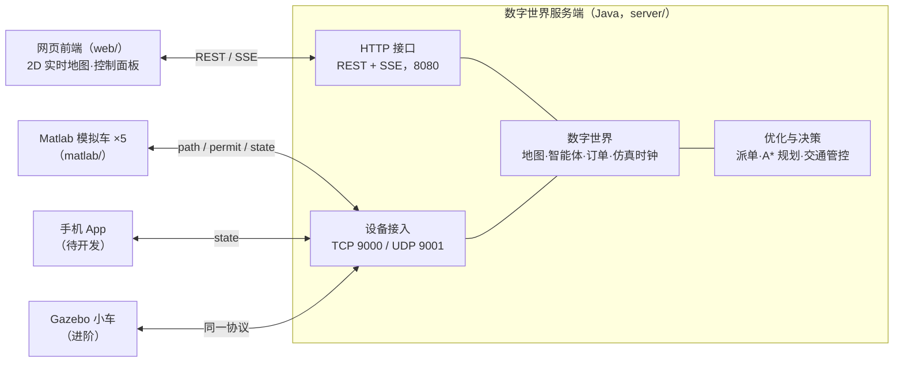
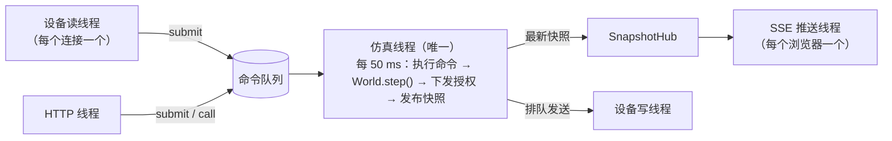
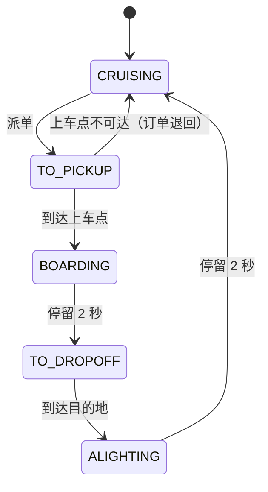

# 系统架构设计说明

## 1. 系统组成

MiniDiDi 是一个缩微无人出租车系统。城市里随机出现叫车的乘客，"系统超脑"（数字世界服务端）派车、规划路径、管控交通。车辆既可以由服务端自己仿真，也可以由外部设备驱动，例如 Matlab 模拟车、手机或 Gazebo。外部设备驱动时，服务端里的数字车就是它的**数字孪生**。

与 PPT 第 14 页"完整的服务端程序"中各模块的对应关系：

| PPT 模块 | 代码位置 | 内容 |
|---|---|---|
| 数字世界模块 | `world/`、`map/`、`sim/` | 地图管理（含静态、动态障碍）、智能体管理、仿真时钟、各设备状态记录 |
| 设备接入模块 | `device/`、`world/DeviceBridge.java` | TCP/UDP 服务、注册绑定、状态同步、心跳与断线接管 |
| 优化与决策模块 | `dispatch/`、`plan/`、`traffic/` | 订单派单（贪心/匈牙利）、A* 路径规划、移动授权交通管控 |
| 可视化与人机交互模块 | `web/`、`api/` | 实时地图、统计面板、配置与管理界面 |
| 图像处理加速模块 | （预留） | 挑战项，见 `docs/plan.md` |

## 2. 代码结构（server/src/main/java/com/zongc/dw）

| 包 | 主要类 | 职责 |
|---|---|---|
| `map` | `GridMap`、`CellType`、`Dir`、`MapLoader` | 栅格地图、车道方向规则、坐标换算、地图文件读取与校验 |
| `plan` | `AStarPlanner`、`Route`、`DistanceField` | A* 路径规划、平滑路线几何、派单用距离场 |
| `traffic` | `TrafficController` | 格子预约、移动授权、受阻检测 |
| `dispatch` | `Dispatcher`、`GreedyDispatcher`、`HungarianDispatcher`、`Hungarian` | 派单策略 |
| `world` | `World`、`Agent`、`Task`、`InternalDriver`、`TaskGenerator`、`CollisionMonitor`、`Metrics`、`DeviceBridge` | 数字世界本体与仿真步 |
| `sim` | `SimulationEngine`、`SnapshotHub` | 仿真线程、命令队列、快照发布 |
| `device` | `DeviceGateway`、`DeviceSession` | 设备网络收发 |
| `api` | `HttpApi` | REST、SSE、静态文件 |
| `tools` | `Experiment` | 离线对比实验 |

`world`、`plan`、`traffic`、`dispatch`、`map` 不依赖任何网络代码，可以单独做单元测试和离线实验。以后如果想换成 Spring Boot，只需要替换 `api`、`device`、`sim` 这一层。

## 3. 线程模型

**World 只在仿真线程里读写。** 网络线程收到消息后，把"要做的事"包装成命令放进队列，由仿真线程在下一个节拍执行。这样整个世界状态不需要加锁，也不会出现"算到一半数据被改"的并发问题。发送消息时只是放进各连接的发送队列，网络慢也不会拖慢仿真。

## 4. 一个仿真步（World.step）

默认 20 Hz，每步 dt = 0.05 s，按以下顺序执行：

1. **生成订单**：泊松过程，每步以 1 − e^(−λ·dt) 的概率生成一单，起终点为随机车道格。
2. **内部车运动**：`InternalDriver` 让内部仿真车沿路线前进，速度受最高速度、转弯限速和授权停车点约束。外部设备驱动的车，位姿由设备上报直接写入。
3. **到站处理**：到达上车点开始上车（停留 2 s），到达目的地开始下车，空车巡游到达随机目的地后换一个目的地。
4. **派单**（每 2 s 一次）：收集空车和等待中的订单，交给派单策略做匹配，被派单的车从授权终点重新规划去上车点的路线。
5. **交通管控**：计算每辆车覆盖的格子，更新路线进度，按优先级延伸各车的移动授权。受阻过久的车尝试绕行。
6. **碰撞监测**：按真实几何检查车—车、车—建筑的接触，并计数。
7. 每个墙钟节拍：检查设备心跳，向外部设备下发新的路线和授权，5 Hz 广播周边车辆；10 Hz 发布快照给浏览器。

## 5. 关键设计

### 5.1 地图与通行规则

城市是 53×34 格的栅格，每格 1 米。道路宽 2 格，双向两车道，靠右行驶。路口格允许任意方向，车道格只能沿箭头方向驶入、驶出。地图格式见 `docs/protocol.md` 第 5 节。

这样设计的好处是：同一条车道上的车同向行驶，不会迎面相撞；冲突只发生在路口和跟车，问题被大大简化。

### 5.2 路径规划

- **A***：搜索状态是"格子 + 驶入方向"。这样可以给转弯加代价（默认 0.5 米），得到更平顺的路线，也可以禁止原地掉头，掉头只能在路口用两次转弯完成。启发函数用曼哈顿距离，不会高估真实代价，所以 A* 的解是最优的。
- **平滑路线**：路线在每个格子里走一段。直行是穿过格中心的直线，90° 转弯用半径为半格的四分之一圆弧连接两条边的中点，圆弧完全落在转弯格内。单元测试验证了车辆中心离建筑始终不小于 0.2 米。
- **行驶中重规划**：派单、绕行等情况需要换路线时，车辆当前格到授权终点这一段已经获得授权，保持不变，新路线从授权终点接出去。这样车辆运动连续，已预约的格子也不会作废。

### 5.3 交通管控：格子预约与移动授权

这是保证"不与任何车辆碰撞"的核心，思路来自铁路的移动闭塞（移动授权）：

1. **一格一车**：每个格子同一时刻只属于一辆车。车身覆盖的格子和已授权的前方格子都归该车所有。
2. **只能驶入已授权的格子**：授权终点之前必须停车，车身不越过边界。内部车和外部设备都遵守这条规则，外部设备通过 permit 消息中的 `stopS` 得知停车位置。
3. **不堵路口**：申请授权遇到路口时，必须把整段路口格加上出口第一格一次性申请到，否则一格也不给。因此车辆只有在能完整通过路口时才会进入路口，路口内不会出现互相卡死。
4. **公平**：每步按"受阻时间"排序依次申请，等得最久的先申请。等待超过 3 秒的那一辆可以先占住它需要的空闲格，防止被源源不断的车流"饿死"。
5. **绕行**：受阻超过 12 秒，就给挡路的格子加惩罚后重新规划，尝试换一条路。

**为什么不会相撞**：任意两车的授权格不相交。车辆只在自己的授权格内运动，并且在授权边界前留出车身半径加余量的距离。因此两车车身不可能重叠。碰撞监测（`CollisionMonitor`）独立于交通管控，按真实几何计数，作为验证。

手机等自由智能体不受管控，但它们周围的格子会被占用，出租车遇到会停车避让。

### 5.4 派单

| 策略 | 做法 | 特点 |
|---|---|---|
| 贪心 GREEDY | 订单按等待时间排序，每单派给离它最近的空车 | 简单、实时；只看眼前 |
| 批量最优 HUNGARIAN | 每 2 秒把"空车 × 等待订单"建成代价矩阵，用匈牙利算法求总代价最小的匹配 | 全局最优；需要积累一批订单 |

- 代价是接驾行驶距离，由每个上车点的**距离场**给出：一次反向广度优先搜索，就能 O(1) 查询任意车辆的接驾步数。
- 匈牙利算法的代价减去 `waitWeight × 已等待时间`，避免偏远订单长期等待。
- 单元测试用暴力枚举验证了匈牙利算法的最优性。

离线对比实验（30 分钟仿真，3 个随机种子取平均，`scripts/experiment.sh`）：

| 场景 | 策略 | 平均等待 (s) | 送达效率 (单/分) | 空驶率 |
|---|---|---|---|---|
| 8 车，6 单/分（轻载） | 贪心 | 34.5 | 5.55 | 60% |
| | 匈牙利 | 29.7 | 5.47 | 60% |
| 16 车，12 单/分（中载） | 贪心 | 24.0 | 11.42 | 58% |
| | 匈牙利 | 23.2 | 11.29 | 59% |
| 16 车，16 单/分（接近饱和） | 贪心 | 66.4 | 13.30 | 51% |
| | 匈牙利 | **36.4** | **14.62** | **45%** |

结论：订单稀少时，两种策略几乎没有差别，因为通常只有一单可派、最近的车就是最优的。接近饱和时，同时等待的订单多，全局匹配把平均等待时间降低了约 45%，送达效率提高约 10%。所有实验均为零碰撞。

### 5.5 数字孪生与驱动源

每辆数字车有一个"驱动源"：内部仿真、Matlab、Gazebo、手机或其他外部设备。

- **设备接管**：设备注册后绑定一辆数字车。服务端把车辆当前位姿通过 `welcome` 发给设备，并把路线"剪掉"已经走过的部分，让设备收到的路线从车辆当前所在格开始。此后由设备上报位姿，服务端只镜像，不再自己推算。
- **断线回退**：设备断开或 3 秒无消息，服务端把车"吸附"回路线上，由内部仿真继续驾驶，系统不停摆。这一点对现场演示很重要。
- **独立运行**：没有任何设备时，数字世界自己就能完整运行（PPT 必做要求）。

### 5.6 订单与车辆状态机

### 5.7 指标

`Metrics` 记录订单数、平均/最长等待时间、平均乘车时间、送达效率、空驶率、碰撞与撞墙次数、最小车距、最小离墙距离、最长连续受阻时间、绕行次数、越权行驶次数等。网页面板实时显示这些指标，`Experiment` 把它们输出成 CSV，可以直接用于技术报告的"效果评估"一章。

## 6. 扩展点

| 想做的事 | 从哪里入手 |
|---|---|
| 新增派单策略（拼车、空车调度、强化学习） | 实现 `dispatch/Dispatcher`，在 `Dispatcher.of` 中注册，用 `Experiment` 对比 |
| 多车协同路径规划（时空预约、冲突搜索 CBS） | `plan/AStarPlanner` 增加时间维度，`traffic/TrafficController` 改为时空预约 |
| 换地图 / 真实校园地图 | `tools/gen_map.py` 生成，或手工编辑地图 JSON |
| 3D 可视化 | 新建前端页面，订阅 `/api/stream`，用 Three.js 渲染，数据结构与 2D 完全相同 |
| 感知与建图（突发路障） | 设备端模拟激光测距发现路障，发送 `event`；服务端调用 `World.setRoadblock` 更新全局地图 |
| Gazebo / 实体车接入 | 写一个桥接程序，按 `docs/protocol.md` 注册为 `gazebo` 设备即可 |
| 手机接入 | 按协议以 `phone` 类型注册，上报地图坐标 |
