# 软件设计说明

> 本文档用 UML 从体系结构、部署、静态结构、动态行为四个视图描述 MiniDiDi 的设计，回答"系统怎么做"。
> 算法细节（交通管控为什么不会撞车、A* 为什么最优、感知怎样避免误检……）写在 [架构设计说明](architecture.md)，
> 消息格式写在 [接口协议说明](protocol.md)，本文只在需要时引用。
>
> 所有 UML 图的源文件在 `docs/uml/*.puml`（PlantUML），修改后运行 `python3 tools/render_uml.py` 重新生成图片。

## 1. 设计目标与原则

| 目标 | 设计上的做法 |
|---|---|
| 零碰撞（NFR-01） | 交通管控用"格子预约 + 移动授权"，从机制上保证任意两车的授权格不相交；碰撞监测独立计数作为验证 |
| 全自主、不停摆（FR-33、FR-60） | 设备断线由内部仿真接管；场景脚本自动触发演示情节；一键启动 |
| 正确性易于验证（NFR-08） | 世界模型与网络代码分层；世界状态只在一个线程中修改，不加锁；核心逻辑都有单元测试 |
| 零依赖、离线可用（NFR-06、NFR-07） | 服务端只依赖 Gson（随仓库提供），JDK 自带 HTTP 服务器；网页和手机核心零第三方库 |
| 设备无关（NFR-09） | 所有外部设备说同一种协议；`kind` 只决定绑定出租车还是新建行人 |

## 2. 体系结构

### 2.1 组件视图

服务端是一个组件，对外只有三个端口：HTTP 8080（REST + SSE，给网页和手机）、TCP 9000（设备协议）、UDP 9001（可选的状态上报）。
所有外部组件——网页、Matlab 车队、安卓 App、Gazebo 桥接、Python 模拟设备——都只通过这三个端口与服务端交互，彼此之间没有依赖。

### 2.2 分层

| 层 | 包 | 职责 | 依赖规则 |
|---|---|---|---|
| 接入层 | `api`、`device` | HTTP / TCP / UDP 收发、JSON 编解码、静态文件 | 只能通过 `SimulationEngine.submit/call` 访问世界 |
| 运行层 | `sim` | 唯一的仿真线程、命令队列、快照发布 | 依赖世界层 |
| 世界层 | `world` | 数字世界本体：智能体、订单、仿真步、设备协议语义、感知、场景、需求与空车调度 | 不依赖接入层 |
| 算法层 | `plan`、`traffic`、`dispatch`、`map`、`vision` | 路径规划、交通管控、派单、栅格地图、图像识别 | 不依赖世界层以上（`vision` 只被 `api` 调用） |
| 基础 | `config`、`util` | 配置读取、日志、数值格式化 | 被所有层使用 |

世界层和算法层不包含任何网络代码，所以能直接写单元测试和离线实验（`tools/Experiment` 不开任何端口就能跑 60 分钟仿真）。
以后如果要换成 Spring Boot，只需要替换接入层和运行层。

### 2.3 线程模型

| 线程 | 数量 | 做什么 | 能否改世界状态 |
|---|---|---|---|
| 仿真线程 | 1 | 每 50 ms：执行命令队列 → `World.step()` → 下发授权 → 发布快照 | **能，且只有它能** |
| HTTP 线程 | 线程池 | 解析请求；查询或修改用 `engine.call(w -> …)` 排队，等仿真线程执行完再返回 | 否 |
| 设备读线程 | 每连接 1 个 | 读一行 JSON，`engine.submit(w -> w.onDeviceMessage(…))` | 否 |
| 设备写线程 | 每连接 1 个 | 从发送队列取消息写出；网络慢不会拖慢仿真 | 否 |
| SSE 推送线程 | 每浏览器 1 个 | 等待新快照（`SnapshotHub.awaitNewer`）并推送 | 否 |
| 图像识别 | ForkJoin 公共池 | 颜色分割、开运算按行并行；结果再交给仿真线程写入地图 | 否 |

这样设计的原因：多个线程同时改世界状态需要处处加锁，容易出现"算到一半数据被改"的并发缺陷，也很难测试。
命令队列把所有修改串行化，世界内部完全不需要锁。

## 3. 部署视图

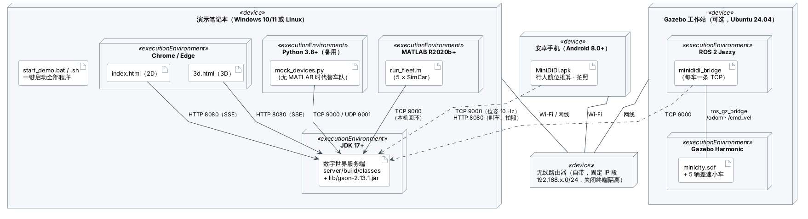

| 节点 | 运行的程序 | 网络 |
|---|---|---|
| 演示笔记本 | 服务端（JDK 17+）、浏览器（2D + 3D）、MATLAB 车队（或 Python 模拟车）、一键启动脚本 | 连自带路由器；服务端监听 8080/9000/9001 |
| 安卓手机 | MiniDiDi App | Wi-Fi 连同一路由器；TCP 9000 上报位姿，HTTP 8080 取快照、叫车、拍照 |
| Gazebo 工作站（可选） | Gazebo Harmonic + ROS 2 Jazzy + `minididi_bridge` | 网线连路由器；每辆车一条 TCP 连接 |
| 无线路由器 | — | 固定 IP 段，关闭终端隔离（AP 隔离） |

Matlab 车队和服务端在同一台笔记本上时走本机回环（127.0.0.1），不受无线网络影响；手机和 Gazebo 走局域网。
部署步骤见 [部署与使用手册](deployment.md)。

## 4. 静态结构

### 4.1 数字世界领域模型

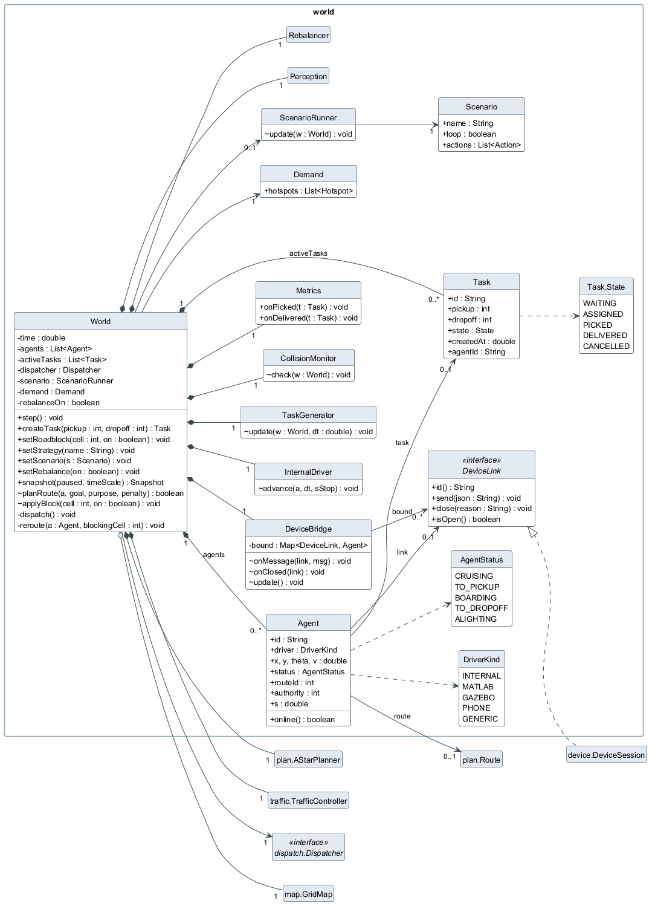

- `World` 是聚合根：它**组合**（实心菱形）了全部智能体、进行中的订单和各个子系统，世界销毁时它们一起销毁；
  地图 `GridMap` 是**聚合**（空心菱形），可以被多个世界共享（离线实验里同一张地图跑多组仿真）。
- `Agent` 同时表示出租车和手机行人（`taxi` 字段区分），驱动源 `driver` 决定位姿由内部仿真推算还是由设备上报。
  外部设备驱动时 `link` 指向一个 `DeviceLink`，这就是"数字孪生"在代码中的体现。
- `DeviceLink` 是接口：生产环境由 `device.DeviceSession`（TCP 连接）实现，单元测试里换成一个记录消息的假实现，
  所以设备协议的语义（注册、接管、断线回退）不开网络端口也能测试。

### 4.2 算法类

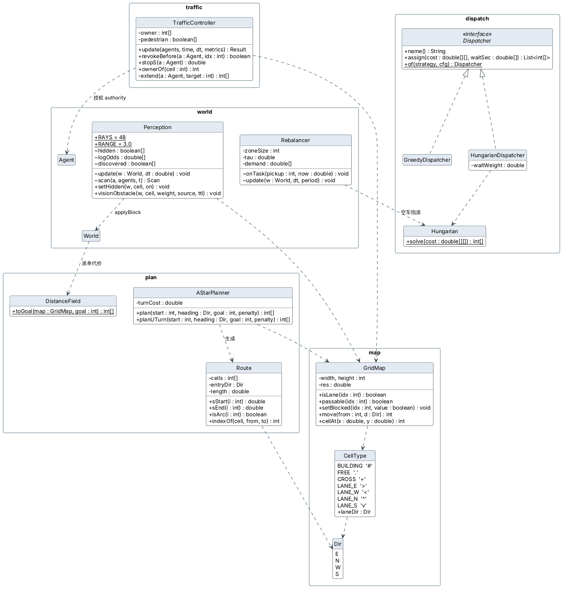

- `Dispatcher` 是策略接口（策略模式），`Dispatcher.of(name)` 按名字创建；新增派单策略只需实现它并注册，
  其他代码不用改。
- `AStarPlanner` 只依赖 `GridMap`，输出格子序列，再由 `Route` 生成平滑路点（直行穿过格中心，转弯用半格半径的四分之一圆弧）。
- `TrafficController` 维护占用表 `owner[]`（每格属于哪辆车）和行人表 `pedestrian[]`；对外的唯一结果是每辆车的
  `authority`（授权到路线第几格）和 `stopS`（停车点）。
- `Perception` 维护"真实世界"中的未知障碍 `hidden[]` 和系统的占据栅格 `logOdds[]`；确认后通过 `World.applyBlock`
  写入地图，与人工路障走同一条处理路径。
- `Rebalancer` 复用 `dispatch.Hungarian` 求空车的最优调度。

### 4.3 手机 App

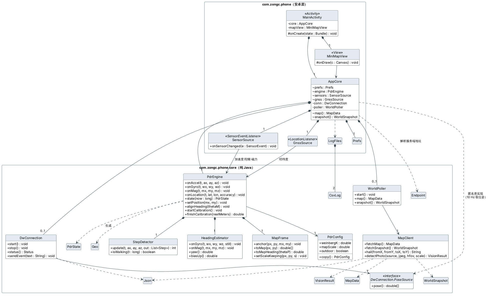

App 分两层：`com.zongc.phone.core` 是纯 Java（不引用任何 `android.*` 类），包含位姿估计、坐标换算、网络协议、JSON，
可以在电脑上做单元测试和端到端仿真；外层只负责界面、读取传感器和卫星定位，再把数据交给核心层。

| 类 | 职责 |
|---|---|
| `PdrEngine` | 位姿估计的总入口：传感器数据进，地图坐标系下的位姿出 |
| `StepDetector` | 加速度模长 → 两级低通 → 峰谷检测计步，回滞量自适应 |
| `HeadingEstimator` | 陀螺仪角速度在重力方向上的分量积分得到航向；静止时估计零偏；室外用磁力计 PI 修正 |
| `MapFrame` | 手机坐标系 → 地图坐标系：锚点、旋转、比例尺，修改时保持当前位置不跳变 |
| `DwConnection` | 按协议注册为 `phone`，10 Hz 上报 `state`，1 Hz `ping`，断线自动重连 |
| `MapClient` / `WorldPoller` | HTTP 取地图和快照（约 3 Hz）、叫车、上传照片 |
| `AppCore` | 把以上部件组装起来，生命周期跟随应用而不是界面 |

### 4.4 Matlab 模拟车

| 文件 | 类型 | 职责 |
|---|---|---|
| `run_fleet.m` | 函数 | 入口：建立 5 条 TCP 连接，注册 car-1 … car-5；20 Hz 控制循环，10 Hz 上报状态；断线重连 |
| `SimCar.m` | 类 | 一辆车：独轮车运动学、纯追踪转向、速度 PI、按 `stopS` 限速 v ≤ √(2a(stopS − s))、前车急停 |
| `DwClient.m` | 类 | TCP 连接封装：每行一条 JSON，非阻塞收取 |
| `FleetView.m` | 类 | 本地实时视图：地图、各车位置、路线、停车点 |
| `test_simcar_offline.m` | 脚本 | 不连服务端的控制器测试：不越过停车点、能到达终点 |

这部分代码按 `tools/mock_devices.py`（已在服务端上测试）逐行移植，**还需要在 MATLAB 中实测**。

### 4.5 网页前端

| 文件 | 职责 |
|---|---|
| `web/index.html`、`js/app.js` | 2D 主界面：订阅 SSE 快照，驱动地图与右侧面板（指标、车辆、订单、控制、事件、图像识别） |
| `js/map.js` | Canvas 渲染：静态层（道路、建筑、标线）离屏画一次；动态层每帧重绘，车辆位置在两次快照间插值 |
| `web/3d.html`、`js/view3d.js` | 3D 视图：由地图建城市模型，快照驱动动态物体；四种视角 |
| `js/gl/math.js`、`geometry.js`、`renderer.js` | 自写 WebGL 渲染器：矩阵运算、网格生成、着色器与绘制顺序 |

## 5. 动态行为

### 5.1 一个订单的生命周期

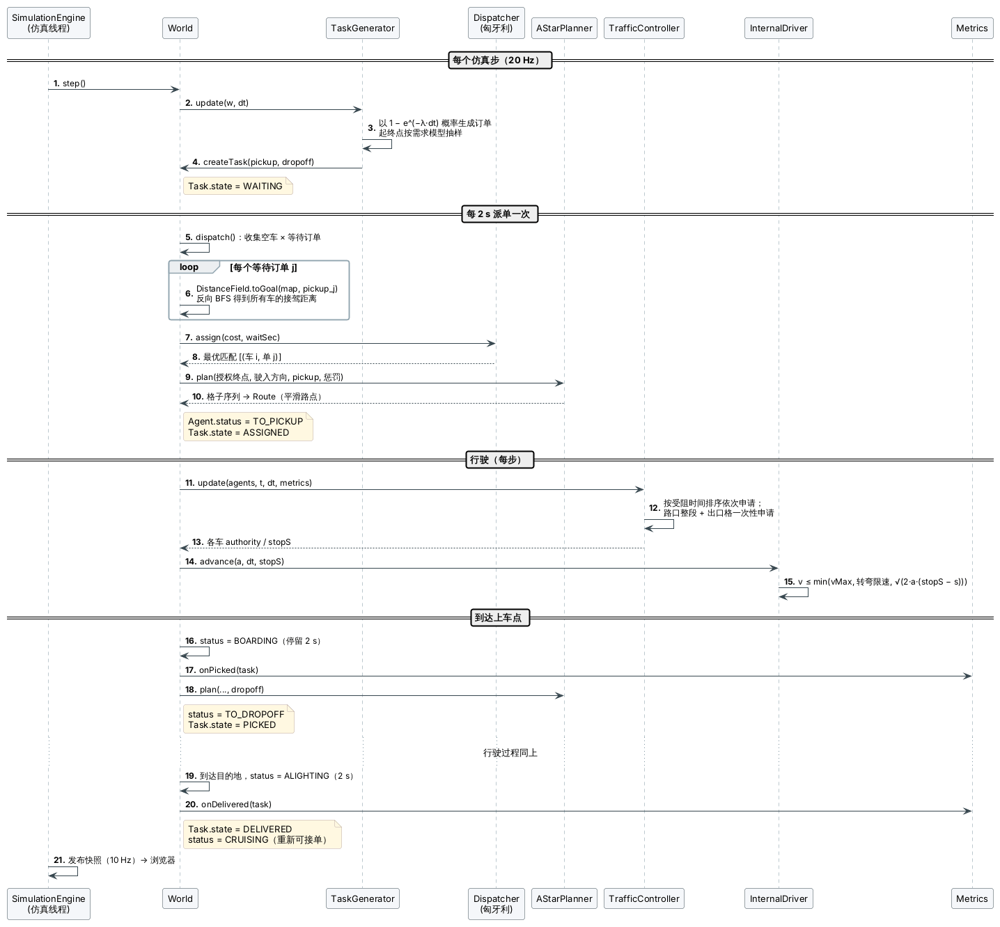

派单每 2 s 一次。对每个等待中的订单，从上车点做一次反向广度优先搜索（距离场），就能 O(1) 查出每辆空车的接驾距离，
组成"空车 × 订单"代价矩阵交给派单策略。匈牙利算法的代价再减去 `waitWeight × 已等待时间`，避免偏远订单一直没人接。

### 5.2 设备接入、按授权行驶与断线接管

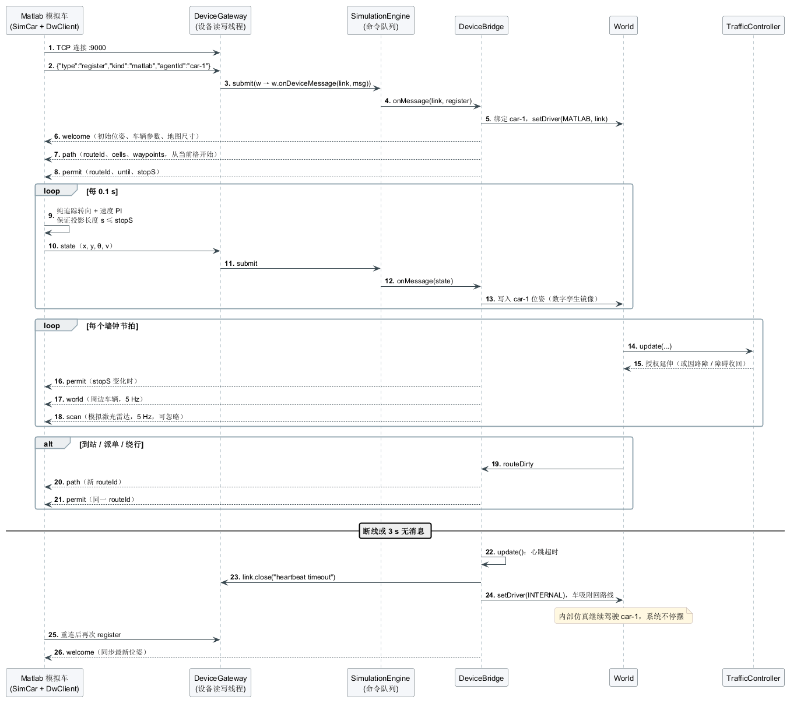

关键约定：设备收到新的 `path` 后、收到同一 `routeId` 的 `permit` 之前不得前进；任何时刻投影长度 s ≤ `stopS`；
`stopS` 变小时必须直接采用（不能取历史最大值）。服务端保证授权格互不相交，所以设备只要遵守这一条就不会相撞。

### 5.3 感知未知障碍并更新地图

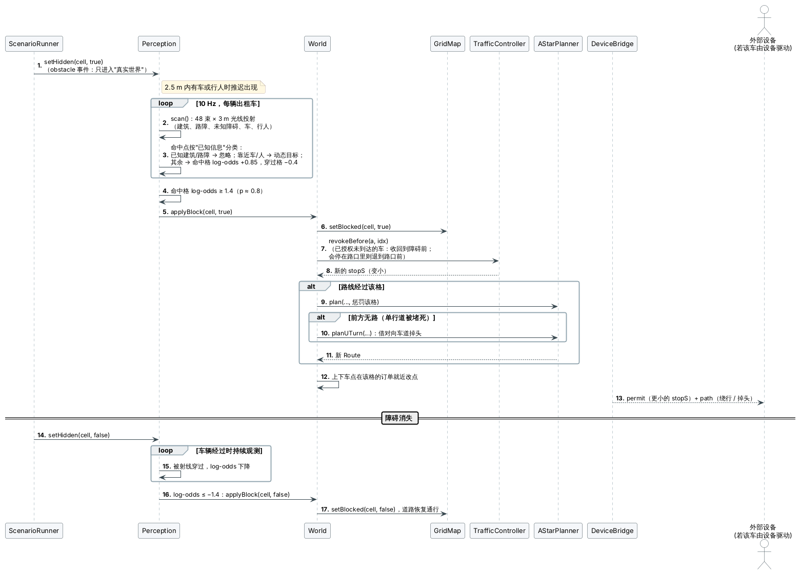

### 5.4 端云互动：拍照识别路障

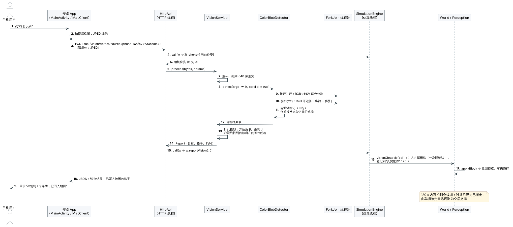

图像识别是计算量最大的操作，放在 HTTP 线程里做，不占用仿真线程；只有"把识别结果写进地图"这一步通过
`engine.call` 交给仿真线程，保持"世界只在一个线程里修改"的约定。

### 5.5 手机接入、行人避让与叫车

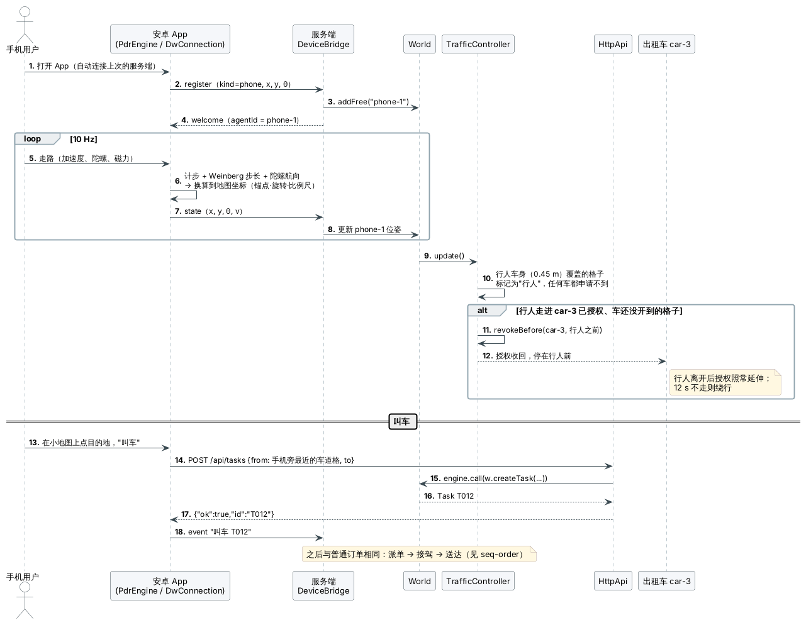

### 5.6 状态机

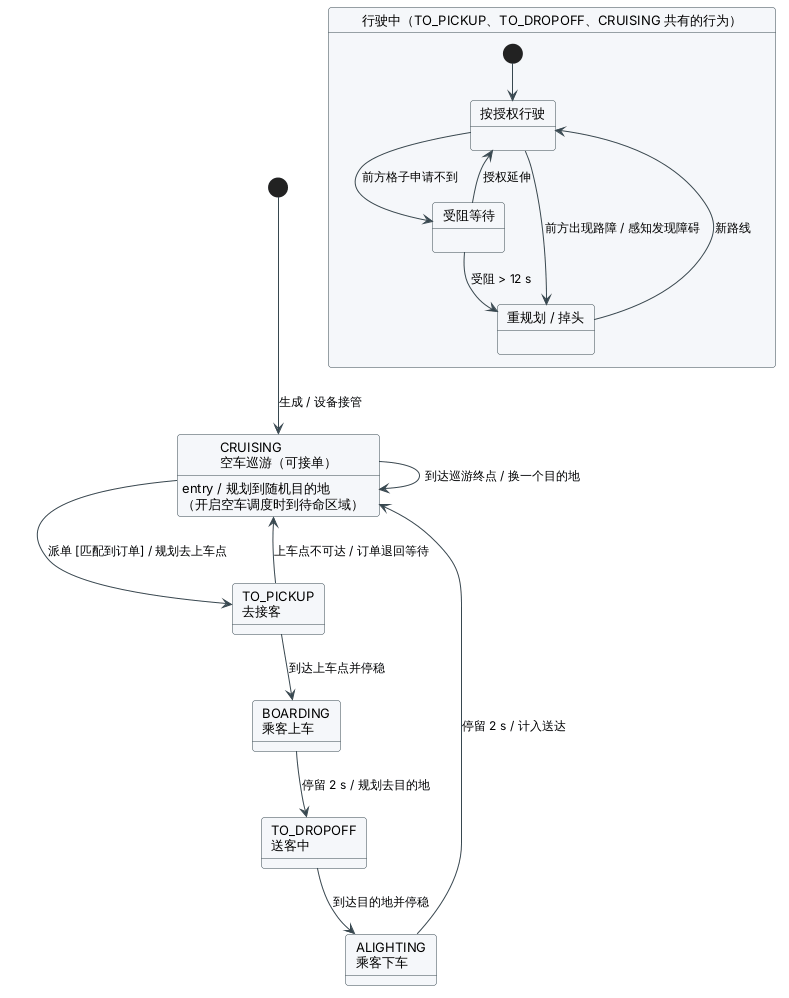

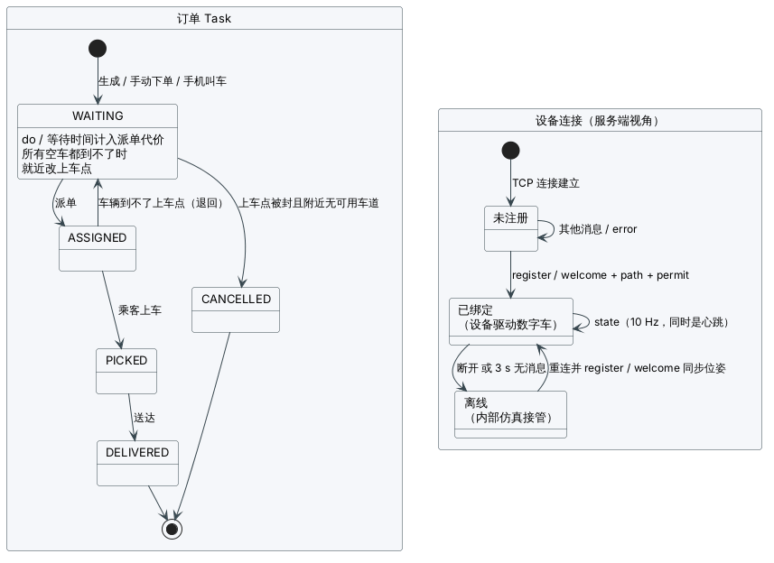

### 5.7 仿真步与授权延伸

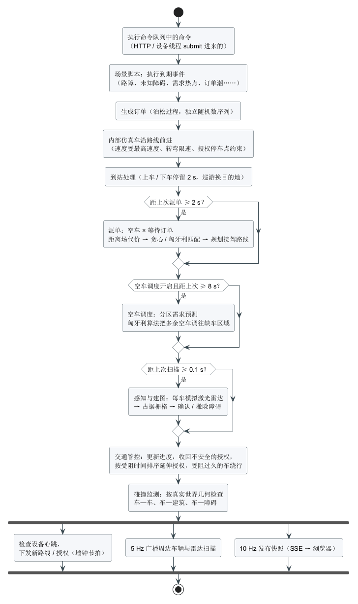

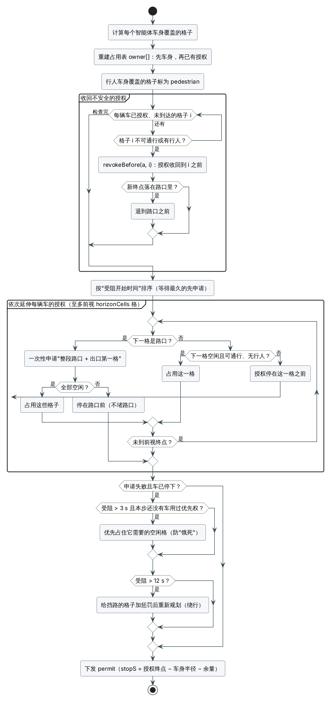

授权延伸的三条规则共同保证不出现死锁：

1. **不堵路口**：路口整段加出口第一格一次性申请，申请不到就停在路口前，所以路口里不会有车互相卡住；
2. **公平**：按受阻时间排序，等得最久的先申请；受阻超过 3 s 的那一辆可以先占住它需要的空闲格，防止被车流"饿死"；
3. **绕行兜底**：受阻超过 12 s 就给挡路的格子加惩罚、重新规划。

## 6. 数据设计

| 数据 | 格式与位置 | 说明 |
|---|---|---|
| 地图 | JSON，`server/maps/*.json` | `rows` 字符串数组，第一行最北；`#` 建筑，`> < ^ v` 单向车道，`+` 路口，`.` 开放区域（协议第 5 节） |
| 场景脚本 | JSON，`server/scenarios/*.json` | 事件列表（时间、动作、参数、横幅文字），可循环（协议第 6 节） |
| 运行配置 | JSON，`server/config/default.json` | 车数、仿真频率、车辆参数、交通管控参数、派单、订单、端口 |
| 世界快照 | JSON（SSE 推送 / `GET /api/snapshot`） | 智能体、订单、指标、事件、路障、感知结果、场景进度、需求、图像识别摘要（协议 3.3 节） |
| 实验结果 | CSV，`docs/eval/*.csv` | 每次仿真一行，30 列指标 |
| 手机记录 | CSV（手机存储） | `pose`（位姿、步数、卫星）与 `imu`（原始传感器）两个文件 |

世界状态只保存在内存中，不需要数据库：演示和实验都从配置和种子重新生成，同一种子可复现。

主要配置参数（默认值）：

| 参数 | 默认 | 含义 |
|---|---|---|
| `taxis` | 8 | 数字车数量 |
| `tickHz` / `snapshotHz` | 20 / 10 | 仿真频率 / 快照推送频率 |
| `vehicle.bodyRadius` / `phoneRadius` | 0.3 / 0.45 m | 车身半径 / 行人半径 |
| `vehicle.vMax` / `aAcc` / `aDec` / `vTurn` | 1.5 m/s / 1.0 / 1.5 m/s² / 0.6 m/s | 最高速度、加减速度、转弯限速 |
| `vehicle.stopMargin` | 0.08 m | 授权终点前额外留出的余量 |
| `traffic.horizonCells` | 3 | 授权最多向前看几格 |
| `traffic.turnCost` | 0.5 | A* 转弯代价（米） |
| `traffic.priorityHoldSec` / `stuckRerouteSec` | 3 / 12 s | 优先通行 / 绕行阈值 |
| `dispatch.strategy` / `intervalSec` / `waitWeight` | HUNGARIAN / 2 s / 0.3 | 派单策略、周期、等待时间权重 |
| `tasks.ratePerMin` | 6 | 订单到达率 |
| `devices.heartbeatTimeoutSec` / `worldHz` | 3 s / 5 Hz | 心跳超时 / 周边车辆广播频率 |

## 7. 关键设计决策

| 决策 | 备选方案 | 选择理由 |
|---|---|---|
| JDK 自带 `HttpServer` + Gson，不用 Spring Boot | Spring Boot | 路线 1 只要求 Java + REST；不用框架就不需要联网下载依赖，学生电脑装个 JDK 即可；接入层与世界层分离，以后要换框架只改接入层 |
| 单线程仿真 + 命令队列 | 多线程共享状态 + 锁 | 无锁、无数据竞争，结果可复现，易于测试 |
| 栅格地图 + 格子预约 | 连续空间 + 速度障碍法 | 格子预约可以证明不相撞；冲突只发生在路口和跟车，问题大大简化 |
| 路口整段申请 | 逐格申请 | 逐格申请会让两辆车在路口中间互相卡死 |
| 授权以 `stopS`（沿路点折线的长度）下发 | 只下发格子范围 | 设备不需要理解格子，只要比较自己走过的长度 |
| 设备断线由内部仿真接管 | 设备断线车辆停止 | 现场演示时任何设备出问题，系统都不停摆 |
| 真实世界与系统认知分开 | 直接把障碍写进地图 | 才能体现"感知发现"；碰撞监测按真实世界判断，评估可信 |
| 手机自己做位姿估计，上报地图坐标 | 上传原始传感器数据由服务端估计 | 网络抖动不影响积分；协议简单；核心代码可在电脑上测试 |
| 3D 用自写 WebGL，不用 Three.js | Three.js | 开发环境下载不了第三方库，演示现场也不一定能联网；渲染需求简单，200 行可以完成 |
| 场景脚本（JSON）驱动演示 | 操作员现场点按钮 | 考核要求不可人工操作；脚本可校验、可循环、可用于离线实验 |
| UML 用 PlantUML 源文件 | 画图软件手绘 | 源文件可以和代码一起评审、修改后一条命令重画；图符符合 UML 规范 |

## 8. 扩展点

见 [架构设计说明第 6 节](architecture.md#6-扩展点)：新增派单策略、新的演示情节、多车协同规划（时空预约 / CBS）、换地图、
更真实的感知、Gazebo / 实体车接入、手机 App 改进等，都给出了从哪里入手。
