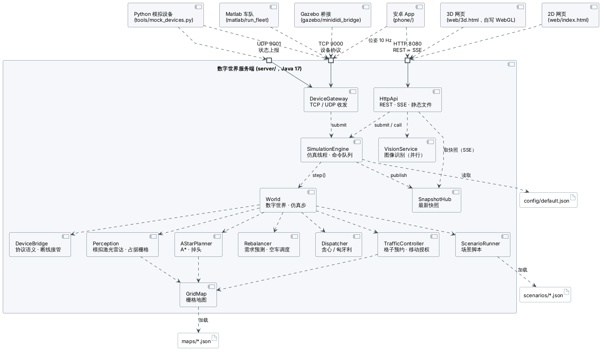
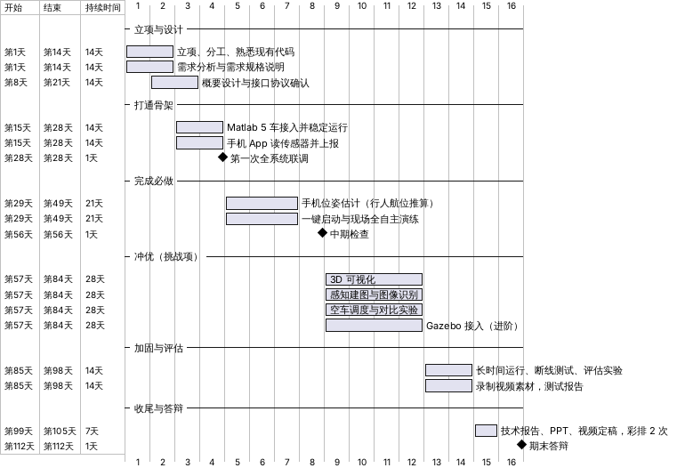

# 立项申请书

| 项目 | 内容 |
|---|---|
| 项目名称 | 缩微滴滴：多智能体无人出租车系统（MiniDiDi / RoboTax） |
| 课程 | 综合设计与实践 C（同济大学） |
| 周期 | 第 1–16 周（第 8 周中期检查，第 16 周期末答辩） |
| 小组成员 | 组长：阮飞翔（2252753）　组员：樊宇泽（2351586）、李昊博（2352853）、付泽亮（2353413）（分工见第 6 节） |
| 代码仓库 | GitHub：https://github.com/fuzeliang1/ZongC |
| 技术路线 | 课程 PPT 的"路线 1"：HTML + JavaScript + CSS 前端，Java 服务端 + REST 接口 |
| 文档版本 | v1.0（随代码一起维护，修改记录见仓库根目录 `CHANGELOG.md`） |

## 1. 背景与意义

网约车平台的核心是一个"系统超脑"：城市里随时有人叫车，平台要决定派哪辆车、走哪条路，同时保证所有车安全通行。
无人驾驶出租车（Robotaxi）把司机也换成了算法，这个"超脑"就要同时管好派单、路径规划和交通管控。

真车实验成本高、风险大，所以先在"缩微世界"里做：用一张栅格化的城市地图代表真实城市，用数字车、Matlab 模拟车、
手机和 Gazebo 小车代表各种交通参与者，服务端作为系统超脑统一调度。外部设备驱动的车在服务端里有一个
"数字孪生"，两边状态实时同步。这样既能验证调度与控制算法，又能完整体验一个多智能体系统从需求、设计、
实现、测试到部署的全过程，这正是本课程的训练目标。

## 2. 项目目标

按课程考核标准分两档。**必做项全部完成是"良"的前提，挑战项决定能否拿"优"。**

| 档次 | 目标 | 可度量的验收标准 |
|---|---|---|
| 必做 | 数字世界（DW）可独立运行 | 不接任何设备也能运行；≥ 5 辆数字车 |
| 必做 | 随机运输任务 | 订单随机生成，车辆完成接驾→上车→送客→下车全过程 |
| 必做 | 基于最优化的路径规划 | A* 最短路（可证明最优）；派单用匈牙利算法求全局最优匹配 |
| 必做 | 人机交互与动态显示 | 网页实时显示地图、车辆、订单、统计指标，可修改配置 |
| 必做 | 不与静态 / 动态障碍碰撞 | 长时间、高密度运行碰撞计数为 0 |
| 必做 | Matlab 模拟车 ≥ 5 辆，与数字车同步 | 5 辆车同时接入，按服务端下发的路线和授权行驶 |
| 必做 | 手机 App | 读取 GPS/北斗、加速度、陀螺仪、磁力计，无线发给服务端并与一个智能体同步，基于惯性元件估计位姿 |
| 必做 | 整体集成、全自主运行 | 一键启动；考核过程中不需要任何人工操作 |
| 挑战 | 3D 渲染可视化 | 浏览器中的三维城市与车辆，数据与 2D 视图一致 |
| 挑战 | 智能：环境感知与辅助建图、端云互动 | 车辆发现系统不知道的障碍并写入全局地图；手机拍照、服务端做图像识别 |
| 挑战 | 服务端图像处理加速模块 | 多线程并行处理，给出加速比 |
| 挑战（进阶） | Gazebo 中 ≥ 5 辆车接入 | 按同一协议注册为数字孪生 |
| 挑战（自选） | 调度优化与定量评估 | 空车调度；配对实验证明平均等待时间下降 |

## 3. 技术方案概述

| 子系统 | 技术选择 | 理由 |
|---|---|---|
| 数字世界服务端 | Java 17，只依赖 Gson；JDK 自带 `HttpServer` 提供 REST + SSE，原生 Socket 提供 TCP/UDP 设备接入 | 路线 1 要求 Java；不用 Spring Boot，离线也能编译运行，学生电脑上一个 JDK 就够 |
| 仿真模型 | 20 Hz 离散时间仿真；1 m 栅格地图，双向两车道、靠右行驶 | 栅格让规划、交通管控和碰撞检测都简单可靠 |
| 路径规划 | A*（状态 = 格子 + 驶入方向，带转弯代价，禁止原地掉头），被堵死时借对向车道掉头 | 曼哈顿启发函数不高估，A* 解最优 |
| 派单 | 贪心与匈牙利算法两种，可切换对比 | 匈牙利算法求总接驾距离最小的全局最优匹配 |
| 交通管控 | 格子预约 + 移动授权（借鉴铁路移动闭塞） | 任意两车的授权格不相交，从机制上保证零碰撞 |
| 可视化 | 原生 HTML/CSS/JS：Canvas 2D；自写 WebGL 渲染器做 3D | 不依赖第三方库，演示现场断网也能打开 |
| Matlab 模拟车 | 独轮车运动学 + 纯追踪 + 速度 PI，严格遵守授权停车点 | 控制专业特色；不需要任何工具箱 |
| 手机 App | 安卓原生 Java（零第三方库）：计步 + Weinberg 步长 + 陀螺仪航向（行人航位推算），室外融合磁力计与卫星定位 | 课程要求"基于惯性元件估计位姿"；教室里收不到卫星信号也能工作 |
| 设备协议 | TCP 每行一条 JSON（register / state / path / permit / world / scan），UDP 可选 | Matlab、Python、安卓、ROS 都容易实现 |
| 全自主运行 | 场景脚本（JSON）按仿真时间自动触发路障、未知障碍、早晚高峰、订单潮，循环播放 | 满足"考核中不可人工操作" |

详细设计见 [软件设计说明](design.md) 与 [架构设计说明](architecture.md)，接口见 [接口协议说明](protocol.md)。

## 4. 可行性分析

| 方面 | 分析 |
|---|---|
| 技术 | 用到的算法（A*、匈牙利算法、纯追踪、互补滤波、占据栅格）都是课堂和教材中的成熟方法；服务端不依赖框架，学习成本低 |
| 设备 | 服务端、网页、Matlab 都在普通笔记本上运行；手机用组员自己的安卓手机；Gazebo 需要一台装 Ubuntu 的电脑（进阶，可选） |
| 人员 | 4–5 人，按服务端、前端、Matlab、手机分工，每块都有明确接口（协议文档），可以并行开发 |
| 时间 | 16 周。先在第 4 周打通"服务端 + Matlab + 手机"骨架，之后每周在能运行的系统上迭代，降低最后集成的风险 |
| 经费 | 无需额外采购；现场演示自带一台无线路由器 |

## 5. 系统边界

- **做**：数字世界服务端、2D/3D 网页、Matlab 模拟车、安卓 App、Python 模拟设备（协议参考实现）、离线评估实验、全套过程文档。
- **不做**：真实道路上的无人驾驶；真实的乘客支付与账户系统；深度学习目标检测（图像识别用颜色分割 + 连通域，服务端接口预留了替换空间）。
- **进阶 / 可选**：Gazebo 小车接入、实体小车接入（同一协议注册为 `gazebo` / `generic` 设备即可）。

## 6. 分工

| 成员 | 角色 | 主要负责 | 兼任 |
|---|---|---|---|
| 阮飞翔（2252753，组长） | 架构与调度 | 总体架构、接口协议、派单与空车调度、联调集成、进度管理 | 立项申请书、需求规格说明、技术报告统稿、答辩主讲 |
| 樊宇泽（2351586） | 服务端 | 数字世界与交通管控、设备接入、感知建图、图像处理加速 | 软件设计说明、测试计划与报告 |
| 李昊博（2352853） | 控制与可视化 | Matlab 模拟车、2D 界面与 3D 可视化 | 部署与使用手册、答辩 PPT、演示视频 |
| 付泽亮（2353413） | 移动端与进阶 | 安卓 App 与位姿估计、Gazebo 接入 | 效果评估报告、GitHub 仓库管理 |

每人主负责一块，同时审查另一块的代码（阮飞翔 ↔ 樊宇泽、李昊博 ↔ 付泽亮）；联调全员参加。答辩时老师可能问任何人整体架构，每个人都要能讲清楚。

## 7. 进度计划

| 周次 | 阶段 | 主要任务 | 里程碑与产出 |
|---|---|---|---|
| 1–2 | 立项设计 | 分工、熟悉现有代码、需求分析、确认 PPT 中的模糊点 | 立项申请书、需求规格说明 |
| 3–4 | 打通骨架 | Matlab 5 车接入并稳定运行；手机 App 读出传感器并上报 | **第一次全系统联调** |
| 5–7 | 完成必做 | 手机位姿估计；一键启动；现场环境演练 | 必做功能全部可演示 |
| 8 | 中期检查 | 全系统演示 + 中期报告；确定挑战项 | **中期检查** |
| 9–12 | 冲优 | 3D、感知建图与图像识别、空车调度、Gazebo | 挑战功能 |
| 13–14 | 加固评估 | 不再加新功能，只修缺陷；长时间运行与断线测试；对比实验 | 测试报告、评估数据 |
| 15 | 收尾 | 报告、PPT（正文 ≤ 5 页）、视频（≤ 5 分钟）定稿；答辩教室彩排 2 次 | 全部提交物 |
| 16 | 答辩 | 现场演示 + 答辩 | **期末答辩** |

## 8. 风险与对策

| 风险 | 可能性 | 影响 | 对策 |
|---|---|---|---|
| 孤立模块拿不到"良" | 中 | 高 | 集成优先：第 4 周前打通全系统；`main` 分支始终可演示 |
| 现场网络：校园网终端隔离、防火墙拦截 | 高 | 高 | 自带路由器、固定 IP；提前放行 8080/9000/9001 端口；所有设备断线后由服务端自动接管，演示不中断 |
| 考核中不能人工操作 | 确定 | 高 | 场景脚本自动触发所有演示情节；一键启动；手机 App 打开即自动连接 |
| Matlab 版本差异、组员不熟悉 Matlab | 中 | 中 | 只用 R2020b 自带函数，不依赖工具箱；先跑离线控制器测试；Python 模拟车作为后备 |
| 手机传感器噪声大、教室收不到卫星信号 | 高 | 中 | 室内用行人航位推算 + 比例尺；"设位置 / 对方向"现场标定；"模拟行走"作为后备 |
| Gazebo 安装配置复杂 | 高 | 低 | 列为进阶可选；桥接程序带纯 Python 后端，不装 ROS 也能验证协议 |
| 期末集中赶文档 | 中 | 中 | 文档随做随写，每个阶段产出对应文档；UML 用 PlantUML 源文件维护，改了就能重画 |
| 组员时间冲突、进度滞后 | 中 | 中 | 每人主负责一块、互相审查代码；固定每周一天联调；GitHub Issues 按周设里程碑 |

## 9. 预期成果

1. 可一键启动、全自主运行的完整系统：服务端、2D/3D 网页、5 辆 Matlab 模拟车、安卓 App（以及可选的 Gazebo 车队）。
2. 全流程文档：立项申请书、需求规格说明、软件设计说明（UML）、接口协议、测试计划与报告、部署与使用手册、效果评估报告、版本记录。
3. 提交物：技术报告（docx/pdf）、介绍 PPT（正文 ≤ 5 页）、源码、图片与 ≤ 5 分钟的演示视频。
4. 量化结论：派单算法、空车调度、感知建图、图像处理加速的对比实验数据，以及长时间高负载运行的安全性数据。
