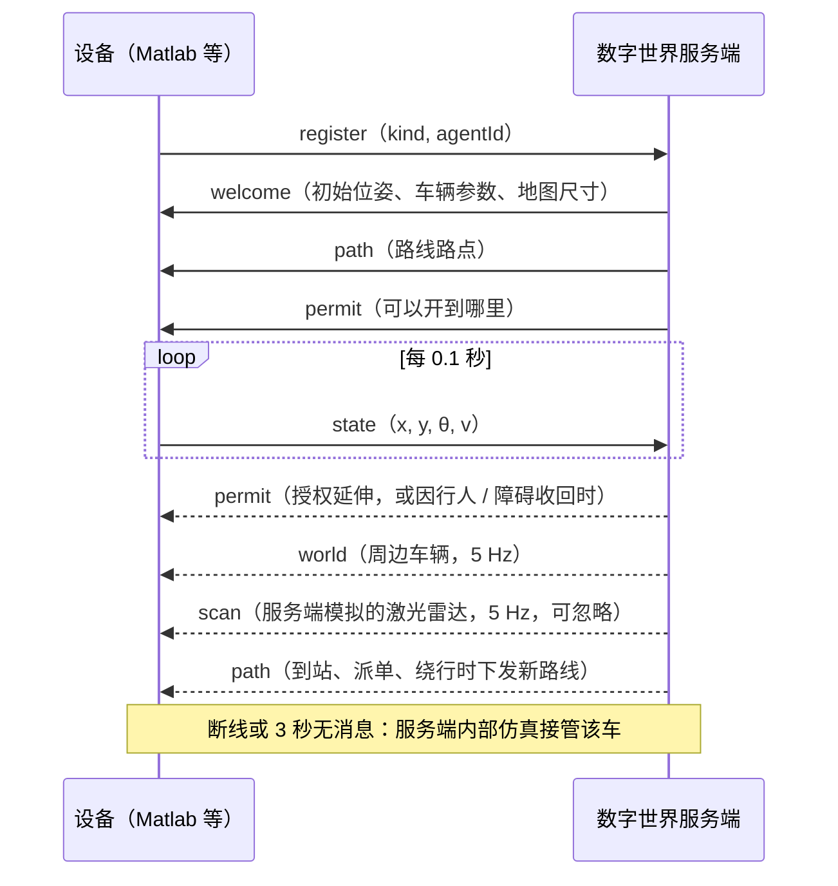

# 接口协议说明（v1）

本文档定义数字世界（DW）服务端对外的全部接口，是各模块并行开发的"合同"。修改协议前请先在组内讨论，并同步更新本文档和 `tools/mock_devices.py`（协议的可运行参考实现）。

| 接口 | 端口 | 使用者 |
|---|---|---|
| 设备接入（TCP，每行一条 JSON） | 9000 | Matlab 模拟车、手机 App、Gazebo 桥接、实体小车 |
| 设备状态上报（UDP，可选） | 9001 | 同上（须先通过 TCP 注册） |
| 浏览器接口（HTTP：REST + SSE） | 8080 | 网页前端、调试工具、3D 前端 |

端口可在 `server/config/default.json` 中修改。

## 1. 通用约定

**坐标系**

- 世界坐标单位为米，原点在地图西南角，x 向东为正，y 向北为正。
- 格子 (i, j) 覆盖 [i·res, (i+1)·res] × [j·res, (j+1)·res]，格中心为 ((i+0.5)·res, (j+0.5)·res)。默认 res = 1 米。
- 航向角 θ 用弧度，从 x 轴逆时针计，范围 (−π, π]：向东 0，向北 π/2，向西 π，向南 −π/2。
- 速度 m/s，角速度 rad/s。

**其他约定**

- 时间 `t` 指服务端的仿真时间（秒）；设备上报中的 `t` 是设备本地时间戳（毫秒），只用于调试。
- 编码 UTF-8；JSON 字段名使用小驼峰；数值保留到毫米级即可。
- 兼容性：接收方必须忽略不认识的字段和消息类型。以后新增字段不会破坏旧客户端。

## 2. 设备接入协议（TCP 9000）

### 2.1 传输格式

- TCP 长连接，每条消息是一个 JSON 对象，以换行符 `\n` 结尾，单条不超过 1 MB。
- 一个设备（一辆模拟车 / 一部手机）使用一条连接。Matlab 跑 5 辆车就开 5 条连接。
- UDP 9001 只用于高频上报 `state`：每个数据报放一条（或多条以换行分隔的）`state` 消息，必须带 `agentId`，且该车已经通过 TCP 完成注册。下行消息只走 TCP。

### 2.2 交互流程



### 2.3 设备 → 服务端

**register**：建立连接后发送的第一条消息。

| 字段 | 类型 | 必填 | 说明 |
|---|---|---|---|
| type | string | 是 | `"register"` |
| kind | string | 是 | `matlab` / `gazebo` / `generic`：绑定一辆出租车（数字孪生）；`phone`：作为自由智能体接入 |
| agentId | string | 否 | 希望绑定的车，如 `"car-3"`。不存在则新建；正被其他活跃设备使用则改派一辆空闲车（以 welcome 中的 agentId 为准） |
| name | string | 否 | 设备名称，仅用于日志 |
| x, y, theta | number | 手机必填 | 自由智能体的初始位姿（地图坐标） |

```json
{"type":"register","kind":"matlab","agentId":"car-1","name":"matlab-1"}
```

**state**：位姿上报，建议 10 Hz，同时也是心跳。

| 字段 | 类型 | 说明 |
|---|---|---|
| type | string | `"state"` |
| agentId | string | 走 TCP 时可省略（按连接识别）；走 UDP 时必填 |
| seq | int | 递增序号（调试用） |
| t | int | 设备时间戳，毫秒（调试用） |
| x, y | number | 位置，米 |
| theta | number | 航向，弧度 |
| v | number | 线速度，m/s |
| w | number | 角速度，rad/s（可选） |

```json
{"type":"state","agentId":"car-1","seq":120,"t":1792713600123,"x":12.5,"y":40.2,"theta":1.571,"v":1.2,"w":0.0}
```

**其他消息**

- `ping`：心跳，服务端回复 `pong`。
- `event`：设备事件，`{"type":"event","event":"任意文字"}`，会记入服务端事件日志。
- `sensor`：预留给手机原始传感器数据（服务端位姿估计时使用），目前只当作心跳。

### 2.4 服务端 → 设备

**welcome**：注册成功。设备应把自己的状态初始化为 `pose`。数字世界接管中的车正在行驶时，`v` 可能不为 0。

```json
{"type":"welcome","protocol":1,"agentId":"car-1","role":"taxi","driver":"MATLAB",
 "pose":{"x":47.5,"y":25.5,"theta":3.142,"v":0.9},
 "params":{"bodyRadius":0.3,"vMax":1.5,"aAcc":1.0,"aDec":1.5,"vTurn":0.6,"stopMargin":0.08,"stateHz":10,"heartbeatTimeoutSec":3.0},
 "map":{"name":"MiniCity 5x4","width":53,"height":34,"resolution":1.0},"t":12.3}
```

**path**：新路线。收到后，旧路线和旧授权立即作废。

| 字段 | 说明 |
|---|---|
| routeId | 路线编号，递增；permit 用它对应路线 |
| purpose | `CRUISE`（空车巡游）/ `PICKUP`（去接客）/ `DROPOFF`（去送客） |
| status | 车辆状态，见第 4.3 节 |
| taskId | 关联订单，可能为 null |
| cells | 路线经过的格子 `[[x,y],...]`，第一个是车辆当前所在格 |
| waypoints | 平滑路线的采样点 `[[x,y],...]`（米），间距不超过 0.25 格，转弯处沿半径为半格的圆弧采样 |
| entryDir | 车辆进入第一个格子的方向（E/N/W/S），从格中心出发时为 null |

**permit**：行驶授权。这是交通管控的核心。

| 字段 | 说明 |
|---|---|
| routeId | 对应的路线；与当前路线不一致时忽略 |
| until | 已授权的最远格子在 `cells` 中的下标 |
| stopS | 沿 `waypoints` 折线、从第一个路点算起的累计长度（米）。车辆的投影位置不得超过它 |
| stop | stopS 对应的点 `[x,y]`，方便画图 |
| final | true 表示授权已到路线终点（车辆应在终点停稳，等待下一条路线） |

```json
{"type":"permit","agentId":"car-1","routeId":7,"until":5,"stopS":5.12,"stop":[44.38,25.5],"final":false}
```

**world**：周边所有智能体的状态（5 Hz），用于本地安全兜底（例如前方很近处有车就急停）。

```json
{"type":"world","t":35.2,"agents":[{"id":"car-2","x":30.1,"y":8.5,"theta":0.0,"v":1.5,"r":0.3,"taxi":true}]}
```

**scan**：服务端按这辆车的最新位姿模拟的激光雷达扫描（约 5 Hz）。服务端自己用它建图（见架构说明 5.9 节）；
设备可以用它做本地安全检查或画出来，不处理的设备直接忽略即可。

| 字段 | 说明 |
|---|---|
| t, x, y, theta | 扫描时刻（仿真时间）与车辆位姿 |
| angleMin, angleStep | 第 k 束射线的方向 = theta + angleMin + k·angleStep（共 48 束，覆盖 360°，从车尾开始逆时针） |
| rangeMax | 量程（米），没有命中的射线距离等于它 |
| ranges | 48 个距离（米） |
| kinds | 48 个命中类型：0 未命中，1 建筑 / 地图边界，2 路障 / 障碍，3 车辆，4 行人（这是"真值"，只用于显示和本地安全检查） |

```json
{"type":"scan","agentId":"car-1","t":35.2,"x":12.5,"y":0.5,"theta":0.0,"angleMin":-3.14159,"angleStep":0.1309,
 "rangeMax":3.0,"ranges":[3.0,3.0,2.71,...],"kinds":[0,0,1,...]}
```

**error**：`{"type":"error","message":"请先发送 register 消息"}`。出错的那条消息被忽略，连接保持。

### 2.5 行驶授权的语义（必须遵守）

1. 设备沿 `waypoints` 折线行驶，并计算自己在折线上的投影长度 s。
2. 任何时刻都必须满足 **s ≤ stopS**。推荐的速度上限是 v ≤ √(2·a·(stopS − s))，这样总能在停车点前刹住。
3. 收到新的 `path` 之后、收到同一 `routeId` 的 `permit` 之前，不得前进（stopS 视为 0）。
4. 服务端保证任意两辆车不会获得同一个格子的授权，因此只要遵守第 2 条就不会相撞。授权通常只向前延伸，**例外有两种**：手机等自由智能体（行人）走进了已经授权给某辆车、但车还没开到的格子；或者这样的格子变得不可通行（人工设置路障、车辆感知发现了障碍）。这时服务端立即把授权收回到它之前，下发一条 `stopS` 更小的 `permit`（如果这样会停在路口中间，就退到路口之前），障碍的情况下紧接着下发绕行或掉头的新 `path`。设备必须直接采用新的 `stopS`（不要取历史最大值），按第 2 条立即减速停车。
5. `final=true` 且到达终点后，服务端会在乘客上下车（约 2 秒）后下发下一条路线。

服务端会统计"越权行驶"次数并显示在界面上，作为考核时的证据。

### 2.6 心跳、断线与接管

- 服务端 3 秒（`heartbeatTimeoutSec`）收不到某设备的任何消息，就判定离线并断开连接。数字世界内部仿真立即接管该车，系统继续运行。
- 设备重连后重新发送 `register` 即可，服务端会用 `welcome` 把最新位姿同步给设备。
- 同一辆车被一个 1 秒内有消息的活跃设备占用时，新设备会被分配其他空闲车，不会互相踢下线。旧连接已失联时，新连接直接接管（方便设备重启）。

### 2.7 设备类型与手机接入

- `matlab` / `gazebo` / `generic`：绑定出租车，参与派单，按服务端路线行驶。
- `phone`：新建一个自由智能体（`phone-1` …），不参与派单，位置完全由手机上报。它在交通管控中算作行人（动态障碍）：车身半径 `phoneRadius`（默认 0.45 m）覆盖的格子任何车都申请不到授权；走进某辆车已获授权的格子时，该车的授权被紧急收回（见 2.5 第 4 条），车会停在行人前面等待，等待超过 12 s 则绕行。
- 手机上报的 `x, y` 必须是**地图坐标**。手机把 GPS 经纬度或行人航位推算（PDR）的结果换算成地图坐标，建议如下：
  1. 选一个地面参考点（如教室某角落）对应地图上某个坐标；
  2. 把位移转换为东-北-天（ENU）坐标系下的米；
  3. 乘一个比例尺（例如人走 1 米 = 地图上 5 米），这样在教室里走动就能让手机车在城市地图上移动。

  位姿估计放在 App 里还是服务端里，PPT 不做限制；v1 协议要求 App 上报已经算好的地图坐标。
- 手机收不到 `world` 广播（它只发给出租车设备）。要显示周边车辆，用 HTTP 轮询 `GET /api/snapshot`（约 6 KB/次，3 Hz 足够）。
- 手机断开或 3 s 无消息，服务端立即移除该自由智能体；重连时若原编号仍被占用（旧连接尚未超时），服务端会分配新编号，以 `welcome` 为准。

本仓库的安卓 App（`phone/`）的实际收发如下：

```json
{"type":"register","protocol":1,"kind":"phone","role":"free","agentId":"phone-1","name":"Xiaomi 14","x":22.4,"y":13.5,"theta":1.5708}
{"type":"state","agentId":"phone-1","x":22.413,"y":13.882,"theta":1.5612,"v":1.08,"w":0.021}
{"type":"ping"}
{"type":"event","event":"叫车 T012"}
```

`state` 10 Hz、`ping` 1 Hz（用 `pong` 计算往返时延，5 s 收不到任何消息就重连）。叫车用 REST：`POST /api/tasks`，上车点取离手机最近、且不在手机脚下的车道格。

### 2.8 最小客户端示例（Python）

```python
import socket, json
s = socket.create_connection(("127.0.0.1", 9000))
f = s.makefile("r", encoding="utf-8")
s.sendall((json.dumps({"type": "register", "kind": "generic", "agentId": "car-1"}) + "\n").encode())
for line in f:
    msg = json.loads(line)
    print(msg["type"])          # welcome / path / permit / world ...
```

完整实现（纯追踪控制、授权停车、重连）见 `tools/mock_devices.py`，Matlab 版本见 `matlab/`。

## 3. 浏览器接口（HTTP 8080）

### 3.1 REST

| 方法 | 路径 | 说明 |
|---|---|---|
| GET | `/api/map` | 地图：`name, width, height, resolution, rows`（rows 第一行为最北边） |
| GET | `/api/snapshot` | 最新的世界快照（结构见 3.3） |
| GET | `/api/stream` | SSE 推送，约 10 Hz，每条 `data:` 是一个快照 |
| GET | `/api/config` | 运行配置：strategy, ratePerMin, timeScale, paused, taxis, seed, tickHz, rebalance, scenario（名称）, scenarioFile |
| POST | `/api/config` | 修改配置，请求体可包含 `strategy`（GREEDY/HUNGARIAN）、`ratePerMin`、`timeScale`、`paused`、`rebalance`（空车调度开关） |
| GET | `/api/scenarios` | 场景目录（`server/scenarios/`）下的全部脚本：`{"current":"demo.json","scenarios":[{"file","name","description","loop","events","durationSec"}]}` |
| POST | `/api/scenario` | 切换场景脚本：`{"file":"perception.json"}`，`file` 为空或 null 表示停止脚本。会重置仿真，脚本从头开始 |
| POST | `/api/vision/detect` | 图像识别：请求体是一张 JPEG / PNG 照片（不是 JSON），参数在查询串里，见 3.4 节 |
| GET | `/api/vision/last` | 最近一次识别的完整结果（JSON） |
| GET | `/api/vision/last.jpg` | 最近一次识别的标注图（画出了检测框） |
| GET | `/api/vision/sample.jpg` | 一张程序画出的示例照片（路面 + 橙色锥桶），用于测试 |
| POST | `/api/sim/pause` | 暂停 |
| POST | `/api/sim/resume` | 继续 |
| POST | `/api/sim/reset` | 重置，可带 `{"seed": 123}`；已连接设备自动重新绑定 |
| POST | `/api/tasks` | 手动下单：`{"from":[x,y],"to":[x,y]}`，格子坐标，必须是车道格 |
| POST | `/api/roadblocks` | 设置/解除路障：`{"cell":[x,y],"blocked":true}`，受影响的车辆立即绕行 |
| GET | `/api/events?n=100` | 最近的事件日志 |
| GET | `/api/info` | 服务端信息与本机局域网地址 |

错误时返回 `{"ok":false,"error":"原因"}`，HTTP 状态码 400/404/500。所有接口都允许跨域访问（CORS），独立开发的前端（如 Three.js、Unity WebGL）可以直接调用。

### 3.2 SSE 用法

```js
const es = new EventSource('http://localhost:8080/api/stream');
es.onmessage = (e) => { const snapshot = JSON.parse(e.data); /* 更新画面 */ };
```

浏览器断线后会自动重连。

### 3.3 快照结构

```json
{
  "type": "snapshot", "t": 125.4, "wall": 1792713600123, "paused": false, "timeScale": 1.0,
  "strategy": "HUNGARIAN", "ratePerMin": 6.0,
  "agents": [{
    "id": "car-1", "num": 1, "taxi": true, "driver": "MATLAB", "online": true, "device": "127.0.0.1:52144",
    "status": "TO_PICKUP", "x": 12.5, "y": 0.5, "theta": 0.0, "v": 1.5, "r": 0.3, "taskId": "T012",
    "route": [12.5,0.5, 13.5,0.5, ...], "held": [12,0, 13,0, 14,0], "stop": [14.12,0.5],
    "routeId": 9, "blocked": false, "scan": [30,30,27, ...], "seen": [1,0,0], "zone": "(0~8, 0~8)"
  }],
  "tasks": [{"id": "T012", "state": "ASSIGNED", "from": [20,0], "to": [31,24], "agent": "car-1", "age": 8.2}],
  "metrics": { "delivered": 31, "avgWait": 24.5, "collisions": 0, "obstacleHits": 0, "barrierHits": 0,
               "minCarGap": 0.28, "discoveries": 3, "coverage": 0.86, "uturns": 1, "rebalanceMoves": 12, ... },
  "events": [{"seq": 210, "t": 125.1, "level": "info", "msg": "订单 T012 派给 car-1（接驾约 8 m，HUNGARIAN）"}],
  "blocked": [22,10],
  "hidden": [35,15], "discovered": [11,20], "suspect": [],
  "scenario": {"name": "期末演示（全自主循环）", "elapsed": 63.2, "step": 7, "steps": 19, "nextIn": 26.8,
               "next": "(11,20) 出现掉落的货物（未知障碍）", "banner": "(35,15) 突然出现施工围挡……", "loop": 1},
  "hotspots": [{"name": "居民区", "x": 5, "y": 4, "radius": 5, "origin": 3, "dest": 0.3}],
  "zones": {"zoneSize": 9, "cols": 6, "rows": 4, "perMin": [2.4, 0.3, ...], "on": true, "moves": 12},
  "vision": {"seq": 2, "source": "phone-1", "t": 88.0, "objects": 1, "summary": "识别到 1 个路障", "mapped": [16,15]}
}
```

| 字段 | 说明 |
|---|---|
| agents[].route | 剩余路线经过的格中心，扁平数组 [x0,y0,x1,y1,…]，从当前格开始 |
| agents[].held | 当前已获授权（预约）的格子，扁平数组 [cx0,cy0,…] |
| agents[].stop | 授权停车点 |
| agents[].blocked | 前方受阻、正在等待 |
| agents[].scan | 最近一次模拟激光雷达扫描：48 个距离，单位**分米**（整数），第 k 束方向 = theta − π + k·2π/48；手机为 null |
| agents[].seen | 这次扫描识别到的 [车辆数, 行人数, 未知障碍命中数] |
| agents[].zone | 空车调度给它指定的待命区域，没有时省略 |
| tasks | 进行中的订单（WAITING / ASSIGNED / PICKED），`age` 为已等待秒数 |
| metrics | 运行指标，字段含义见 `Metrics.View`（server/src/main/java/com/zongc/dw/world/Metrics.java）。`barrierHits` 是车撞路障 / 未知障碍的次数（按真实世界判断，必须为 0），`discoveries` / `obstacleClears` 是感知发现 / 撤除的障碍数，`coverage` 是最近 60 s 内被车辆传感器核实过的道路比例 |
| blocked | 人工路障格子（扁平数组），不含感知发现的障碍 |
| hidden | 真实世界里存在、系统还不知道的障碍（"上帝视角"，只用于显示，规划时不用） |
| discovered | 车辆感知发现、已写进全局地图的障碍 |
| suspect | 疑似障碍（占据概率 0.6~0.8，还没确认） |
| scenario | 正在运行的场景脚本：名称、本轮已进行时间、已执行 / 总事件数、下一个事件及倒计时、当前横幅（事件发生后显示 8 s）、第几轮；没有脚本时省略 |
| hotspots | 需求热点（均匀需求时省略） |
| zones | 分区需求预测（单/分钟，按行从南到北、每行从西到东）与空车调度状态 |
| vision | 最近一次图像识别的摘要（详细结果见 `GET /api/vision/last`），没有时省略 |

值为 null 的字段会被省略（例如内部仿真车没有 `device`）。

### 3.4 图像识别（图像处理加速模块）

```
POST /api/vision/detect?source=phone-1&hfov=63&scale=3
Content-Type: image/jpeg
<照片的二进制内容>
```

| 查询参数 | 默认值 | 说明 |
|---|---|---|
| source | `web` | 拍照的智能体编号（手机用 welcome 里的 agentId）。不是 `web` 时，服务端用这个智能体的当前位姿作为相机位姿 |
| x, y, theta | 无 | 直接给出相机在地图上的位姿（优先于 source） |
| hfov | 63 | 相机水平视场角（度） |
| h | 0.7 | 目标的真实高度（米），用于按针孔模型估计距离 |
| scale | 1 | 比例尺：真实世界 1 米 = 地图上多少米（与手机 App 设置一致） |
| benchmark | 0 | 1 表示再用单线程跑一遍，返回并行加速比 |

返回（节选）：

```json
{"ok": true, "seq": 2, "source": "phone-1", "width": 960, "height": 720, "procWidth": 640, "procHeight": 480,
 "decodeMs": 12.4, "detectMs": 5.1, "serialMs": 6.3, "speedup": 1.24, "threads": 2, "posed": true,
 "objects": [{"label": "路障", "kind": "barrier", "bbox": [520, 330, 160, 230], "area": 15800,
              "bearingDeg": 9.1, "distance": 2.44, "cell": [18, 15]}],
 "mapped": [18, 15], "summary": "识别到 1 个目标：路障（右前方 9°，约 2.44 m，格子 (18,15)），1 处路障已写入地图"}
```

- `kind`：`barrier`（橙 / 红色路障、锥桶）或 `warning`（黄色警示牌）。只有路障会写入地图。
- `bearingDeg` 以相机光轴为 0，右边为正；`distance` 是地图米。
- 有相机位姿时，路障所在格作为观测并入感知的占据栅格（一次识别即可确认），写入全局地图，出租车立即绕行；
  同时登记到数字孪生的"真实世界"里 120 s（期间再拍到会续期），之后视为已搬走，由车辆感知把它从地图上撤掉。
- 照片缩到 640 像素宽再处理；单张不超过 16 MB。

## 4. 枚举值

### 4.1 driver（驱动源）

`INTERNAL`（数字世界内部仿真）、`MATLAB`、`GAZEBO`、`PHONE`、`GENERIC`（其他外部设备）

### 4.2 订单状态

`WAITING`（等待接驾）→ `ASSIGNED`（已派车）→ `PICKED`（乘客在车上）→ `DELIVERED`（已送达）。`CANCELLED` 表示上车点被路障封闭等原因取消。

### 4.3 车辆状态

`CRUISING`（空车巡游，可接单）→ `TO_PICKUP` → `BOARDING`（乘客上车，约 2 秒）→ `TO_DROPOFF` → `ALIGHTING`（乘客下车）→ `CRUISING`。手机等自由智能体为 `FREE`。

## 5. 地图文件格式

地图是一个 JSON 文件（默认 `server/maps/city-5x4.json`），由 `tools/gen_map.py` 生成，也可以手工编辑：

```json
{
  "name": "MiniCity 5x4",
  "resolution": 1.0,
  "rows": [
    "++<<<<<<<<++<<<<<<<<<<++",
    "++>>>>>>>>++>>>>>>>>>>++",
    "v^########v^##########v^"
  ]
}
```

| 字符 | 含义 | 通行规则 |
|---|---|---|
| `#` | 建筑（静态障碍） | 不可通行 |
| `>` `<` `^` `v` | 向东 / 向西 / 向北 / 向南车道 | 只能沿箭头方向驶入、驶出 |
| `+` | 路口 | 任意方向 |
| `.` | 开放区域 | 任意方向 |

**规则**

- `rows` 第一行是地图最北边，所有行等长。
- 道路宽 2 格、靠右行驶：东西向道路南侧一行向东、北侧一行向西；南北向道路东侧一列向北、西侧一列向南。
- 每个车道格沿箭头方向必须能继续行驶，否则服务端启动时报错，并指出死路的位置。
- 上下车点、出生点只会选在车道格上，不会选在路口内。

**生成新地图**

```bash
python tools/gen_map.py --widths 8,10,6,8,9 --heights 6,5,7,6 -o server/maps/my-city.json
```

然后修改配置文件中的 `map` 字段。

## 6. 场景脚本格式

场景脚本（`server/scenarios/*.json`）让演示中的突发情况按时间自动发生，满足"考核过程中不可人工操作"。
启动时用 `scripts/start_server.sh --scenario demo` 指定（`none` 表示不运行），也可以在网页"控制"面板里切换。

```json
{
  "name": "期末演示（全自主循环）",
  "description": "一句话说明，会显示在网页的场景列表里",
  "loop": true, "loopGapSec": 20,
  "events": [
    {"t": 0, "action": "announce", "text": "演示开始"},
    {"t": 30, "action": "roadblock", "cell": [17, 24], "text": "交通管制：(17,24) 封路"},
    {"t": 60, "action": "obstacle", "cell": [35, 15], "text": "出现施工围挡（系统不知道）"},
    {"t": 255, "action": "obstacle", "cell": [35, 15], "on": false}
  ]
}
```

- `t`：本轮开始后的秒数（仿真时间）。同一时刻的事件按文件中的先后执行。
- `text`：可选，事件发生时写入事件日志，并在网页上以横幅显示 8 秒。
- `loop`：最后一个事件之后再等 `loopGapSec` 秒重新开始；新一轮开始时自动撤掉本轮脚本放置的路障和障碍，并清掉感知对它们的结论。
- 加载时逐条检查（格子是否在地图内、是否可通行、字段是否齐全），出错时报出第几个事件、什么问题。

| action | 参数 | 作用 |
|---|---|---|
| `announce` | `text` | 只显示文字 |
| `rate` | `ratePerMin`（0~120） | 修改订单到达率 |
| `strategy` | `value`：`GREEDY` / `HUNGARIAN` | 切换派单策略 |
| `roadblock` | `cell`，`blocked`（默认 true） | 设置 / 解除**已知**路障：立即写入地图，车辆马上绕行 |
| `obstacle` | `cell`，`on`（默认 true） | 在真实世界放置 / 移除**未知**障碍：系统不知道，要靠车辆感知发现；2.5 m 内有车或行人时推迟出现（最多 30 s） |
| `task` | `from`、`to`（车道格） | 下一个指定订单 |
| `rush` | `count`（1~50） | 订单潮：一次出现 count 个随机订单 |
| `demand` | `originShare`、`destShare`、`hotspots[{name, center:[x,y], radius, origin, dest}]` | 设置需求热点；`hotspots` 为空数组表示恢复均匀需求 |
| `rebalance` | `on` | 开 / 关空车调度 |
| `clear` | 无 | 撤掉本脚本放置的全部路障和障碍（障碍要等车辆观测到才从地图上删掉） |

## 7. 版本记录

| 版本 | 内容 |
|---|---|
| v1 | 首版：register/state/path/permit/world；REST + SSE；地图格式 |
| v1（补充） | 行人闯入已授权格子时紧急收回授权（permit 的 stopS 可能变小）；补充手机 App 的实际报文。消息格式不变，旧设备只要直接采用最新 stopS 即兼容 |
| v1（补充 2） | 新增下行消息 `scan`（模拟激光雷达，可忽略）；授权也会因路障 / 感知发现的障碍而收回；快照新增感知、场景、需求字段；新增场景脚本接口与格式（第 6 节）；新增图像识别接口（3.4 节）。旧设备不受影响 |
