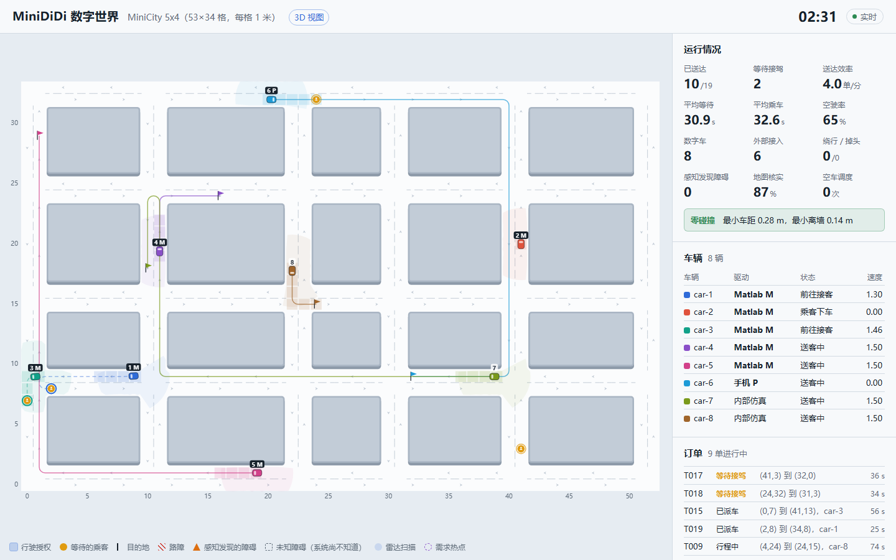
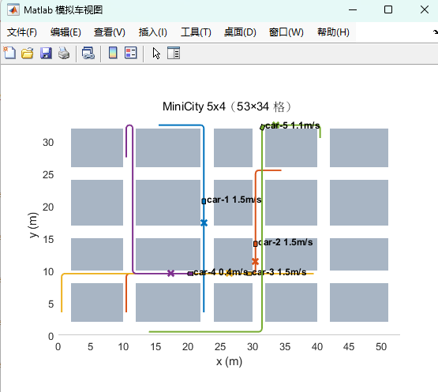
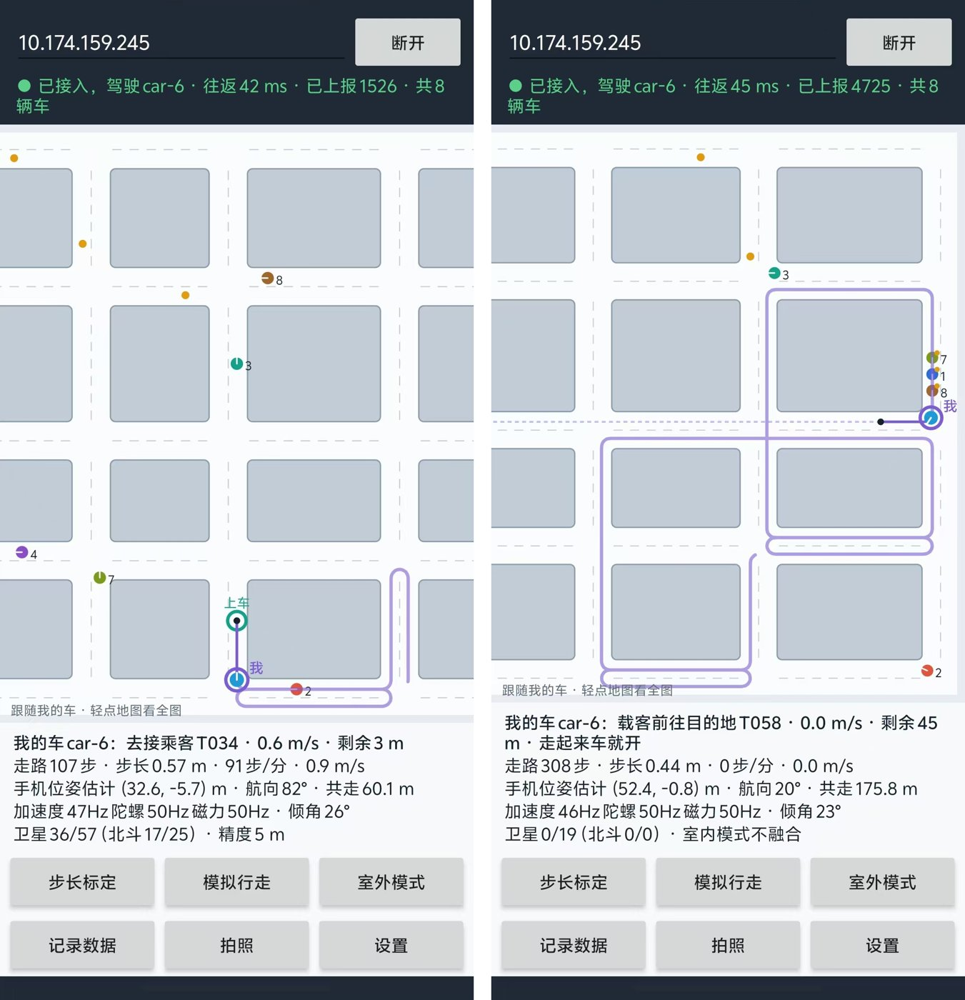
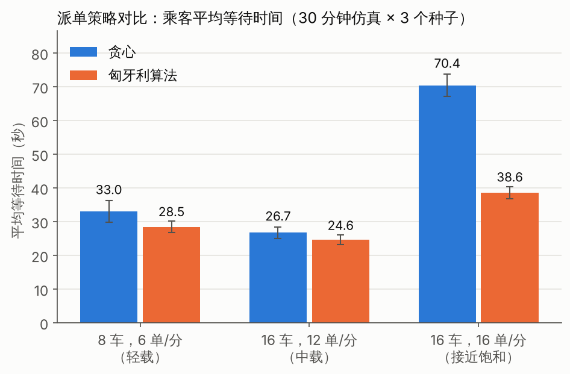

::: {custom-style="Cover School"}
同济大学
:::

::: {custom-style="Cover Course"}
综合设计与实践 C
:::

::: {custom-style="Cover Title"}
缩微滴滴：多智能体无人出租车系统
:::

::: {custom-style="Cover Subtitle"}
MiniDiDi / RoboTax　中期报告
:::

::: {custom-style="Cover Info"}
小　　组：第 1 组
:::

::: {custom-style="Cover Info"}
组　　长：阮飞翔（2252753）
:::

::: {custom-style="Cover Info"}
组　　员：樊宇泽（2351586）
:::

::: {custom-style="Cover Info"}
　　　　　李昊博（2352853）
:::

::: {custom-style="Cover Info"}
　　　　　付泽亮（2353413）
:::

::: {custom-style="Cover Info"}
　　　　　张　川（2252947）
:::

::: {custom-style="Cover Info"}
指导教师：许春权
:::

```{=openxml}
<w:p><w:r><w:br w:type="page"/></w:r></w:p>
```

::: {custom-style="Abstract Title"}
摘　要
:::

本项目在一个 53 m × 34 m 的缩微城市中实现多智能体无人出租车系统（MiniDiDi）：城市里随时有人叫车，由 Java 编写的数字世界服务端（"系统超脑"）负责订单生成、派单、路径规划和交通管控；车辆既可以由服务端内部仿真，也可以由 Matlab 模拟车、安卓手机驱动，外部设备驱动时服务端中的数字车即为其数字孪生。本报告总结第 1–8 周的工作，并给出第 9–16 周的计划。

截至中期，课程的全部必做内容已经完成并集成运行。路径规划采用以"格子 + 驶入方向"为状态的 A* 算法，在遵守车道方向、禁止原地掉头的约束下求最短路；派单采用匈牙利算法求"空车 × 订单"的全局最优匹配；交通管控借鉴铁路的移动闭塞思想，以格子预约和移动授权保证任意两车的授权区域互不相交，从机制上避免碰撞。5 辆 Matlab 模拟车通过 TCP 协议接入并与数字车同步；安卓 App 读取加速度计、陀螺仪、磁力计和卫星定位，用行人航位推算估计位姿，并按课程要求"以人携带手机运动来模拟车辆的运动"——路线由服务端规划，人走路的速度就是车的油门。系统可一键启动，演示情节由场景脚本按时间自动触发，考核过程无需人工操作。

阶段测试表明：服务端 14 项、手机核心 65 项单元测试全部通过；16 辆车在中期演示场景下以 16 单/分运行 3 × 60 分钟零碰撞；接近饱和负载时匈牙利算法派单比贪心算法的平均等待时间降低 45%；5 辆 Matlab 车在 Windows 上连续运行约 16 分钟零碰撞、零越权；安卓真机接入后车辆始终没有越过授权停车点。中期以后，小组将集中完成 3D 可视化、环境感知与辅助建图、图像处理加速、空车调度和 Gazebo 接入等挑战项，并开展长时间测试与定量评估。

**关键词**：多智能体系统；数字孪生；路径规划；匈牙利算法；移动授权；行人航位推算

```{=openxml}
<w:p><w:r><w:br w:type="page"/></w:r></w:p>
```

::: {custom-style="Abstract Title"}
目　录
:::

```{=openxml}
<w:sdt><w:sdtPr><w:docPartObj><w:docPartGallery w:val="Table of Contents"/><w:docPartUnique/></w:docPartObj></w:sdtPr><w:sdtContent><w:p><w:r><w:fldChar w:fldCharType="begin" w:dirty="true"/></w:r><w:r><w:instrText xml:space="preserve"> TOC \o "1-2" \h \z \u </w:instrText></w:r><w:r><w:fldChar w:fldCharType="separate"/></w:r><w:r><w:t>（在 Word 中右键此处选择"更新域"即可生成目录）</w:t></w:r><w:r><w:fldChar w:fldCharType="end"/></w:r></w:p></w:sdtContent></w:sdt>
<w:p><w:r><w:br w:type="page"/></w:r></w:p>
```

# 第 1 章　项目概述

## 1.1 背景与意义

无人驾驶出租车（Robotaxi）把司机换成了算法，平台的"系统超脑"需要同时完成派单、路径规划和交通管控三件事，并保证安全。真车实验成本高、风险大，因此本课程在"缩微世界"中开展：用一张栅格化的城市地图代表真实城市，用数字车、Matlab 模拟车和手机代表各类交通参与者，由服务端统一调度。通过这个项目，小组将完整经历一个多智能体系统从立项、需求、设计、实现、测试、部署到效果评估的全过程；本报告对应其中的前半程。

## 1.2 课程要求与中期完成情况

课程要求系统启动后即自主运行、考核中不可人工操作、整体可集成运行。按照"必做求稳、挑战求精"的策略，前 8 周集中完成全部必做内容，挑战项在中期确定、在第 9–12 周完成。表 1-1 汇总了截至中期的完成情况。

| 档次 | 要求 | 中期完成情况 |
|---|---|---|
| 必做 | 数字世界：≥ 5 辆数字车、随机运输任务 | 已完成：默认 8 辆，可配置；泊松到达的订单，完整接送流程 |
| 必做 | 基于最优化的路径规划 | 已完成：A* 最短路（含掉头）；匈牙利算法全局最优派单 |
| 必做 | 人机交互与动态显示 | 已完成：2D 实时地图、指标面板、配置与控制 |
| 必做 | 不与静态 / 动态障碍碰撞 | 已完成：移动授权交通管控；16 车高负载 3 小时零碰撞 |
| 必做 | Matlab 模拟车 ≥ 5 辆并与数字车同步 | 已完成：Windows + MATLAB R2024b 实测 5 车接入，零碰撞、零越权 |
| 必做 | 手机 App：读传感器、无线同步、惯性元件估计位姿 | 已完成：核心算法仿真验证通过，已在安卓真机上实测 |
| 必做 | 整体集成、全自主运行 | 已完成：一键启动；场景脚本自动触发；断线自动接管 |
| 挑战 | 3D 渲染可视化 | 计划第 9–10 周完成 |
| 挑战 | 环境感知与辅助建图、端云互动 | 计划第 9–11 周完成 |
| 挑战 | 服务端图像处理加速模块 | 计划第 11–12 周完成 |
| 挑战（进阶） | Gazebo 中 ≥ 5 辆车 | 计划第 11–12 周完成 |
| 挑战（自选） | 调度优化与定量评估 | 派单对比实验已完成；空车调度计划第 10–11 周完成 |

: 表 1-1　课程要求与中期完成情况

## 1.3 技术路线

本项目选择课程给出的"路线 1"：HTML + JavaScript + CSS 前端，Java 服务端 + REST 接口。为了让系统在没有网络的演示现场也能完整运行，所有组成部分都尽量不依赖第三方库：服务端只依赖 Gson（随仓库提供），使用 JDK 自带的 HTTP 服务器；网页不依赖任何框架；手机 App 只使用安卓自带的 API。

## 1.4 小组分工与进度

| 成员 | 角色 | 主要负责 |
|---|---|---|
| 阮飞翔（组长） | 架构与调度 | 总体架构、接口协议、派单与空车调度、联调集成；立项与需求文档、技术报告统稿 |
| 樊宇泽 | 服务端 | 数字世界与交通管控、设备接入、感知建图、图像处理加速；设计文档、测试报告 |
| 李昊博 | 控制与可视化 | Matlab 模拟车、2D 界面与 3D 可视化；部署手册、答辩 PPT、演示视频 |
| 付泽亮 | 移动端与进阶 | 安卓 App 与位姿估计、Gazebo 接入；效果评估报告 |

: 表 1-2　小组分工

项目周期为第 1–16 周，第 8 周中期检查，第 16 周答辩。进度安排与当前状态见表 1-3：先在第 4 周打通"服务端 + Matlab + 手机"的骨架，之后每周在能运行的系统上迭代，降低最后集成的风险。前 8 周的计划已全部按时完成。

| 周次 | 阶段 | 主要工作 | 状态 |
|---|---|---|---|
| 第 1–3 周 | 立项与设计 | 立项、分工；需求分析与需求规格说明；概要设计与接口协议 | 已完成 |
| 第 3–4 周 | 打通骨架 | 服务端 v1、2D 网页；Matlab 5 车接入；手机 App 读传感器并上报 | 已完成，第 4 周末第一次全系统联调 |
| 第 5–8 周 | 完成必做 | 手机位姿估计与走路驾驶；一键启动、场景脚本与全自主演练；派单对比实验 | 已完成 |
| 第 8 周 | 中期检查 | 全系统演示 + 中期报告；确定挑战项 | 进行中 |
| 第 9–12 周 | 冲优（挑战项） | 3D 可视化；感知建图与图像识别；空车调度；Gazebo 接入（进阶） | 未开始 |
| 第 13–14 周 | 加固与评估 | 长时间运行、断线测试、持续集成、评估实验；测试报告 | 未开始 |
| 第 15–16 周 | 收尾与答辩 | 技术报告、PPT、视频定稿，彩排 2 次 | 未开始 |

: 表 1-3　16 周进度安排与中期状态

# 第 2 章　需求分析

## 2.1 参与者与用例

系统的参与者分为三类：人（观察者、演示操作员、手机用户）、外部系统（车辆设备，中期为 Matlab 模拟车和手机（模拟车），后期加入 Gazebo 小车）以及时间（时钟与场景脚本，负责按时触发订单生成和场景事件）。各参与者的用例见表 2-1，其中演示操作员是一种特殊的观察者，也可以使用观察者的全部用例；标注"后期"的用例属于挑战项，在中期以后实现。

| 参与者 | 用例 |
|---|---|
| 观察者（评委 / 观众） | UC02 查看 2D 实时画面（3D 为后期）；UC03 查看运行指标与事件日志 |
| 演示操作员 | UC01 一键启动全自主演示；UC04 调整派单策略 / 到达率；UC05 设置 / 解除路障；UC06 手动下单；UC07 切换场景脚本 |
| 手机用户（手机车驾驶员） | UC08 走路驾驶手机车；UC09 接入数字世界并上报位姿；UC10 拍照识别路障（后期） |
| 车辆设备（Matlab 模拟车、手机；后期加入 Gazebo 小车） | UC11 注册并接管数字车；UC12 接收路线与行驶授权；UC13 上报车辆状态 |
| 时钟与场景脚本 | UC14 自动生成订单；UC15 按时间触发场景事件；UC16 车辆感知未知障碍（后期） |

: 表 2-1　参与者与用例

用例之间的包含与扩展关系如下（"A → B"表示 A 包含 B）：

- 手动下单（UC06）、自动生成订单（UC14）→ 派单（贪心 / 匈牙利）→ 路径规划（A*，含掉头）。
- 设置 / 解除路障（UC05）→ 更新全局地图（收回授权）→ 路径规划。后期的拍照识别（UC10）和车辆感知（UC16）也将包含"更新全局地图"。
- 走路驾驶手机车（UC08）→ 接收路线与行驶授权（UC12）、上报车辆状态（UC13）；UC12 → 交通管控（格子预约 + 移动授权）。
- 扩展关系：受阻超过 12 s 时，交通管控扩展出"绕行 / 掉头"（它又包含路径规划）；设备 3 s 没有上报时，上报车辆状态扩展出"断线接管"（由内部仿真驾驶）。

设计时有意让"更新全局地图"成为一个公共用例：中期只有人工路障一个来源，后期的感知和拍照识别只需接入这一入口，收回授权、重规划等后续处理不必重写。

## 2.2 功能需求

功能需求按模块编号（FR-xx），共 9 组、40 余条，完整列表见仓库中的需求规格说明。表 2-2 列出各组的核心需求及中期状态。

| 编号 | 模块 | 核心需求 | 中期状态 |
|---|---|---|---|
| FR-01~06 | 数字世界 | 无设备时独立运行；≥ 5 辆车；泊松订单；完整接送流程；地图校验；同种子可复现 | 已完成 |
| FR-10~13 | 优化与决策 | A* 最短路；贪心 / 匈牙利派单可切换；掉头；空车调度 | 空车调度未开始，其余已完成 |
| FR-20~25 | 交通管控 | 零碰撞；一格一车；不堵路口；格子变得不可通行时收回授权；不死锁；独立碰撞监测 | 已完成 |
| FR-30~34 | 设备接入 | TCP/UDP 接入；注册绑定；下发路线与授权；断线接管；≥ 5 辆 Matlab 车 | 已完成 |
| FR-40~44 | 人机交互 | 实时地图与指标；配置与控制；3D 视图；REST + SSE 接口 | 3D 视图未开始，其余已完成 |
| FR-50~53 | 感知与图像 | 真实世界与系统认知分离；激光雷达建图；拍照识别路障；并行加速 | 未开始（挑战项） |
| FR-60~63 | 全自主运行 | 一键启动；场景脚本自动触发；脚本校验；手机自动连接 | 已完成 |
| FR-70~73 | Matlab 模拟车 | 5 车注册；纯追踪 + 速度控制；不越过授权停车点；本地视图 | 已完成 |
| FR-80~84 | 手机 App | 读取传感器；惯性位姿估计；室外融合；以人携带手机运动模拟车辆运动；拍照识别 | 拍照识别未开始，其余已完成 |

: 表 2-2　功能需求概要与中期状态

## 2.3 非功能需求

| 编号 | 类别 | 需求 | 中期状态 |
|---|---|---|---|
| NFR-01 | 安全 | 16 车、16 单/分运行 ≥ 60 分钟，车车碰撞、撞墙、撞障碍均为 0 | 已满足（中期场景 3 × 60 分钟） |
| NFR-02 | 实时性 | 仿真 20 Hz；快照推送 10 Hz；授权更新延迟不超过一个节拍（50 ms） | 已满足 |
| NFR-03 | 性能 | 16 车时单次派单 < 5 ms；离线仿真速度 > 100 倍实时 | 已满足 |
| NFR-04 | 可靠性 | 任一设备断线不影响系统运行，3 s 内由内部仿真接管 | 已满足 |
| NFR-05 | 可用性 | 一条命令（或双击）启动全部程序 | 已满足 |
| NFR-06/07 | 可移植、离线 | Windows / Linux / macOS 均可运行；演示现场断网时功能完整 | Windows、Linux 已验证 |
| NFR-08 | 可维护性 | 核心逻辑与网络代码分层；服务端 ≥ 25 项、手机 ≥ 60 项单元测试 | 手机已满足；服务端 14 项，随挑战项补充 |

: 表 2-3　非功能需求与中期状态

# 第 3 章　系统设计

项目的 UML 图（甘特图、用例图、组件图、部署图、类图、时序图、状态图、活动图等）以 PlantUML 源文件维护，收录在仓库的立项申请书、需求规格说明和软件设计说明中。这些图幅面较大，缩到 A4 页宽后字迹难以辨认，因此本报告改用表格和文字描述。

## 3.1 总体架构

系统由数字世界服务端和若干外部组件构成（表 3-1）。服务端对外只有三个端口：HTTP 8080（REST + SSE，供网页和手机使用）、TCP 9000（设备协议）和 UDP 9001（可选的状态上报）。网页、Matlab 车队、安卓 App 和 Python 模拟设备都只通过这三个端口与服务端交互，彼此之间没有依赖，因此可以由不同组员并行开发，接口协议文档就是开发的"合同"。后期的 3D 网页和 Gazebo 桥接同样按这一方式接入，不需要改动服务端的结构。

| 外部组件 | 接入方式 | 作用 | 中期状态 |
|---|---|---|---|
| 2D 网页 | HTTP 8080（REST + SSE） | 实时地图、运行指标、事件日志和控制面板 | 已完成 |
| Matlab 车队 | TCP 9000 | 5 辆模拟车，纯追踪跟踪服务端下发的路线 | 已完成 |
| 安卓 App | TCP 9000 + HTTP 8080 | 手机车（10 Hz 上报车的位姿） | 已完成 |
| Python 模拟设备 | TCP 9000 / UDP 9001 | 协议参考实现，没有 MATLAB 时代替车队 | 已完成 |
| 3D 网页 | HTTP 8080（REST + SSE） | 3D 视图 | 后期 |
| Gazebo 桥接 | TCP 9000 | 每辆 Gazebo 小车一条连接 | 后期 |

: 表 3-1　外部组件与接入方式

服务端内部分为五层（表 3-2）。世界层和算法层不包含任何网络代码，可以直接进行单元测试和离线实验。

| 层（包） | 主要组件与职责 |
|---|---|
| 接入层（api、device） | HttpApi：REST、SSE 与静态文件；DeviceGateway：TCP / UDP 设备收发 |
| 运行层（sim） | SimulationEngine：20 Hz 仿真线程与命令队列；SnapshotHub：保存并发布最新快照 |
| 世界层（world） | World：仿真步；DeviceBridge：设备协议语义与断线接管；ScenarioRunner：场景脚本；后期加入 Perception（感知建图）和 Rebalancer（空车调度） |
| 算法层（plan、traffic、dispatch、map） | AStarPlanner：A* 规划与掉头；TrafficController：格子预约与移动授权；Dispatcher：贪心 / 匈牙利派单；GridMap：栅格地图；后期加入 vision（图像识别） |
| 基础层（config、util） | 读取配置、JSON 等通用工具 |

: 表 3-2　服务端分层

组件之间的调用关系是：HTTP 线程和设备线程把请求作为命令交给 `SimulationEngine`；仿真线程每步调用 `World.step()`，再由 `World` 调用各子系统；规划和交通管控都基于同一个 `GridMap`；每步结束后快照交给 `SnapshotHub`，网页通过 SSE 取得。地图、场景脚本和配置分别从 `maps/`、`scenarios/` 和 `config/default.json` 加载。

## 3.2 部署

考核现场的部署见表 3-3。演示笔记本运行服务端、浏览器和 Matlab 车队（车队通过本机回环连接，不受无线网络影响）；手机通过自带的无线路由器接入。之所以自带路由器，是因为校园网普遍开启终端隔离，设备之间可能互相连不上。

| 节点 | 运行环境与程序 | 与服务端的连接 |
|---|---|---|
| 演示笔记本（Windows 10/11 或 Linux） | JDK 17+：数字世界服务端；MATLAB R2020b+：run_fleet（5 辆 SimCar），没有 MATLAB 时用 Python 3.8+ 运行模拟车代替；Chrome / Edge：2D 网页；start_demo 一键启动全部程序 | 本机回环：TCP 9000（车队）、HTTP 8080（网页） |
| 安卓手机（Android 8.0+） | MiniDiDi App：手机车（走路即油门）、惯性位姿估计 | Wi-Fi：TCP 9000（路线、授权，10 Hz 上报车的位姿），HTTP 8080（地图、快照） |
| 无线路由器（自带） | 固定 IP 段 192.168.x.0/24，关闭终端隔离 | 连接以上设备 |

: 表 3-3　部署节点

## 3.3 线程模型

服务端只有一个仿真线程可以修改世界状态。HTTP 线程和设备读线程收到消息后，把"要做的事"包装成命令放入队列，由仿真线程在下一个节拍（50 ms）统一执行；需要返回结果的查询使用 `engine.call` 等待执行完成。发送消息时只放入各连接的发送队列，由独立的写线程发出。这样整个世界状态无需加锁，也不会出现"算到一半数据被改"的并发问题，结果可以复现，测试也简单。

## 3.4 静态结构

数字世界的领域模型见表 3-4。`World` 是聚合根，组合了全部智能体、进行中的订单和各个子系统；`Agent` 表示一辆出租车（数字车），其"驱动源"（内部仿真、Matlab、手机等）决定位姿由内部仿真推算还是由设备上报。外部设备驱动时，`Agent.link` 指向一个 `DeviceLink`——这正是数字孪生在代码中的体现。`DeviceLink` 被设计为接口，单元测试中用记录消息的假实现替代真实 TCP 连接，因此设备协议的语义不开网络端口也能测试。

| 类 | 职责 |
|---|---|
| `World` | 聚合根：持有全部车辆、进行中的订单和各子系统，执行仿真步，处理下单、路障、策略切换等命令 |
| `Agent` | 一辆出租车（数字车）：位姿 x、y、θ、v，状态，驱动源，路线，授权，设备连接 |
| `Task` | 一个订单：上车点、目的地；状态 WAITING → ASSIGNED → PICKED → DELIVERED（或 CANCELLED） |
| `InternalDriver` | 内部仿真驾驶：没有设备时按停车点限速推算车辆运动 |
| `DeviceBridge` | 设备协议语义：注册绑定、下发路线和授权、心跳超时后接管 |
| `DeviceLink` | 接口，表示一条设备连接；由 DeviceSession（TCP）实现，测试中用假实现 |
| `TaskGenerator` | 按泊松过程生成订单 |
| `ScenarioRunner` | 按仿真时间触发场景脚本（Scenario）中的事件，可循环播放 |
| `CollisionMonitor` | 独立于交通管控的碰撞监测，按真实几何计数 |
| `Metrics` | 运行指标统计：送达数、等待时间、空驶率等 |

: 表 3-4　数字世界的主要类

驱动源 `DriverKind` 取 INTERNAL、MATLAB、GAZEBO、PHONE、GENERIC 之一（GAZEBO 已在协议中预留）；车辆状态 `AgentStatus` 见 3.5 节。

优化与决策相关的算法类见表 3-5。派单采用策略模式，新增策略只需实现 `Dispatcher` 接口并注册；设置路障统一调用 `World.applyBlock`，后期感知模块确认障碍后也将走这一入口。

| 类（包） | 职责 |
|---|---|
| `AStarPlanner`（plan） | A* 规划与借对向车道掉头，搜索状态为"格子 + 驶入方向" |
| `Route`（plan） | 规划结果：格子序列与平滑路点，可按弧长 s 查询各格的起止位置 |
| `DistanceField`（plan） | 从上车点反向广度优先搜索，得到任意车辆的接驾距离 |
| `TrafficController`（traffic） | 格子占用表；延伸授权、收回授权、计算停车点 stopS |
| `Dispatcher`（dispatch） | 派单接口（策略模式），实现有贪心和匈牙利两种；匈牙利算法由 Hungarian 类求最优指派 |
| `GridMap`（map） | 栅格地图（建筑、车道、路口）、可通行判断、设置路障 |

: 表 3-5　算法类

## 3.5 动态行为

每个仿真步依次执行场景脚本、订单生成、车辆运动、到站处理、派单（每 2 s）、交通管控和碰撞监测。一个订单的完整生命周期如下：

1. **生成**：`TaskGenerator` 每步以 $1-e^{-\lambda\Delta t}$ 的概率生成订单，起终点在车道格中随机抽取，订单状态为 WAITING。
2. **派单**（每 2 s）：`World.dispatch()` 收集空车和等待中的订单，对每个上车点用 `DistanceField` 反向搜索得到所有车的接驾距离，组成代价矩阵交给 `Dispatcher`（匈牙利算法）求最优匹配。
3. **规划**：被派单的车从授权终点出发，用 `AStarPlanner` 规划去上车点的路线并平滑成路点；车辆状态变为 TO_PICKUP，订单变为 ASSIGNED。
4. **行驶**（每步）：`TrafficController` 按受阻时间排序依次延伸授权（路口整段加出口格一次性申请），得到每辆车的停车点 stopS；`InternalDriver` 按 $v \le \min(v_{\max},\ \text{转弯限速},\ \sqrt{2a(s_{\text{stop}}-s)})$ 推进车辆。
5. **接客与送客**：到达上车点后停留 2 s（BOARDING）并记入 `Metrics`，再规划去目的地（TO_DROPOFF，订单变为 PICKED）；到达目的地后停留 2 s（ALIGHTING），订单变为 DELIVERED，车辆回到 CRUISING，重新可以接单。
6. **显示**：仿真线程以 10 Hz 发布快照，浏览器通过 SSE 接收。

外部设备的接入与断线接管过程如下（以 Matlab 车 car-1 为例）：

1. 设备连接 TCP 9000 并发送 `register`（kind = matlab，agentId = car-1）。设备读线程不直接修改世界，而是把消息作为命令提交给仿真线程，由 `DeviceBridge` 处理。
2. `DeviceBridge` 把 car-1 的驱动源改为 MATLAB，依次回复 `welcome`（初始位姿、车辆参数、地图尺寸）、`path`（routeId、格子序列和路点）和 `permit`（同一 routeId 的停车点 stopS）。
3. 设备每 0.1 s 用纯追踪转向和速度 PI 控制行驶一步，保证沿路线的投影长度 s ≤ stopS，并上报 `state`（x, y, θ, v）；服务端把它写入 car-1，这就是数字孪生的"镜像"。
4. 服务端每个节拍更新授权，stopS 变化时下发新的 `permit`（出现路障时会变小）；另以 5 Hz 下发周边车辆 `world`（设备可以忽略）。到站、派单或绕行时下发新的 `path` 和对应的 `permit`。
5. 设备断开或 3 s 无消息时，`DeviceBridge` 关闭连接，把驱动源改回内部仿真并把车吸附回路线，由内部仿真继续驾驶，系统不会停摆；设备重连后再次 `register`，服务端用 `welcome` 同步最新位姿。

车辆状态机见表 3-6。表中的空车巡游、去接客、乘客上车、送客、乘客下车依次对应代码中 `AgentStatus` 的取值 CRUISING、TO_PICKUP、BOARDING、TO_DROPOFF 和 ALIGHTING。

| 当前状态 | 事件 / 条件 | 下一状态 | 动作 |
|---|---|---|---|
| （创建） | 车辆生成，或设备接管 | 空车巡游 | — |
| 空车巡游 | 到达巡游终点 | 空车巡游 | 换一个随机目的地 |
| 空车巡游 | 派单匹配到订单 | 去接客 | 规划去上车点 |
| 去接客 | 到达上车点并停稳 | 乘客上车 | — |
| 去接客 | 上车点不可达 | 空车巡游 | 订单退回等待 |
| 乘客上车 | 停留 2 s | 送客 | 规划去目的地 |
| 送客 | 到达目的地并停稳 | 乘客下车 | — |
| 乘客下车 | 停留 2 s | 空车巡游 | 计入送达 |

: 表 3-6　车辆状态转移

三个行驶状态（空车巡游、去接客、送客）共用同一套行驶行为：按授权行驶；前方格子申请不到时受阻等待，授权延伸后继续；受阻超过 12 s，或前方出现路障时，重新规划或掉头。

## 3.6 接口设计

设备协议基于 TCP 长连接，每行一条 JSON，消息类型见表 3-7（上行指设备发给服务端，下行指服务端发给设备）。协议规定所有接收方必须忽略不认识的字段和消息类型，这样后期新增下行消息（如计划中的模拟激光雷达扫描 `scan`）不会影响已经完成的 Matlab 车和手机。

| 方向 | 消息 | 作用 |
|---|---|---|
| 上行 | `register` | 注册：`kind` 为 matlab / gazebo / phone / generic，一律绑定一辆出租车 |
| 上行 | `state` | 位姿上报（x, y, θ, v），10 Hz，同时作为心跳 |
| 下行 | `welcome` | 注册成功：初始位姿、车辆参数、地图尺寸 |
| 下行 | `path` | 新路线：格子序列与平滑路点（转弯处为半径半格的圆弧） |
| 下行 | `permit` | 行驶授权：沿路点折线的停车位置 stopS，车辆投影长度不得超过它 |
| 下行 | `world` | 周边车辆（5 Hz，可忽略） |

: 表 3-7　设备协议消息

浏览器接口提供地图、快照、SSE 推送、配置、场景切换、路障、下单等 REST 接口，均允许跨域访问。

# 第 4 章　关键算法

本章介绍中期已经实现的算法；挑战项涉及的算法（空车调度、占据栅格建图、图像识别等）的设计思路见第 8 章。

## 4.1 地图与路径规划

城市是 53 × 34 格的栅格，每格 1 m；道路宽 2 格、双向两车道、靠右行驶。车道格只能沿箭头方向驶入和驶出，路口格允许任意方向。这样同一车道上的车同向行驶，不会迎面相撞，冲突只发生在路口和跟车，问题被大大简化。

路径规划采用 A* 算法，搜索状态为"格子 + 驶入方向"。引入方向维度有两个作用：一是可以给转弯加代价（默认 0.5 m），得到更平顺的路线；二是可以禁止原地掉头。代价函数为

$$f(n) = g(n) + h(n),\qquad h(n) = |x_n - x_g| + |y_n - y_g|,$$

其中 $g(n)$ 为已走步数加转弯代价，$h(n)$ 为曼哈顿距离。由于车辆只能沿四个方向移动，曼哈顿距离不会高估真实代价，所以 A* 的解是最优的。单元测试用 300 组随机起终点与广度优先搜索的最短步数比较，验证了这一点。

规划得到的格子序列再转换成平滑路线：直行段穿过格中心，90° 转弯用半径为半格的四分之一圆弧连接两条边的中点，圆弧完全落在转弯格内，车辆中心离建筑始终不小于 0.2 m。

当车辆开进一段单行道、前方又被路障堵死时，按正常规则无路可走。此时 `planUTurn` 借用左侧的对向车道掉头：两段四分之一圆弧正好拼成半径半格的半圆，车身不越出这两格；对向车道格同样要先申请授权，所以掉头也不会撞车。

## 4.2 交通管控：格子预约与移动授权

这是保证"不与任何车辆碰撞"的核心，思路来自铁路的移动闭塞（CBTC 中的移动授权）。规则如下：

1. **一格一车**：每个格子同一时刻只属于一辆车。车身覆盖的格子和已授权的前方格子都归该车所有。
2. **只能驶入已授权的格子**：车辆在授权终点前留出"车身半径 + 余量"停车，内部车和外部设备都遵守。
3. **不堵路口**：申请授权遇到路口时，必须把整段路口格加出口第一格一次性申请到，否则一格也不给。
4. **公平**：每步按"受阻时间"排序依次申请；等待超过 3 s 的车可以先占住它需要的空闲格，防止被车流"饿死"。
5. **绕行**：受阻超过 12 s，给挡路的格子加惩罚后重新规划。
6. **路障收回授权**：授权一般只向前延伸；路障出现在已授权的格子里时，授权立即收回到它之前，车辆重规划或掉头。

**安全性论证**：任意两车的授权格不相交，车辆只在自己的授权格内运动，且在授权边界前留出车身半径加余量的距离，因此两车车身不可能重叠。碰撞监测模块独立于交通管控、按真实几何计数，作为验证。规则 3 保证路口内不会出现互相卡死；规则 4、5 保证受阻的车最终能通过或绕行，不会出现永久死锁。

每个仿真步的授权计算过程如下：

1. 计算每辆车车身覆盖的格子，重建占用表 `owner[]`：先登记车身，再登记已有的授权。
2. **收回不安全的授权**：逐辆车检查已授权、尚未到达的格子；如果某一格变得不可通行（路障），用 `revokeBefore` 把授权收回到这一格之前，新终点落在路口里时再退到路口之前。
3. 按"受阻开始时间"排序，等得最久的车先申请。
4. **依次延伸授权**（每辆车至多向前看 `horizonCells` 格）：下一格是路口时，一次性申请"整段路口 + 出口第一格"，全部空闲才占用，否则停在路口之前；下一格是普通车道格时，空闲且可通行就占用，否则授权停在它之前。
5. **处理受阻**：申请失败且车已停下时，受阻超过 3 s 并且本步还没有车用过优先权的，可以先占住它需要的空闲格（防止被"饿死"）；受阻超过 12 s 的，给挡路的格子加惩罚后重新规划（绕行）。
6. 下发 `permit`，停车点 stopS = 授权终点 − 车身半径 − 余量。

## 4.3 派单：匈牙利算法

每 2 s 把"空车 × 等待订单"建成代价矩阵 $C$，求总代价最小的匹配：

$$\min_{x}\sum_{i}\sum_{j} c_{ij}x_{ij},\qquad \text{s.t.}\ \sum_j x_{ij}\le 1,\ \sum_i x_{ij}\le 1,\ x_{ij}\in\{0,1\},$$

$$c_{ij} = d_{ij} - w\cdot t_j,$$

其中 $d_{ij}$ 是车 $i$ 沿路网到订单 $j$ 上车点的距离，$t_j$ 是订单已等待的时间，$w$（默认 0.3）用于避免偏远订单长期没人接。$d_{ij}$ 由每个上车点的**距离场**给出：从上车点沿车道方向的反方向做一次广度优先搜索，就能以 $O(1)$ 查询任意车辆的接驾距离。该指派问题用匈牙利算法以 $O(n^3)$ 求得最优解；单元测试用 300 个随机矩阵与穷举法对比，结果完全一致。作为对照，贪心策略按等待时间依次把订单派给最近的空车。

## 4.4 手机模拟车：走路驾驶与惯性位姿估计

课程要求手机"以人携带手机运动来模拟车辆的运动"：读取卫星定位、加速度、陀螺和地磁，无线发给服务端并与数字世界中某一智能体保持状态同步，基于惯性元件估计位姿。难点在于教室只有十来米，人不可能沿地图上的街道走。因此采用"**路线由服务端规划，快慢由人决定**"的分工：

- **绑定**：App 以 `kind = phone` 注册，绑定一辆数字车（默认 car-6，Matlab 车队占用 car-1 ~ car-5），之后服务端像对待 Matlab 车一样给它派单、下发路线和授权，不需要任何特殊逻辑。
- **走路即油门**：期望车速 $v_{\text{want}} = k\,v_{\text{walk}}$，其中 $v_{\text{walk}}$ 为步长 × 步频（停步 1.6 s 后为 0），$k$ 为驾驶比例（默认 1）。车沿路线折线推进弧长 $s$，车速同时不超过最高速度 1.5 m/s、弯道限速 0.6 m/s 和刹车曲线 $\sqrt{2a_{\text{dec}}(s_{\text{stop}}-s)}$，并且始终 $s \le s_{\text{stop}}$，所以手机车和其他车一样不会越权；授权被收回时直接采用新的停车点，不倒车。App 10 Hz 上报 $s$ 处的位姿，与数字车保持同步。

惯性位姿估计采用行人航位推算（PDR），各环节如下：

- **计步**：加速度模长经两级低通滤波后做峰谷检测，一个"峰"要等信号回落超过自适应回滞量才确认，与手机的握持方式无关。
- **步长**：Weinberg 模型 $L = K\sqrt[4]{a_{\max} - a_{\min}}$，$K$ 默认 0.45，可通过沿已知距离直线行走标定。
- **航向**：陀螺仪角速度在重力方向上的分量积分得到航向（与手机姿态无关），静止时估计零偏；室外用倾斜补偿后的磁力计做 PI 互补修正。
- **卫星融合**（室外）：经纬度换算为局部东北坐标，用标量卡尔曼滤波修正累积漂移。

手机端完整的数据流见表 4-1，全部在 `core` 包中实现（纯 Java，不依赖安卓，可以在电脑上测试）。

| 环节（类） | 输入 | 输出 |
|---|---|---|
| 计步（StepDetector） | 加速度计 | 每一步的时刻和加速度幅值 |
| 步长（Weinberg 模型） | 一步内的加速度最大、最小值 | 步长 L |
| 航向（HeadingEstimator） | 陀螺仪、重力方向；室外加磁力计 | 航向 ψ |
| 推算（PdrEngine） | 步长、航向；室外加卫星定位 | 手机坐标系中的位置和航向（显示、CSV 记录）；走路速度 = 步长 × 步频 |
| 手机车（RouteFollower） | 走路速度 × 驾驶比例；服务端下发的路线和停车点 | 车沿路线的弧长 s 和位姿 (x, y, θ, v) |
| 连接（DwConnection） | 车的位姿 | 10 Hz 上报的 state 消息 |

: 表 4-1　手机端的数据流

## 4.5 车辆控制

Matlab 模拟车和 Python 模拟设备使用同一套控制逻辑：纯追踪转向——在前视距离 $l_d$ 处取路线上的目标点，曲率 $\kappa = 2\sin\alpha / l_d$（$\alpha$ 为目标点相对车头的方位角）；速度控制则同时满足最高速度、转弯限速和授权约束

$$v \le \min\left(v_{\max},\ \sqrt{a_{\mathrm{lat}}/|\kappa|},\ \sqrt{2a\,(s_{\mathrm{stop}} - s)}\right),$$

保证车辆总能在授权停车点前刹住。后期 Gazebo 小车也将沿用这套控制逻辑。

# 第 5 章　系统实现（中期进展）

## 5.1 实现概况

| 组成 | 语言 / 技术 | 中期状态 | 说明 |
|---|---|---|---|
| 数字世界服务端 | Java 17 + Gson | 必做部分已完成 | JDK 自带 HttpServer，REST + SSE；TCP / UDP 设备接入；离线实验工具 |
| 网页前端 | HTML / CSS / JavaScript | 2D 已完成，3D 待做 | 2D Canvas，不依赖第三方库 |
| Matlab 模拟车 | MATLAB R2020b+ | 已完成 | 不需要工具箱 |
| 手机 App | Java（安卓 8.0+） | 已完成，拍照识别待做 | 零第三方库；核心算法为纯 Java |
| 工具 | Python | 已完成 | 模拟设备（协议参考实现）、地图生成、一键脚本 |
| Gazebo 接入 | Python（ROS 2） | 未开始 | 计划第 11–12 周 |

: 表 5-1　各组成部分的中期状态

## 5.2 服务端与 2D 网页

服务端启动后按配置加载地图、场景脚本，开始以 20 Hz 运行仿真。网页 2D 主界面（图 5-1）订阅 SSE 快照，实时显示地图、车辆（两次快照之间插值，动画平滑）、行驶授权、路线、乘客与目的地、路障，右侧为运行指标、车辆与订单列表、控制面板和事件日志。顶部显示正在运行的场景脚本、进度和下一个事件。

{width=100%}

## 5.3 Matlab 模拟车

Matlab 部分由 `run_fleet`（建立 5 条 TCP 连接，20 Hz 控制循环）、`SimCar`（独轮车运动学 + 纯追踪 + 速度控制）、`DwClient`（每行一条 JSON 的非阻塞收发）和 `FleetView`（本地视图，图 5-2）组成，按已在服务端上测试过的 Python 参考实现逐行移植。服务端从设备注册开始计心跳，3 s 收不到状态就断开，所以 `run_fleet` 先打开本地视图、建好全部连接，最后一起注册，注册后立即开始上报（6.4 节 D03）。

{width=70%}

## 5.4 手机 App

手机 App 分两层：`core` 包是纯 Java（不引用任何安卓类），包括位姿估计、手机车行驶（`RouteFollower`）、设备协议和 HTTP 客户端，可以在电脑上做单元测试和端到端仿真；外层负责界面、传感器和卫星定位的读取。界面包括小地图（显示周边车辆，以及我的车的路线和授权停车点）、步长标定、模拟行走（桌面演示时自动"走路"）和数据记录；打开 App 即自动连接上次的服务端，驾驶的车号和驾驶比例在设置里修改。真机运行画面见图 5-3（界面中的"拍照"按钮为后期图像识别预留）。

{width=70%}

## 5.5 一键启动与全自主运行

考核要求"启动后即自主运行，过程中不可人工操作"。演示中要出现的情况都写在场景脚本里，按仿真时间自动触发，循环播放；新一轮开始时自动撤掉上一轮放置的路障。一键启动脚本（Windows 为 `start_demo.bat`，Linux 为 `start_demo.sh`）依次启动服务端、Matlab 车队（未安装 MATLAB 时自动改用 Python 模拟车）、模拟手机车和浏览器。中期演示使用的场景脚本 `midterm.json` 只用到必做功能，见表 5-2。

| 时间 | 事件 |
|---|---|
| 0 s | 演示开始：匈牙利派单，6 单/分 |
| 30 s | 交通管制：(17,24) 封路，途经车辆立即收回授权并绕行 |
| 75 s | (35,15) 道路施工封闭 |
| 120 s | 叫车高峰：10 单/分 |
| 180 s | 演唱会散场：一次出现 8 个订单 |
| 210–225 s | 两处封路先后解除 |
| 240 s | 恢复平峰：6 单/分 |
| 280 s | 本轮结束，20 s 后自动重新开始 |

: 表 5-2　中期演示场景脚本

# 第 6 章　阶段测试

## 6.1 测试策略

测试分为四个层次（表 6-1）。由于交通管控和规划的边界情况很多，手写用例难以覆盖，单元测试大量使用固定种子的随机输入（如 300 组随机起终点、15 分钟 16 车稠密交通），反复检查"零碰撞、路线合法、不卡死"等不变量，既覆盖大量情况，又能复现。

| 层次 | 对象 | 方法 | 结果 |
|---|---|---|---|
| 单元测试 | 服务端世界层、算法层 | JUnit；随机输入 + 不变量；与穷举 / 广度优先搜索对拍 | 14 / 14 通过 |
| 单元测试 | 手机核心算法与网络 | JUnit；传感器模拟器（按姿态生成带噪声的读数） | 65 / 65 通过 |
| 端到端测试 | 手机核心代码 ↔ 服务端 | 用同一套核心代码模拟"拿着手机走路" | 通过 |
| 联调测试 | 服务端 + Matlab 车队 / 安卓真机 | 真实设备接入，长时间运行 | 通过（零碰撞、零越权） |
| 系统测试 | 性能、安全、长时间 | 离线仿真实验（第 7 章） | 通过 |

: 表 6-1　测试层次与结果

## 6.2 单元测试

服务端 14 项测试覆盖规划（地图无死路、车道规则、A* 合法且最短、路线几何）、派单（匈牙利算法与穷举一致、不劣于贪心、不可达组合不匹配）、世界（16 车 15 分钟零碰撞不死锁、不进入路障、设备接管与回退、按弧长行驶的手机车完成接送）和场景脚本（随仓库提供的脚本全部合法、错误脚本给出原因、事件按时触发且循环时恢复世界）。手机核心 65 项测试覆盖计步、航向估计、位姿推算与标定、走路速度、手机车沿路线行驶（收到授权前不走、不越过授权停车点、车速跟随走路速度、弯道限速）、地图解析、JSON、设备协议（10 Hz 上报、断线重连）和 HTTP 客户端。

## 6.3 端到端测试与设备联调

手机端到端仿真用 App 的核心代码模拟一个拿着手机走路的人驾驶 car-6：站着不动时车不动；检测 37 步，与模拟器实际步数一致，人走 23.0 m，车沿路线开 21.6 m；服务端看到的车位置与手机本地平均相差 0.10 m；人停下车也停下；断开后这辆车由内部仿真接管。

真机测试在 vivo S20（安卓 15）上进行：手机开热点，笔记本连上后运行服务端，App 输入笔记本的 WLAN 地址接入并驾驶 car-6。连续记录 97 s，全程保持接入，往返延迟中位数 34 ms；人走了 154 步（推算 90.8 m），车沿路线开了 79.1 m，898 个采样中车始终没有越过授权停车点。

Matlab 车队在 Windows 11 + MATLAB R2024b（只装 MATLAB 本体）上实测：带本地视图的 `run_fleet` 连续运行约 16 分钟没有断线，5 辆车各规划 42~47 条路线、收到 908~954 次授权、行驶 1172~1216 m，全场车车碰撞、撞墙、撞障碍、越权行驶均为 0；一键启动脚本能找到 MATLAB 并自动启动车队，与场景脚本、模拟手机车一起全自主运行。

## 6.4 缺陷记录

| 编号 | 现象 | 原因 | 修复与验证 |
|---|---|---|---|
| D01 | 换派单策略后订单序列也变，对比不公平 | 订单与车辆共用随机数序列 | 订单使用只由种子决定的独立随机数序列；配对实验 |
| D02 | 用场景脚本做实验时，命令行指定的到达率被脚本改写 | 场景脚本的 `rate` 事件会修改到达率 | 命令行指定的到达率优先；核对实验输出的订单数 |
| D03 | Matlab 车队刚启动就心跳超时断开 | 先注册后画图，刚启动的 MATLAB 画图和建连接慢，期间不上报状态 | 先画图、建好连接再一起注册；5 车 0.5 s 内全部接入 |

: 表 6-2　缺陷记录

# 第 7 章　阶段效果评估

## 7.1 评估方法

评估使用离线仿真工具 `Experiment`：不开网络端口，直接以最快速度推进仿真（16 车时 100 倍以上实时），每次仿真 30 分钟（安全性实验 60 分钟）。订单的到达时间和起终点使用只由种子决定的独立随机数序列，同一组实验中各配置使用相同的种子，所以对比的两种配置面对的是完全相同的订单序列（配对比较）。每个配置跑 3 个种子，给出平均值 ± 标准差。

## 7.2 派单策略

{width=80%}

| 场景 | 策略 | 送达（单） | 平均等待 (s) | 送达效率（单/分） | 空驶率 |
|---|---|---|---|---|---|
| 8 车，6 单/分 | 贪心 | 171 ± 8 | 33.0 ± 3.2 | 5.69 | 60% |
|  | 匈牙利 | 171 ± 9 | 28.5 ± 1.7 | 5.71 | 60% |
| 16 车，12 单/分 | 贪心 | 351 ± 5 | 26.7 ± 1.7 | 11.71 | 57% |
|  | 匈牙利 | 353 ± 4 | 24.6 ± 1.4 | 11.76 | 57% |
| 16 车，16 单/分 | 贪心 | 398 ± 13 | 70.4 ± 3.2 | 13.28 | 51% |
|  | 匈牙利 | **450 ± 10** | **38.6 ± 1.9** | **14.99** | **44%** |

: 表 7-1　派单策略对比（30 分钟 × 3 个种子，全部零碰撞）

轻载和中载时两种策略差别很小：同时等待的订单很少，"离它最近的车"往往就是全局最优。接近饱和时差距明显：匈牙利算法把平均等待从 70.4 s 降到 38.6 s（**−45%**），送达效率提高 13%，空驶率从 51% 降到 44%。这时同时等待的订单多，贪心按顺序"先到先得"，会把一辆车派给第一单、让第二单只能找远处的车；全局匹配考虑所有组合，总接驾距离最小。单次派单耗时仅 0.07~0.6 ms。

## 7.3 安全性

16 辆车运行中期演示场景（两处路障、叫车高峰、订单潮），到达率固定为 16 单/分，3 个种子、每次 60 分钟（表 7-2）。

| 指标 | 结果 |
|---|---|
| 运行次数 × 时长 | 3 × 60 分钟 |
| 送达订单（每次） | 966 ± 12 |
| 平均等待 (s) | 48.7 ± 2.4 |
| 车车碰撞 / 车墙碰撞 / 车撞路障（合计） | 0 / 0 / 0 |
| 最小车距 (m) | 0.256 |
| 最小离墙 (m) | 0.20 |
| 掉头脱困（次 / 每次运行） | 19.3 |
| 最长连续受阻 (s) | 12.0 |

: 表 7-2　中期演示场景下的长时间运行（16 车，16 单/分）

3 小时的高密度运行中没有发生任何碰撞，最长连续受阻 12.0 s 恰好是绕行阈值（之后绕行，没有死锁），验证了"授权格互不相交 ⇒ 不相撞"的设计。路障出现时，被困在单行道里的车借对向车道掉头脱困，每次运行约 19 次。

## 7.4 手机位姿估计与手机车

用传感器模拟器验证：沿正方形走 57 步，慢走、快走、竖拿、斜拿时计步误差都不超过 1 步；沿 9 m × 9 m 正方形走一圈，闭合误差约 0.6 m（周长的 1.7%）；步长模型偏大 30%、走 5 分钟（335 m）时，不融合卫星的最终误差为 33 m，融合后为 2.6 m。

真机（vivo S20）连续步行 97 s 的记录：步频中位数 97 步/分，步长中位数 0.60 m，步速中位数 0.95 m/s；车沿路线行驶了人走距离的 87%，差额来自 7 个弯道的限速（弯内 0.6 m/s）和约 6 s 的等待放行；往返延迟中位数 34 ms、最大 60 ms。室外模式下可见 57 颗卫星、36 颗参与定位（北斗 17 颗），定位精度约 5 m。

# 第 8 章　后期工作计划

## 8.1 挑战项的选择

中期对照课程要求和小组人手，从立项时列出的候选挑战项中选定五项（表 8-1）。选择的原则是：课程 PPT 点名的优先；既要有直观的演示效果，也要有算法深度；尽量复用中期已经搭好的结构，不推翻已完成的必做部分。

| 挑战项 | 体现什么 | 负责人 | 计划周次 |
|---|---|---|---|
| A. 3D 渲染可视化 | 课程点名的挑战，演示效果直观 | 李昊博 | 第 9–10 周 |
| C. 环境感知与辅助建图、端云互动 | 补齐课程第 2 页要求的"智能" | 樊宇泽 | 第 9–11 周 |
| B. 空车调度与定量评估 | 体现"最优化"的深度 | 阮飞翔 | 第 10–11 周 |
| I. 服务端图像处理加速模块 | 课程列出的可选模块，与 C 配合完成端云互动 | 樊宇泽、付泽亮 | 第 11–12 周 |
| E. Gazebo 中 ≥ 5 辆车（进阶） | 课程的进阶内容 | 付泽亮 | 第 11–12 周 |

: 表 8-1　选定的挑战项

立项时考虑过的拼车、多车协同路径规划（CBS）、模型预测控制和接入实体小车等，因工作量或与课程要求的关联度，暂不列入计划。

## 8.2 各挑战项的技术方案

**3D 可视化**：在浏览器中用 WebGL 渲染城市、车辆、路线和授权格，提供自由、俯视、跟随某辆车和自动巡游四种视角。考虑到演示现场可能没有网络，计划自己编写一个小型 WebGL 渲染器，而不依赖 Three.js 等第三方库；数据直接复用 2D 网页的 SSE 快照。

**环境感知与辅助建图**：服务端把"真实世界"（建筑、路障、场景脚本放置的未知障碍、所有车）和"系统认知"（全局地图）分开，规划、派单和交通管控只能使用系统认知。每辆车以 10 Hz 做一次模拟激光雷达扫描（360°、量程 3 m，用栅格光线投射求交点），命中格并入对数几率占据栅格

$$l = \ln\frac{p}{1-p},\qquad l \leftarrow l + \Delta l,$$

超过阈值即确认为障碍、写入全局地图，复用中期已实现的"收回授权、重规划或掉头"流程；障碍被反复观测为空后自动撤除。安全余量的初步估算：量程 3 m，最高速度 1.5 m/s 时刹车距离 0.75 m，只要两三次扫描即可确认，正前方出现的障碍一定能停住。

**空车调度**：派单只决定"哪辆空车接哪一单"，没有订单时空车随机巡游，常常离下一单很远。计划把城市划分为若干区域，按指数衰减统计各区域近期的叫车强度，把空车按比例分配到各区域，多余的空车调往缺车区域，调度指派同样用匈牙利算法求总空驶距离最小。效果用潮汐需求（早高峰居民区 → 商务区）下的配对实验验证。

**图像处理加速**：手机只负责拍照上传，服务端完成识别、测距和建图：HSV 颜色分割识别锥桶等路障，开运算去噪，连通域标记得到目标框，用针孔相机模型估计方位和距离，结果作为观测并入占据栅格。颜色分割和开运算的每一行互不依赖，按行并行（ForkJoin 线程池），测量不同图像尺寸下的加速比。

**Gazebo 接入**：编写世界生成器，把数字世界的地图转换为 Gazebo Harmonic 世界和 5 辆差速小车；编写 ROS 2 桥接包，每辆车按协议注册为 `gazebo` 设备，订阅里程计上报状态，按纯追踪和授权约束发布速度指令。物理仿真中的通信延迟和执行滞后可能让车越过停车点，需要实测后补偿。

## 8.3 进度安排

| 周次 | 主要工作 | 产出 |
|---|---|---|
| 第 9 周 | 3D 渲染器框架；感知模块（模拟激光雷达、占据栅格） | 3D 城市与车辆可显示；感知单元测试 |
| 第 10 周 | 3D 四种视角；感知发现障碍后重规划；需求热点与空车调度 | 场景脚本加入未知障碍；配对实验 |
| 第 11 周 | 服务端图像识别与并行加速；手机拍照上传；Gazebo 世界生成器 | 拍照识别闭环；加速比数据 |
| 第 12 周 | ROS 2 桥接包；Gazebo 5 车接入；期末演示场景脚本 | 5 车接入零碰撞 |
| 第 13–14 周 | 不再加新功能：长时间运行、断线测试、系统集成测试脚本、持续集成；全部评估实验 | 测试报告、评估报告 |
| 第 15 周 | 技术报告、PPT（正文 ≤ 5 页）、演示视频（≤ 5 分钟）定稿；答辩教室彩排 2 次 | 全部提交物 |
| 第 16 周 | 现场演示 + 答辩 | — |

: 表 8-2　后期进度安排

## 8.4 风险与对策

| 风险 | 对策 |
|---|---|
| 挑战项影响已完成的必做功能 | 每项挑战都在单元测试和长时间零碰撞实验的保护下开发；新功能可以关闭，关闭后与中期行为一致 |
| Gazebo 对电脑配置要求高，组内机器有限 | 先实现不依赖 ROS 的纯 Python 运动学后端验证协议；Gazebo 用无界面模式运行 |
| 考核现场网络不可靠 | 自带路由器；Matlab 车队走本机回环；所有程序零第三方依赖、离线可用 |
| 设备接入的时序问题只在真实环境出现 | 第 13–14 周搭建持续集成，在 Linux、Windows、安卓 SDK、MATLAB 上自动运行测试 |

: 表 8-3　风险与对策

# 第 9 章　中期小结

## 9.1 阶段总结

前 8 周，小组完成了课程的全部必做内容，并且整体集成、可一键启动、全自主运行。主要体会有：

1. **集成优先**：第 4 周就打通了"服务端 + Matlab + 手机"的骨架，之后每周在能运行的系统上迭代，没有出现最后才集成的风险；
2. **接口先行**：设备协议文档是组内并行开发的合同，Matlab 车和手机按同一协议接入，任何设备断线都由服务端接管；
3. **安全由机制保证**：格子预约 + 移动授权使任意两车的授权区域互不相交，3 小时高负载运行零碰撞；
4. **用数据说话**：派单策略用配对实验比较，结论可复现。

## 9.2 存在的问题

1. 服务端单元测试只有 14 项，挑战项开发时要同步补充，目标 25 项以上；
2. 手机真机还没有做推算精度实验（如 10 m 正方形闭合误差），计步阈值和步长系数需要根据真机数据调整；
3. 目前的测试都在开发者手动运行，后期需要持续集成在每次推送后自动验证；
4. 过程文档（测试报告、部署手册、评估报告）需要随后期工作补全。

## 9.3 个人阶段总结

**阮飞翔**（组长，架构与调度）：前 8 周我负责总体架构、接口协议、派单和联调集成，并编写了立项申请书和需求规格说明。项目一开始我们就确定了"一个服务端 + 一套设备协议"的结构，把协议文档当作组内并行开发的合同，Matlab 车和手机都按同一协议接入，各模块可以独立开发、随时集成。派单方面，我把派单建模为二分图最优匹配，用匈牙利算法求解。做对比实验时发现换派单策略后订单序列也跟着变，对比并不公平，于是把订单生成改为只由种子决定的独立随机数序列，做成配对实验，证明了接近饱和时平均等待减少 45%。为了满足"考核中不可人工操作"，我设计了场景脚本，让演示情节按时间自动触发。后期我将负责空车调度和全部评估实验，并统稿技术报告。

**樊宇泽**（服务端）：前 8 周我负责数字世界服务端，包括仿真主循环、交通管控和设备接入，并编写了软件设计说明。为了避免多线程问题，数字世界只在仿真线程里访问，网络线程一律通过命令队列提交请求，内部不加锁。交通管控采用格子预约的移动授权，一格只给一辆车，从机制上保证不相撞；路口整段一次性申请，避免车辆堵在路口里互相卡死。设备 3 s 没有上报就由内部仿真接管，系统不会因为某台设备掉线而停摆。16 车 3 小时的长时间实验零碰撞，让我对这套机制有了信心。后期我将在这个基础上实现感知建图和图像处理加速，并负责测试报告。

**李昊博**（控制与可视化）：前 8 周我负责 Matlab 模拟车和 2D 网页。Matlab 车用纯追踪跟踪服务端下发的路线、用速度 PI 控制车速，并按授权停车点限制速度上限，保证任何时候都能在停车点前刹住。一个容易出错的地方是：遇到路障时授权会被收回，车端必须直接采用最新授权的停车点，不能取历史最大值。为了在没有 MATLAB 的电脑上也能联调，我们先写了同协议的 Python 参考实现，再移植到 MATLAB。在 Windows 上第一次带本地视图运行时，5 辆车刚注册就被服务端判为心跳超时：刚启动的 MATLAB 画图和建立连接都很慢；改为先打开视图、建好连接再一起注册后解决。后期我将负责 3D 可视化、部署手册、答辩 PPT 和演示视频。

**付泽亮**（移动端与进阶）：前 8 周我负责安卓手机 App 与位姿估计，并管理 GitHub 仓库。手机端采用行人航位推算：加速度计步、Weinberg 模型估计步长、陀螺仪积分航向。仿真中发现陀螺仪零偏会让航向在 150 s 内偏 73°，于是在室外用磁力计做 PI 修正，最大偏差降到 3.4°；再用卡尔曼滤波融合卫星定位，5 分钟行走的最终误差从 33 m 降到 2.6 m。按课程要求，手机作为模拟车接入：路线由服务端规划，人走路的速度就是油门，车始终不越过授权停车点。为了能在电脑上测试，我把算法放在不依赖安卓的核心包里，写了 65 项单元测试，并在 vivo S20 真机上完成了接入测试。后期我将负责 Gazebo 接入、手机拍照上传和效果评估报告。

# 参考文献

::: {custom-style="Reference"}
[1] Hart P E, Nilsson N J, Raphael B. A formal basis for the heuristic determination of minimum cost paths[J]. IEEE Transactions on Systems Science and Cybernetics, 1968, 4(2): 100-107.
:::

::: {custom-style="Reference"}
[2] Kuhn H W. The Hungarian method for the assignment problem[J]. Naval Research Logistics Quarterly, 1955, 2(1-2): 83-97.
:::

::: {custom-style="Reference"}
[3] Munkres J. Algorithms for the assignment and transportation problems[J]. Journal of the Society for Industrial and Applied Mathematics, 1957, 5(1): 32-38.
:::

::: {custom-style="Reference"}
[4] IEEE Std 1474.1-2004. IEEE standard for communications-based train control (CBTC) performance and functional requirements[S]. New York: IEEE, 2004.
:::

::: {custom-style="Reference"}
[5] Coulter R C. Implementation of the pure pursuit path tracking algorithm[R]. Pittsburgh: Carnegie Mellon University, CMU-RI-TR-92-01, 1992.
:::

::: {custom-style="Reference"}
[6] Weinberg H. Using the ADXL202 in pedometer and personal navigation applications[R]. Analog Devices, Application Note AN-602, 2002.
:::

::: {custom-style="Reference"}
[7] Pavone M, Smith S L, Frazzoli E, et al. Robotic load balancing for mobility-on-demand systems[J]. The International Journal of Robotics Research, 2012, 31(7): 839-854.
:::

::: {custom-style="Reference"}
[8] Elfes A. Using occupancy grids for mobile robot perception and navigation[J]. Computer, 1989, 22(6): 46-57.
:::

::: {custom-style="Reference"}
[9] Thrun S, Burgard W, Fox D. Probabilistic robotics[M]. Cambridge: MIT Press, 2005.
:::

::: {custom-style="Reference"}
[10] Koenig N, Howard A. Design and use paradigms for Gazebo, an open-source multi-robot simulator[C]//Proceedings of IEEE/RSJ International Conference on Intelligent Robots and Systems. 2004: 2149-2154.
:::

::: {custom-style="Reference"}
[11] GB/T 8567—2006. 计算机软件文档编制规范[S]. 北京: 中国标准出版社, 2006.
:::

# 附录 A　源代码结构（中期）

| 目录 | 内容 |
|---|---|
| `server/` | 数字世界服务端（Java）：`map` 栅格地图，`plan` 路径规划，`traffic` 交通管控，`dispatch` 派单，`world` 数字世界本体（场景、设备协议），`sim` 仿真线程，`api` / `device` 接口，`tools` 离线实验 |
| `server/scenarios/` | 场景脚本（JSON），中期演示为 `midterm.json` |
| `web/` | 网页：2D 主界面 |
| `matlab/` | Matlab 模拟车 |
| `phone/` | 安卓 App（Android Studio 工程） |
| `tools/` | Python 模拟设备、地图生成 |
| `scripts/` | 编译、启动、一键演示、实验脚本（Windows / Linux） |
| `docs/` | 立项、需求、设计、协议等过程文档与 UML 源文件 |

: 表 A-1　源代码目录
