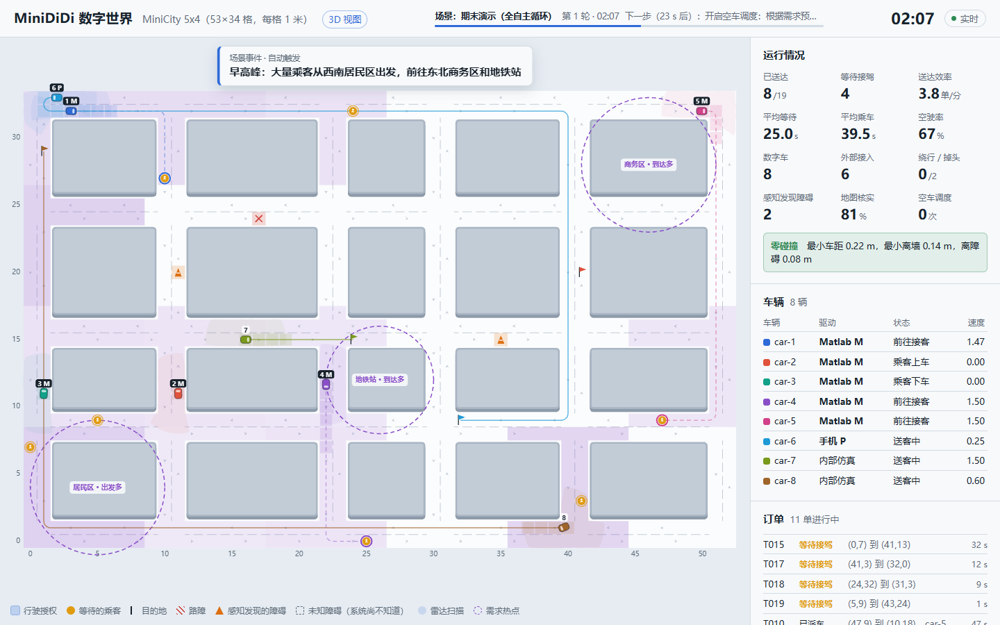
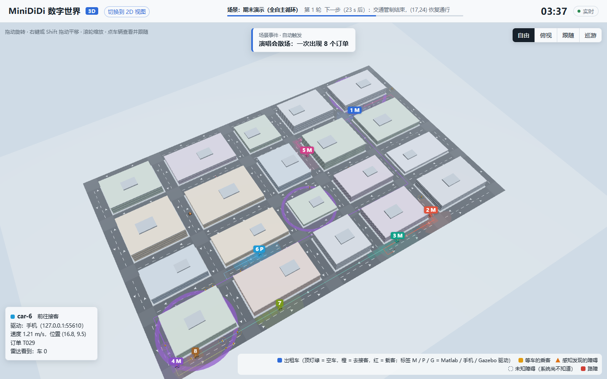
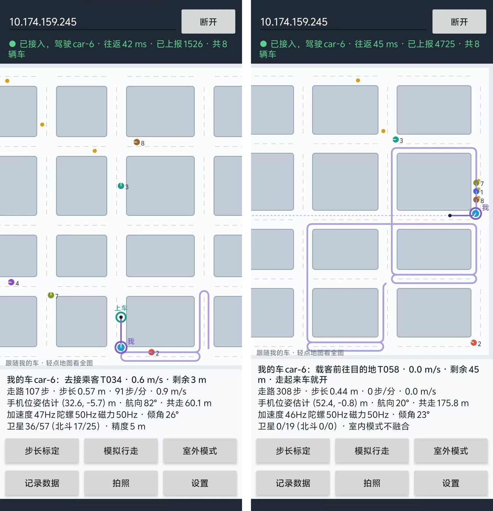
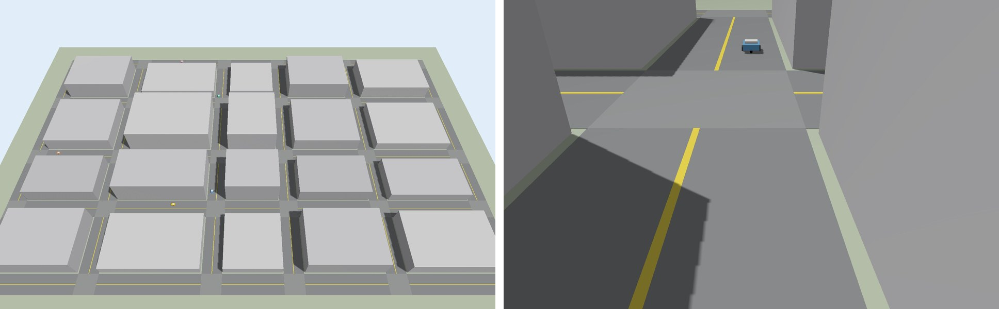
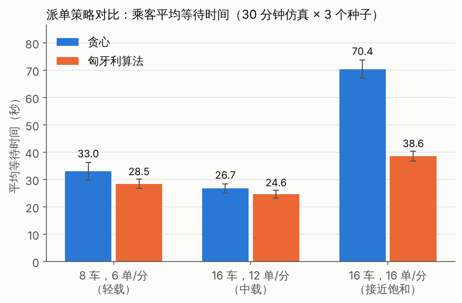
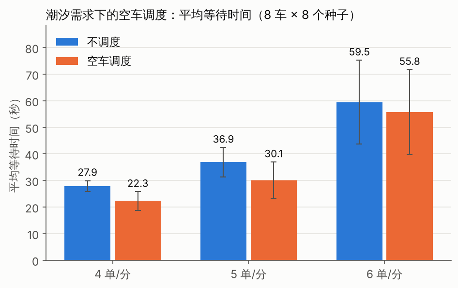
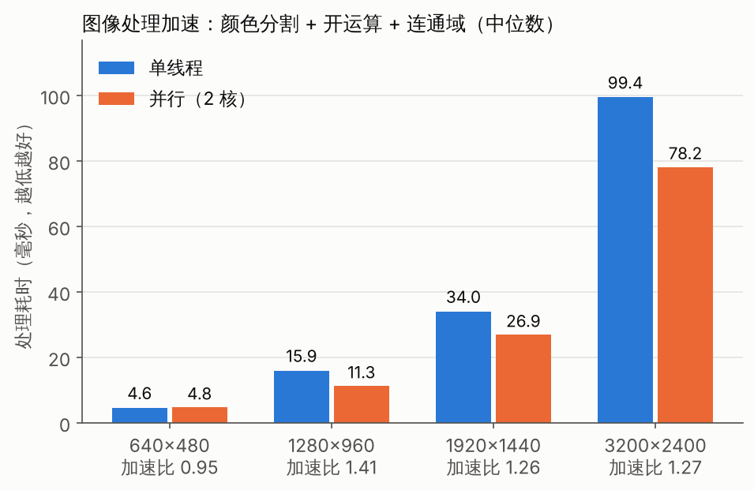

::: {custom-style="Cover School"}
同济大学
:::

::: {custom-style="Cover Course"}
综合设计与实践 C
:::

::: {custom-style="Cover Title"}
缩微滴滴：多智能体无人出租车系统
:::

::: {custom-style="Cover Subtitle"}
MiniDiDi / RoboTax　技术报告
:::

::: {custom-style="Cover Info"}
小　　组：第 1 组
:::

::: {custom-style="Cover Info"}
组　　长：阮飞翔（2252753）
:::

::: {custom-style="Cover Info"}
组　　员：樊宇泽（2351586）
:::

::: {custom-style="Cover Info"}
　　　　　李昊博（2352853）
:::

::: {custom-style="Cover Info"}
　　　　　付泽亮（2353413）
:::

::: {custom-style="Cover Info"}
指导教师：许春权
:::

```{=openxml}
<w:p><w:r><w:br w:type="page"/></w:r></w:p>
```

::: {custom-style="Abstract Title"}
摘　要
:::

网约车平台的核心是一个"系统超脑"：城市里随时有人叫车，平台要决定派哪辆车、走哪条路，并保证所有车辆安全通行。本项目在一个 53 m × 34 m 的缩微城市中实现了这样一个多智能体无人出租车系统（MiniDiDi）。系统以 Java 编写的数字世界服务端为核心，负责订单生成、派单、路径规划和交通管控；车辆既可以由服务端内部仿真，也可以由 Matlab 模拟车、安卓手机或 Gazebo 小车驱动，外部设备驱动时服务端中的数字车即为其数字孪生。

路径规划采用以"格子 + 驶入方向"为状态的 A* 算法，在遵守车道方向、禁止原地掉头的约束下求最短路，并在单行道被堵死时借对向车道掉头；派单采用匈牙利算法求"空车 × 订单"的全局最优匹配；交通管控借鉴铁路的移动闭塞思想，以格子预约和移动授权保证任意两车的授权区域互不相交，从机制上避免碰撞。在此基础上，系统实现了基于模拟激光雷达与占据栅格的环境感知和辅助建图、基于需求预测的空车调度、手机拍照后由服务端完成的图像识别（多线程加速）、自写 WebGL 的 3D 可视化，以及按场景脚本自动触发事件的全自主演示。手机按课程要求模拟一辆车：人走路的速度就是油门，车沿服务端规划的路线行驶；位姿由计步、Weinberg 步长和陀螺仪航向推算，室外融合地磁与卫星。

测试方面，服务端 30 项与手机核心 66 项单元测试全部通过；系统集成测试在无人操作下完成设备接入（含手机车）、感知避障、断线接管与图像识别全流程。评估实验表明：接近饱和负载时匈牙利算法派单比贪心算法的平均等待时间降低 45%；潮汐需求下空车调度使平均等待再降低 18%~20%；16 辆车高负载运行 6 × 60 分钟零碰撞（含系统事先不知道的障碍）；5 辆 Gazebo 物理仿真小车接入后同样零碰撞、零越权。

**关键词**：多智能体系统；数字孪生；路径规划；匈牙利算法；移动授权；占据栅格；行人航位推算

```{=openxml}
<w:p><w:r><w:br w:type="page"/></w:r></w:p>
```

::: {custom-style="Abstract Title"}
目　录
:::

```{=openxml}
<w:sdt><w:sdtPr><w:docPartObj><w:docPartGallery w:val="Table of Contents"/><w:docPartUnique/></w:docPartObj></w:sdtPr><w:sdtContent><w:p><w:r><w:fldChar w:fldCharType="begin" w:dirty="true"/></w:r><w:r><w:instrText xml:space="preserve"> TOC \o "1-2" \h \z \u </w:instrText></w:r><w:r><w:fldChar w:fldCharType="separate"/></w:r><w:r><w:t>（在 Word 中右键此处选择"更新域"即可生成目录）</w:t></w:r><w:r><w:fldChar w:fldCharType="end"/></w:r></w:p></w:sdtContent></w:sdt>
<w:p><w:r><w:br w:type="page"/></w:r></w:p>
```

# 第 1 章　项目概述

## 1.1 背景与意义

无人驾驶出租车（Robotaxi）把司机换成了算法，平台的"系统超脑"需要同时完成派单、路径规划和交通管控三件事，并保证安全。真车实验成本高、风险大，因此本课程在"缩微世界"中开展：用一张栅格化的城市地图代表真实城市，用数字车、Matlab 模拟车、手机和 Gazebo 小车代表各类交通参与者，由服务端统一调度。通过这个项目，小组完整经历了一个多智能体系统从立项、需求、设计、实现、测试、部署到效果评估的全过程。

## 1.2 课程要求与完成情况

课程要求系统启动后即自主运行、考核中不可人工操作、整体可集成运行。表 1-1 汇总了完成情况。

| 档次 | 要求 | 完成情况 |
|---|---|---|
| 必做 | 数字世界：≥ 5 辆数字车、随机运输任务 | 已完成：默认 8 辆，可配置；泊松到达的订单，完整接送流程 |
| 必做 | 基于最优化的路径规划 | 已完成：A* 最短路；匈牙利算法全局最优派单 |
| 必做 | 人机交互与动态显示 | 已完成：2D 实时地图、指标面板、配置与控制 |
| 必做 | 不与静态 / 动态障碍碰撞 | 已完成：移动授权交通管控；长时间高负载零碰撞 |
| 必做 | Matlab 模拟车 ≥ 5 辆并与数字车同步 | 已完成：持续集成中用 MATLAB R2024b 运行，5 辆 Matlab 车接入零碰撞、零越权 |
| 必做 | 手机 App：读传感器、无线同步、惯性元件估计位姿 | 已完成：核心算法仿真验证通过，APK 由持续集成编译，已在安卓真机上实测 |
| 必做 | 整体集成、全自主运行 | 已完成：一键启动；场景脚本自动触发；断线自动接管 |
| 挑战 | 3D 渲染可视化 | 已完成：自写 WebGL，四种视角 |
| 挑战 | 环境感知与辅助建图、端云互动 | 已完成：模拟激光雷达 + 占据栅格；手机拍照、服务端识别 |
| 挑战 | 服务端图像处理加速模块 | 已完成：按行并行，给出加速比 |
| 挑战（进阶） | Gazebo 中 ≥ 5 辆车 | 已完成：5 辆差速小车接入，无界面模式实测零碰撞 |
| 挑战（自选） | 调度优化与定量评估 | 已完成：空车调度；配对对比实验 |

: 表 1-1　课程要求与完成情况

## 1.3 技术路线

本项目选择课程给出的"路线 1"：HTML + JavaScript + CSS 前端，Java 服务端 + REST 接口。为了让系统在没有网络的演示现场也能完整运行，所有组成部分都尽量不依赖第三方库：服务端只依赖 Gson（随仓库提供），使用 JDK 自带的 HTTP 服务器；网页不依赖任何框架，3D 视图使用自己编写的 WebGL 渲染器；手机 App 只使用安卓自带的 API。

## 1.4 小组分工与进度

| 成员 | 角色 | 主要负责 |
|---|---|---|
| 阮飞翔（组长） | 架构与调度 | 总体架构、接口协议、派单与空车调度、联调集成；立项与需求文档、技术报告统稿 |
| 樊宇泽 | 服务端 | 数字世界与交通管控、设备接入、感知建图、图像处理加速；设计文档、测试报告 |
| 李昊博 | 控制与可视化 | Matlab 模拟车、2D 界面与 3D 可视化；部署手册、答辩 PPT、演示视频 |
| 付泽亮 | 移动端与进阶 | 安卓 App 与位姿估计、Gazebo 接入；效果评估报告 |

: 表 1-2　小组分工

项目周期为第 1–16 周，第 8 周中期检查，第 16 周答辩。进度安排见表 1-3（甘特图见立项申请书）：先在第 4 周打通"服务端 + Matlab + 手机"的骨架，之后每周在能运行的系统上迭代，降低最后集成的风险。

| 周次 | 阶段 | 主要工作 | 里程碑 |
|---|---|---|---|
| 第 1–3 周 | 立项与设计 | 立项、分工、熟悉现有代码；需求分析与需求规格说明；概要设计与接口协议确认 | — |
| 第 3–4 周 | 打通骨架 | Matlab 5 车接入并稳定运行；手机 App 读传感器并上报 | 第 4 周末第一次全系统联调 |
| 第 5–8 周 | 完成必做 | 手机位姿估计（行人航位推算）；一键启动与现场全自主演练 | 第 8 周中期检查 |
| 第 9–12 周 | 冲优（挑战项） | 3D 可视化；感知建图与图像识别；空车调度与对比实验；Gazebo 接入（进阶） | — |
| 第 13–14 周 | 加固与评估 | 长时间运行、断线测试、评估实验；录制视频素材，测试报告 | — |
| 第 15–16 周 | 收尾与答辩 | 技术报告、PPT、视频定稿，彩排 2 次 | 第 16 周期末答辩 |

: 表 1-3　16 周进度安排

# 第 2 章　需求分析

## 2.1 参与者与用例

系统的参与者分为三类：人（观察者、演示操作员、手机用户）、外部系统（车辆设备，具体为 Matlab 模拟车、Gazebo 小车、手机（模拟车）和实体小车）以及时间（时钟与场景脚本，负责按时触发订单生成、场景事件和感知扫描）。各参与者的用例见表 2-1，其中演示操作员是一种特殊的观察者，也可以使用观察者的全部用例。

| 参与者 | 用例 |
|---|---|
| 观察者（评委 / 观众） | UC02 查看 2D / 3D 实时画面；UC03 查看运行指标与事件日志 |
| 演示操作员 | UC01 一键启动全自主演示；UC04 调整派单策略 / 到达率 / 空车调度；UC05 设置 / 解除路障；UC06 手动下单；UC07 切换场景脚本 |
| 手机用户（手机车驾驶员） | UC08 走路驾驶手机车；UC09 接入数字世界并上报位姿；UC10 拍照识别路障 |
| 车辆设备（Matlab 模拟车、Gazebo 小车、手机、实体小车） | UC11 注册并接管数字车；UC12 接收路线与行驶授权；UC13 上报车辆状态 |
| 时钟与场景脚本 | UC14 自动生成订单；UC15 按时间触发场景事件；UC16 车辆感知未知障碍 |

: 表 2-1　参与者与用例

用例之间的包含与扩展关系如下（"A → B"表示 A 包含 B）：

- 手动下单（UC06）、自动生成订单（UC14）→ 派单（贪心 / 匈牙利）→ 路径规划（A*，含掉头）。
- 设置 / 解除路障（UC05）、拍照识别路障（UC10，先经过图像识别）、车辆感知未知障碍（UC16）→ 更新全局地图（收回授权、改上下车点）→ 路径规划。
- 走路驾驶手机车（UC08）→ 接收路线与行驶授权（UC12）、上报车辆状态（UC13）；UC12 → 交通管控（格子预约 + 移动授权）。
- 扩展关系：受阻超过 12 s 时，交通管控扩展出"绕行 / 掉头"（它又包含路径规划）；设备 3 s 没有上报时，上报车辆状态扩展出"断线接管"（由内部仿真驾驶）。

可见，"派单"被手动下单和自动生成订单两个用例共同包含；"更新全局地图"被设置路障、拍照识别和车辆感知三个用例共同包含，并进一步包含"路径规划"——这意味着无论障碍从哪里来，后续处理（收回授权、重规划）都走同一条路径，这一点直接影响了第 3 章的设计。

## 2.2 功能需求

功能需求按模块编号（FR-xx），共 9 组、40 余条，完整列表见仓库中的需求规格说明。表 2-2 列出各组的核心需求。

| 编号 | 模块 | 核心需求 |
|---|---|---|
| FR-01~06 | 数字世界 | 无设备时独立运行；≥ 5 辆车；泊松订单；完整接送流程；地图校验；同种子可复现 |
| FR-10~13 | 优化与决策 | A* 最短路；贪心 / 匈牙利派单可切换；掉头与改点；空车调度 |
| FR-20~25 | 交通管控 | 零碰撞；一格一车；不堵路口；格子变得不可通行时收回授权；不死锁；独立碰撞监测 |
| FR-30~34 | 设备接入 | TCP/UDP 接入；注册绑定；下发路线与授权；断线接管；≥ 5 辆 Matlab 车 |
| FR-40~44 | 人机交互 | 实时地图与指标；配置与控制；3D 视图；REST + SSE 接口 |
| FR-50~53 | 感知与图像 | 真实世界与系统认知分离；激光雷达建图；拍照识别路障；并行加速 |
| FR-60~63 | 全自主运行 | 一键启动；场景脚本自动触发；脚本校验；手机自动连接 |
| FR-70~73 | Matlab 模拟车 | 5 车注册；纯追踪 + 速度控制；不越过授权停车点；本地视图 |
| FR-80~84 | 手机 App | 读取传感器；惯性位姿估计；室外融合；以人携带手机运动模拟车辆运动（走路驾驶手机车）；拍照识别 |

: 表 2-2　功能需求概要

## 2.3 非功能需求

| 编号 | 类别 | 需求 |
|---|---|---|
| NFR-01 | 安全 | 16 车、16 单/分运行 ≥ 60 分钟，车车碰撞、撞墙、撞障碍均为 0 |
| NFR-02 | 实时性 | 仿真 20 Hz；快照推送 10 Hz；授权更新延迟不超过一个节拍（50 ms） |
| NFR-03 | 性能 | 16 车时单次派单 < 5 ms；离线仿真速度 > 100 倍实时 |
| NFR-04 | 可靠性 | 任一设备断线不影响系统运行，3 s 内由内部仿真接管 |
| NFR-05 | 可用性 | 一条命令（或双击）启动全部程序 |
| NFR-06/07 | 可移植、离线 | Windows / Linux / macOS 均可运行；演示现场断网时功能完整 |
| NFR-08 | 可维护性 | 核心逻辑与网络代码分层；服务端 ≥ 25 项、手机 ≥ 60 项单元测试 |

: 表 2-3　非功能需求

# 第 3 章　系统设计

项目的完整 UML 图（甘特图、用例图、组件图、部署图、类图、时序图、状态图、活动图等共 18 张）以 PlantUML 源文件维护，收录在仓库的立项申请书、需求规格说明和软件设计说明中。这些图幅面较大，缩到 A4 页宽后字迹难以辨认，因此本报告改用表格和文字描述。

## 3.1 总体架构

系统由数字世界服务端和若干外部组件构成（表 3-1）。服务端对外只有三个端口：HTTP 8080（REST + SSE，供网页和手机使用）、TCP 9000（设备协议）和 UDP 9001（可选的状态上报）。网页、Matlab 车队、安卓 App、Gazebo 桥接和 Python 模拟设备都只通过这三个端口与服务端交互，彼此之间没有依赖，因此可以由不同组员并行开发，接口协议文档就是开发的"合同"。

| 外部组件 | 接入方式 | 作用 |
|---|---|---|
| 2D 网页 | HTTP 8080（REST + SSE） | 实时地图、运行指标、事件日志和控制面板 |
| 3D 网页 | HTTP 8080（REST + SSE） | 自写 WebGL 的 3D 视图，四种视角 |
| Matlab 车队 | TCP 9000 | 5 辆模拟车，纯追踪跟踪服务端下发的路线 |
| 安卓 App | TCP 9000 + HTTP 8080 | 手机车（10 Hz 上报车的位姿）、拍照识别 |
| Gazebo 桥接 | TCP 9000 | 每辆 Gazebo 小车一条连接 |
| Python 模拟设备 | TCP 9000 / UDP 9001 | 协议参考实现，没有 MATLAB 时代替车队 |

: 表 3-1　外部组件与接入方式（各组件的源码目录见附录表 A-1）

服务端内部分为五层（表 3-2）。世界层和算法层不包含任何网络代码，可以直接进行单元测试和离线实验。

| 层（包） | 主要组件与职责 |
|---|---|
| 接入层（api、device） | HttpApi：REST、SSE 与静态文件；DeviceGateway：TCP / UDP 设备收发 |
| 运行层（sim） | SimulationEngine：20 Hz 仿真线程与命令队列；SnapshotHub：保存并发布最新快照 |
| 世界层（world） | World：仿真步；DeviceBridge：设备协议语义与断线接管；Perception：模拟激光雷达与占据栅格；ScenarioRunner：场景脚本；Rebalancer：需求预测与空车调度 |
| 算法层（plan、traffic、dispatch、map、vision） | AStarPlanner：A* 规划与掉头；TrafficController：格子预约与移动授权；Dispatcher：贪心 / 匈牙利派单；GridMap：栅格地图；VisionService：图像识别（并行） |
| 基础层（config、util） | 读取配置、JSON 等通用工具 |

: 表 3-2　服务端分层

组件之间的调用关系是：HTTP 线程和设备线程把请求作为命令交给 `SimulationEngine`；仿真线程每步调用 `World.step()`，再由 `World` 调用各子系统；规划、交通管控和感知都基于同一个 `GridMap`；每步结束后快照交给 `SnapshotHub`，网页通过 SSE 取得。地图、场景脚本和配置分别从 `maps/`、`scenarios/` 和 `config/default.json` 加载。

## 3.2 部署

考核现场的部署见表 3-3。演示笔记本运行服务端、浏览器和 Matlab 车队（车队通过本机回环连接，不受无线网络影响）；手机和可选的 Gazebo 工作站通过自带的无线路由器接入。之所以自带路由器，是因为校园网普遍开启终端隔离，设备之间可能互相连不上。

| 节点 | 运行环境与程序 | 与服务端的连接 |
|---|---|---|
| 演示笔记本（Windows 10/11 或 Linux） | JDK 17+：数字世界服务端；MATLAB R2020b+：run_fleet（5 辆 SimCar），没有 MATLAB 时用 Python 3.8+ 运行模拟车代替；Chrome / Edge：2D、3D 网页；start_demo 一键启动全部程序 | 本机回环：TCP 9000（车队）、HTTP 8080（网页） |
| 安卓手机（Android 8.0+） | MiniDiDi App：手机车（走路即油门）、惯性位姿估计、拍照 | Wi-Fi：TCP 9000（路线、授权，10 Hz 上报车的位姿），HTTP 8080（快照、拍照） |
| Gazebo 工作站（可选，Ubuntu 24.04） | ROS 2 Jazzy：minididi_bridge 桥接；Gazebo Harmonic：城市模型和 5 辆差速小车 | 网线：TCP 9000（每车一条连接） |
| 无线路由器（自带） | 固定 IP 段 192.168.x.0/24，关闭终端隔离 | 连接以上设备 |

: 表 3-3　部署节点

## 3.3 线程模型

服务端只有一个仿真线程可以修改世界状态。HTTP 线程和设备读线程收到消息后，把"要做的事"包装成命令放入队列，由仿真线程在下一个节拍（50 ms）统一执行；需要返回结果的查询使用 `engine.call` 等待执行完成。发送消息时只放入各连接的发送队列，由独立的写线程发出。这样整个世界状态无需加锁，也不会出现"算到一半数据被改"的并发问题，结果可以复现，测试也简单。

## 3.4 静态结构

数字世界的领域模型见表 3-4。`World` 是聚合根，组合了全部智能体、进行中的订单和各个子系统；`Agent` 表示一辆出租车（数字车），其"驱动源"（内部仿真、Matlab、Gazebo、手机等）决定位姿由内部仿真推算还是由设备上报。外部设备驱动时，`Agent.link` 指向一个 `DeviceLink`——这正是数字孪生在代码中的体现。`DeviceLink` 被设计为接口，单元测试中用记录消息的假实现替代真实 TCP 连接，因此设备协议的语义不开网络端口也能测试。

| 类 | 职责 |
|---|---|
| `World` | 聚合根：持有全部车辆、进行中的订单和各子系统，执行仿真步，处理下单、路障、策略切换等命令 |
| `Agent` | 一辆出租车（数字车）：位姿 x、y、θ、v，状态，驱动源，路线，授权，设备连接 |
| `Task` | 一个订单：上车点、目的地；状态 WAITING → ASSIGNED → PICKED → DELIVERED（或 CANCELLED） |
| `InternalDriver` | 内部仿真驾驶：没有设备时按停车点限速推算车辆运动 |
| `DeviceBridge` | 设备协议语义：注册绑定、下发路线和授权、心跳超时后接管 |
| `DeviceLink` | 接口，表示一条设备连接；由 DeviceSession（TCP）实现，测试中用假实现 |
| `TaskGenerator` | 按泊松过程和需求模型（Demand，可设需求热点）生成订单 |
| `ScenarioRunner` | 按仿真时间触发场景脚本（Scenario）中的事件，可循环播放 |
| `CollisionMonitor` | 独立于交通管控的碰撞监测，按真实几何计数 |
| `Metrics` | 运行指标统计：送达数、等待时间、空驶率等 |

: 表 3-4　数字世界的主要类

驱动源 `DriverKind` 取 INTERNAL、MATLAB、GAZEBO、PHONE、GENERIC 之一；车辆状态 `AgentStatus` 见 3.5 节。

优化与决策相关的算法类见表 3-5。派单采用策略模式，新增策略只需实现 `Dispatcher` 接口并注册；感知模块确认障碍后调用 `World.applyBlock`，与人工设置路障走同一条处理路径。

| 类（包） | 职责 |
|---|---|
| `AStarPlanner`（plan） | A* 规划与借对向车道掉头，搜索状态为"格子 + 驶入方向" |
| `Route`（plan） | 规划结果：格子序列与平滑路点，可按弧长 s 查询各格的起止位置 |
| `DistanceField`（plan） | 从上车点反向广度优先搜索，得到任意车辆的接驾距离 |
| `TrafficController`（traffic） | 格子占用表；延伸授权、收回授权、计算停车点 stopS |
| `Dispatcher`（dispatch） | 派单接口（策略模式），实现有贪心和匈牙利两种；匈牙利算法由 Hungarian 类求最优指派 |
| `GridMap`（map） | 栅格地图（建筑、车道、路口）、可通行判断、设置路障 |
| `Perception`（world） | 48 束 × 3 m 模拟激光雷达、对数几率占据栅格、未知障碍与拍照识别结果 |
| `Rebalancer`（world） | 分区需求计数（按 τ 衰减）与空车调度（同样用匈牙利算法） |

: 表 3-5　算法类

## 3.5 动态行为

每个仿真步依次执行场景脚本、订单生成、车辆运动、到站处理、派单（每 2 s）、空车调度（每 8 s）、感知（10 Hz）、交通管控和碰撞监测。一个订单的完整生命周期如下：

1. **生成**：`TaskGenerator` 每步以 $1-e^{-\lambda\Delta t}$ 的概率生成订单，起终点按需求模型抽样，订单状态为 WAITING。
2. **派单**（每 2 s）：`World.dispatch()` 收集空车和等待中的订单，对每个上车点用 `DistanceField` 反向搜索得到所有车的接驾距离，组成代价矩阵交给 `Dispatcher`（匈牙利算法）求最优匹配。
3. **规划**：被派单的车从授权终点出发，用 `AStarPlanner` 规划去上车点的路线并平滑成路点；车辆状态变为 TO_PICKUP，订单变为 ASSIGNED。
4. **行驶**（每步）：`TrafficController` 按受阻时间排序依次延伸授权（路口整段加出口格一次性申请），得到每辆车的停车点 stopS；`InternalDriver` 按 $v \le \min(v_{\max},\ \text{转弯限速},\ \sqrt{2a(s_{\text{stop}}-s)})$ 推进车辆。
5. **接客与送客**：到达上车点后停留 2 s（BOARDING）并记入 `Metrics`，再规划去目的地（TO_DROPOFF，订单变为 PICKED）；到达目的地后停留 2 s（ALIGHTING），订单变为 DELIVERED，车辆回到 CRUISING，重新可以接单。
6. **显示**：仿真线程以 10 Hz 发布快照，浏览器通过 SSE 接收。

外部设备的接入与断线接管过程如下（以 Matlab 车 car-1 为例）：

1. 设备连接 TCP 9000 并发送 `register`（kind = matlab，agentId = car-1）。设备读线程不直接修改世界，而是把消息作为命令提交给仿真线程，由 `DeviceBridge` 处理。
2. `DeviceBridge` 把 car-1 的驱动源改为 MATLAB，依次回复 `welcome`（初始位姿、车辆参数、地图尺寸）、`path`（routeId、格子序列和路点）和 `permit`（同一 routeId 的停车点 stopS）。
3. 设备每 0.1 s 用纯追踪转向和速度 PI 控制行驶一步，保证沿路线的投影长度 s ≤ stopS，并上报 `state`（x, y, θ, v）；服务端把它写入 car-1，这就是数字孪生的"镜像"。
4. 服务端每个节拍更新授权，stopS 变化时下发新的 `permit`（出现路障或感知发现障碍时会变小）；另以 5 Hz 下发周边车辆 `world` 和模拟激光雷达 `scan`（设备可以忽略）。到站、派单或绕行时下发新的 `path` 和对应的 `permit`。
5. 设备断开或 3 s 无消息时，`DeviceBridge` 关闭连接，把驱动源改回内部仿真并把车吸附回路线，由内部仿真继续驾驶，系统不会停摆；设备重连后再次 `register`，服务端用 `welcome` 同步最新位姿。

车辆状态机见表 3-6。表中的空车巡游、去接客、乘客上车、送客、乘客下车依次对应代码中 `AgentStatus` 的取值 CRUISING、TO_PICKUP、BOARDING、TO_DROPOFF 和 ALIGHTING。

| 当前状态 | 事件 / 条件 | 下一状态 | 动作 |
|---|---|---|---|
| （创建） | 车辆生成，或设备接管 | 空车巡游 | — |
| 空车巡游 | 到达巡游终点 | 空车巡游 | 换一个随机目的地（开启空车调度时去待命区域） |
| 空车巡游 | 派单匹配到订单 | 去接客 | 规划去上车点 |
| 去接客 | 到达上车点并停稳 | 乘客上车 | — |
| 去接客 | 上车点不可达 | 空车巡游 | 订单退回等待 |
| 乘客上车 | 停留 2 s | 送客 | 规划去目的地 |
| 送客 | 到达目的地并停稳 | 乘客下车 | — |
| 乘客下车 | 停留 2 s | 空车巡游 | 计入送达 |

: 表 3-6　车辆状态转移

三个行驶状态（空车巡游、去接客、送客）共用同一套行驶行为：按授权行驶；前方格子申请不到时受阻等待，授权延伸后继续；受阻超过 12 s，或前方出现路障、感知发现障碍时，重新规划或掉头。

## 3.6 接口设计

设备协议基于 TCP 长连接，每行一条 JSON，消息类型见表 3-7（上行指设备发给服务端，下行指服务端发给设备）。所有接收方必须忽略不认识的字段和消息类型，这样新增下行消息（如后来加入的 `scan`）不会影响旧设备。

| 方向 | 消息 | 作用 |
|---|---|---|
| 上行 | `register` | 注册：`kind` 为 matlab / gazebo / phone / generic，一律绑定一辆出租车 |
| 上行 | `state` | 位姿上报（x, y, θ, v），10 Hz，同时作为心跳 |
| 下行 | `welcome` | 注册成功：初始位姿、车辆参数、地图尺寸 |
| 下行 | `path` | 新路线：格子序列与平滑路点（转弯处为半径半格的圆弧） |
| 下行 | `permit` | 行驶授权：沿路点折线的停车位置 stopS，车辆投影长度不得超过它 |
| 下行 | `world` / `scan` | 周边车辆（5 Hz）/ 服务端模拟的激光雷达扫描（5 Hz，可忽略） |

: 表 3-7　设备协议消息

浏览器接口提供地图、快照、SSE 推送、配置、场景切换、路障、下单、图像识别等 REST 接口，均允许跨域访问。

# 第 4 章　关键算法

## 4.1 地图与路径规划

城市是 53 × 34 格的栅格，每格 1 m；道路宽 2 格、双向两车道、靠右行驶。车道格只能沿箭头方向驶入和驶出，路口格允许任意方向。这样同一车道上的车同向行驶，不会迎面相撞，冲突只发生在路口和跟车，问题被大大简化。

路径规划采用 A* 算法，搜索状态为"格子 + 驶入方向"。引入方向维度有两个作用：一是可以给转弯加代价（默认 0.5 m），得到更平顺的路线；二是可以禁止原地掉头。代价函数为

$$f(n) = g(n) + h(n),\qquad h(n) = |x_n - x_g| + |y_n - y_g|,$$

其中 $g(n)$ 为已走步数加转弯代价，$h(n)$ 为曼哈顿距离。由于车辆只能沿四个方向移动，曼哈顿距离不会高估真实代价，所以 A* 的解是最优的。单元测试用 300 组随机起终点与广度优先搜索的最短步数比较，验证了这一点。

规划得到的格子序列再转换成平滑路线：直行段穿过格中心，90° 转弯用半径为半格的四分之一圆弧连接两条边的中点，圆弧完全落在转弯格内，车辆中心离建筑始终不小于 0.2 m。

当车辆开进一段单行道、前方又被障碍堵死时，按正常规则无路可走。此时 `planUTurn` 借用左侧的对向车道掉头：两段四分之一圆弧正好拼成半径半格的半圆，车身不越出这两格；对向车道格同样要先申请授权，所以掉头也不会撞车。如果目的地本身被切断，就把它改到附近一个可达的车道格。

## 4.2 交通管控：格子预约与移动授权

这是保证"不与任何车辆碰撞"的核心，思路来自铁路的移动闭塞（CBTC 中的移动授权）。规则如下：

1. **一格一车**：每个格子同一时刻只属于一辆车。车身覆盖的格子和已授权的前方格子都归该车所有。
2. **只能驶入已授权的格子**：车辆在授权终点前留出"车身半径 + 余量"停车，内部车和外部设备都遵守。
3. **不堵路口**：申请授权遇到路口时，必须把整段路口格加出口第一格一次性申请到，否则一格也不给。
4. **公平**：每步按"受阻时间"排序依次申请；等待超过 3 s 的车可以先占住它需要的空闲格，防止被车流"饿死"。
5. **绕行**：受阻超过 12 s，给挡路的格子加惩罚后重新规划。
6. **障碍收回授权**：授权一般只向前延伸；人工路障或感知发现的障碍出现在已授权的格子里时，授权立即收回到它之前，车辆重规划或掉头。

**安全性论证**：任意两车的授权格不相交，车辆只在自己的授权格内运动，且在授权边界前留出车身半径加余量的距离，因此两车车身不可能重叠。碰撞监测模块独立于交通管控、按真实几何计数，作为验证。规则 3 保证路口内不会出现互相卡死；规则 4、5 保证受阻的车最终能通过或绕行，不会出现永久死锁。

每个仿真步的授权计算过程如下：

1. 计算每辆车车身覆盖的格子，重建占用表 `owner[]`：先登记车身，再登记已有的授权。
2. **收回不安全的授权**：逐辆车检查已授权、尚未到达的格子；如果某一格变得不可通行（路障或感知发现的障碍），用 `revokeBefore` 把授权收回到这一格之前，新终点落在路口里时再退到路口之前。
3. 按"受阻开始时间"排序，等得最久的车先申请。
4. **依次延伸授权**（每辆车至多向前看 `horizonCells` 格）：下一格是路口时，一次性申请"整段路口 + 出口第一格"，全部空闲才占用，否则停在路口之前；下一格是普通车道格时，空闲且可通行就占用，否则授权停在它之前。
5. **处理受阻**：申请失败且车已停下时，受阻超过 3 s 并且本步还没有车用过优先权的，可以先占住它需要的空闲格（防止被"饿死"）；受阻超过 12 s 的，给挡路的格子加惩罚后重新规划（绕行）。
6. 下发 `permit`，停车点 stopS = 授权终点 − 车身半径 − 余量。

## 4.3 派单：匈牙利算法

每 2 s 把"空车 × 等待订单"建成代价矩阵 $C$，求总代价最小的匹配：

$$\min_{x}\sum_{i}\sum_{j} c_{ij}x_{ij},\qquad \text{s.t.}\ \sum_j x_{ij}\le 1,\ \sum_i x_{ij}\le 1,\ x_{ij}\in\{0,1\},$$

$$c_{ij} = d_{ij} - w\cdot t_j,$$

其中 $d_{ij}$ 是车 $i$ 沿路网到订单 $j$ 上车点的距离，$t_j$ 是订单已等待的时间，$w$（默认 0.3）用于避免偏远订单长期没人接。$d_{ij}$ 由每个上车点的**距离场**给出：从上车点沿车道方向的反方向做一次广度优先搜索，就能以 $O(1)$ 查询任意车辆的接驾距离。该指派问题用匈牙利算法以 $O(n^3)$ 求得最优解；单元测试用 300 个随机矩阵与穷举法对比，结果完全一致。作为对照，贪心策略按等待时间依次把订单派给最近的空车。

## 4.4 空车调度

派单只决定"哪辆空车接哪一单"，没有订单时空车随机巡游，常常离下一单很远。空车调度把空车提前调往"即将有人叫车"的区域：

1. **需求预测**：城市划分为 9 × 9 格的区域（共 24 个）。每来一单，上车点所在区域计数加 1，并按时间常数 $\tau = 180$ s 指数衰减，得到各区域近期的叫车强度 $\lambda_z$。
2. **目标分布**：空车总数按 $\lambda_z$ 的比例分配到各区域（最大余数法取整）。
3. **最优调度**：多余的空车调往缺车的区域，同样用匈牙利算法求"总空驶距离最小"的指派。

## 4.5 环境感知与辅助建图

课程要求系统"知道周边有什么障碍物和目标物，能辅助建立地图"。服务端把**真实世界**（建筑、人工路障、场景脚本放置的未知障碍、所有车）和**系统认知**（全局地图）分开：规划、派单、交通管控只能使用系统认知，未知障碍必须由车辆"看见"后才能写入地图。

每辆车以 10 Hz 做一次模拟激光雷达扫描：48 束射线均布 360°，量程 3 m，用 Amanatides–Woo 栅格光线投射求与建筑、障碍的交点，再与其他车的圆求交，取最近者。命中点按系统已知的信息分类：命中已知建筑或路障的忽略；靠近已知车辆的视为动态目标；其余命中并入占据栅格。每个格子维护占据概率的对数几率

$$l = \ln\frac{p}{1-p},\qquad l \leftarrow \mathrm{clamp}\left(l + \Delta l,\ -2,\ 4\right),$$

命中时 $\Delta l = +0.85$，射线穿过时 $\Delta l = -0.4$。连续两次命中（约 0.2 s）即超过 1.4（$p \approx 0.8$），确认为障碍并写入全局地图，随后收回授权、重规划或掉头；已确认的格子被连续观测为空、降到 −1.4（$p\approx 0.2$）以下时自动撤除。这样单次误检不会改动地图，障碍消失也能自动恢复。

开发中曾出现误检：最初用"命中点往前一点"反查命中格，射线擦过建筑转角时落进旁边的路面，10 分钟内误检 10 处。改为直接取光线投射撞上的那一格后，稠密交通 10 分钟零误检。

安全余量方面：量程 3 m，最高速度 1.5 m/s 时刹车距离 0.75 m，确认只需约 0.2 s（行驶 0.3 m），所以正前方出现的障碍一定能停住。

## 4.6 图像识别与并行加速

课程要求"端云互动：服务端负责重型图像处理"。手机只负责拍照上传，识别、测距、建图都在服务端完成，处理流程是：

1. **颜色分割**：像素转为 HSV，色相在红—橙范围、饱和度 ≥ 0.45、亮度 ≥ 0.3 的标为"路障色"，黄色标为"警示色"。按色相分割对光照变化不敏感。
2. **开运算**：3 × 3 腐蚀再膨胀，去掉零星噪点。
3. **连通域标记**：广度优先搜索统计外接矩形和面积；锥桶上的白色反光条会把锥桶切成上下两块，同类、左右重叠、上下间隔很小的块合并为一个。
4. **测距与建图**：针孔相机模型，焦距 $f = \frac{W/2}{\tan(\mathrm{FOV}/2)}$，方位角 $\beta = \arctan\frac{c_x - W/2}{f}$，距离 $d = H\cdot f / h$（$H$ 为目标真实高度、$h$ 为像素高度），从手机位姿沿视线找到目标所在的格子，作为观测并入占据栅格。

颜色分割和开运算的每一行互不依赖，按行并行（ForkJoin 线程池）；连通域标记串行。照片先缩到 640 像素宽再处理，像素数比手机原图少几十倍。

一次拍照识别的端云交互过程是：

1. 用户在 App 上点"拍照"，App 拍摄缩略图、编码为 JPEG，连同相机水平视场角一起 POST 到 `/api/vision/detect?source=car-6`。
2. HTTP 线程通过 `engine.call` 向仿真线程取得手机车 car-6 当前的位姿，作为相机位姿。
3. `VisionService` 解码并缩图，`ColorBlobDetector` 在 ForkJoin 线程池中按行并行完成颜色分割和开运算，再串行做连通域标记得到目标框；然后用针孔模型算出方位和距离，沿视线找到目标所在的可行驶格。
4. HTTP 线程再通过 `engine.call` 把结果交给仿真线程：路障作为观测并入占据栅格（一次即确认），同时登记到"真实世界" 120 s；写入地图后，经过它的授权被收回，附近车辆绕行。
5. App 收到 JSON 结果，显示"识别到 1 个路障，已写入地图"。120 s 内再拍到会续期；过期后视为已搬走，由车辆激光雷达观测为空后撤掉。

## 4.7 手机模拟车：走路驾驶与惯性位姿估计

课程要求手机"以人携带手机运动来模拟车辆的运动"：读取卫星定位、加速度、陀螺和地磁，无线发给服务端并与数字世界中某一智能体保持状态同步，基于惯性元件估计位姿。难点在于教室只有十来米，人不可能沿地图上的街道走。因此采用"**路线由服务端规划，快慢由人决定**"的分工：

- **绑定**：App 以 `kind = phone` 注册，绑定一辆数字车（默认 car-6，Matlab 车队占用 car-1 ~ car-5），之后服务端像对待 Matlab 车一样给它派单、下发路线和授权，不需要任何特殊逻辑。
- **走路即油门**：期望车速 $v_{\text{want}} = k\,v_{\text{walk}}$，其中 $v_{\text{walk}}$ 为步长 × 步频（停步 1.6 s 后为 0），$k$ 为驾驶比例（默认 1）。车沿路线折线推进弧长 $s$，车速同时不超过最高速度 1.5 m/s、弯道限速 0.6 m/s 和刹车曲线 $\sqrt{2a_{\text{dec}}(s_{\text{stop}}-s)}$，并且始终 $s \le s_{\text{stop}}$，所以手机车和其他车一样不会越权；授权被收回时直接采用新的停车点，不倒车。App 10 Hz 上报 $s$ 处的位姿，与数字车保持同步。

惯性位姿估计采用行人航位推算（PDR），各环节如下：

- **计步**：加速度模长经两级低通滤波后做峰谷检测，一个"峰"要等信号回落超过自适应回滞量才确认，与手机的握持方式无关。
- **步长**：Weinberg 模型 $L = K\sqrt[4]{a_{\max} - a_{\min}}$，$K$ 默认 0.45，可通过沿已知距离直线行走标定。
- **航向**：陀螺仪角速度在重力方向上的分量积分得到航向（与手机姿态无关），静止时估计零偏；室外用倾斜补偿后的磁力计做 PI 互补修正。
- **卫星融合**（室外）：经纬度换算为局部东北坐标，用标量卡尔曼滤波修正累积漂移。

推算出的位置和航向（手机自己的坐标系，单位为真实的米）显示在 App 上并记录到 CSV，用于评估惯性推算的精度；其中的走路速度就是手机车的油门。

手机端完整的数据流见表 4-1，全部在 `core` 包中实现（纯 Java，不依赖安卓，可以在电脑上测试）。

| 环节（类） | 输入 | 输出 |
|---|---|---|
| 计步（StepDetector） | 加速度计 | 每一步的时刻和加速度幅值 |
| 步长（Weinberg 模型） | 一步内的加速度最大、最小值 | 步长 L |
| 航向（HeadingEstimator） | 陀螺仪、重力方向；室外加磁力计 | 航向 ψ |
| 推算（PdrEngine） | 步长、航向；室外加卫星定位 | 手机坐标系中的位置和航向（显示、CSV 记录）；走路速度 = 步长 × 步频 |
| 手机车（RouteFollower） | 走路速度 × 驾驶比例；服务端下发的路线和停车点 | 车沿路线的弧长 s 和位姿 (x, y, θ, v) |
| 连接（DwConnection） | 车的位姿 | 10 Hz 上报的 state 消息 |

: 表 4-1　手机端的数据流

## 4.8 车辆控制

Matlab 模拟车、Python 模拟设备和 Gazebo 桥接使用同一套控制逻辑：纯追踪转向——在前视距离 $l_d$ 处取路线上的目标点，曲率 $\kappa = 2\sin\alpha / l_d$（$\alpha$ 为目标点相对车头的方位角）；速度控制则同时满足最高速度、转弯限速和授权约束

$$v \le \min\left(v_{\max},\ \sqrt{a_{\mathrm{lat}}/|\kappa|},\ \sqrt{2a\,(s_{\mathrm{stop}} - s)}\right),$$

保证车辆总能在授权停车点前刹住。Gazebo 物理仿真中还要补偿里程计延迟和执行滞后（见 5.5 节）。

# 第 5 章　系统实现

## 5.1 实现概况

| 组成 | 语言 / 技术 | 代码量（行） | 说明 |
|---|---|---|---|
| 数字世界服务端 | Java 17 + Gson | 6 526（测试 911） | JDK 自带 HttpServer，REST + SSE；TCP / UDP 设备接入 |
| 网页前端 | HTML / CSS / JavaScript | 2 923 | 2D Canvas；自写 WebGL 3D 渲染器 |
| 手机 App | Java（安卓 8.0+） | 4 846（测试 1 978） | 零第三方库；核心算法为纯 Java |
| Matlab 模拟车 | MATLAB R2020b+ | 775 | 不需要工具箱 |
| Gazebo 接入 | Python（ROS 2） | 1 238 | 世界生成器 + 桥接包 |
| 工具 | Python | 1 129 | 模拟设备、地图生成、评估与系统测试 |

: 表 5-1　各组成部分的实现

## 5.2 服务端与网页

服务端启动后按配置加载地图、场景脚本，开始以 20 Hz 运行仿真。网页 2D 主界面（图 5-1）订阅 SSE 快照，实时显示地图、车辆（两次快照之间插值，动画平滑）、行驶授权、路线、乘客与目的地、雷达扫描、路障与感知发现的障碍、需求热点，右侧为运行指标、车辆与订单列表、控制面板和事件日志。顶部显示正在运行的场景脚本、进度和下一个事件。

{width=100%}

3D 视图（图 5-2）使用自己编写的约 500 行 WebGL 渲染器：一套着色器（半球环境光 + 平行光 + 距离雾），不透明物体先画、半透明物体按远近排序后画；静态城市合并为 4 个网格一次绘制。支持自由、俯视、跟随某辆车和自动巡游四种视角。之所以不用 Three.js，是因为开发环境无法下载第三方库，演示现场也不一定能联网。

{width=100%}

## 5.3 Matlab 模拟车与手机 App

Matlab 部分由 `run_fleet`（建立 5 条 TCP 连接，20 Hz 控制循环）、`SimCar`（独轮车运动学 + 纯追踪 + 速度控制）、`DwClient`（每行一条 JSON 的非阻塞收发）和 `FleetView`（本地视图）组成，按已在服务端上测试过的 Python 参考实现逐行移植。

手机 App 分两层：`core` 包是纯 Java（不引用任何安卓类），包括位姿估计、手机车行驶（`RouteFollower`）、设备协议和 HTTP 客户端，可以在电脑上做单元测试和端到端仿真；外层负责界面、传感器和卫星定位的读取。界面包括小地图（显示周边车辆，以及我的车的路线和授权停车点）、步长标定、拍照识别、模拟行走（桌面演示时自动"走路"）和数据记录；打开 App 即自动连接上次的服务端，驾驶的车号和驾驶比例在设置里修改。真机运行画面见图 5-3。

{width=70%}

## 5.4 全自主演示

考核要求"启动后即自主运行，过程中不可人工操作"。演示中要出现的情况都写在场景脚本里，按仿真时间自动触发（表 5-2），约 6 分钟一轮、循环播放；新一轮开始时自动撤掉上一轮放置的路障和障碍。一键启动脚本依次启动服务端、Matlab 车队（未安装 MATLAB 时自动改用 Python 模拟车）、模拟手机车和浏览器。

| 时间 | 事件 |
|---|---|
| 0 s | 演示开始：匈牙利派单，6 单/分 |
| 30 s | 交通管制：(17,24) 封路（已知路障），途经车辆立即绕行 |
| 60 s | (35,15) 出现施工围挡——系统不知道，要靠车辆激光雷达发现 |
| 90 s | (11,20) 出现掉落的货物（未知障碍） |
| 120 s | 早高峰：乘客从西南居民区前往东北商务区和地铁站，7 单/分 |
| 150 s | 开启空车调度 |
| 210 s | 演唱会散场：一次出现 8 个订单 |
| 240–265 s | 封路解除；围挡和货物撤走（同样要等车辆看到才从地图上删掉） |
| 300 s | 恢复平峰，关闭空车调度 |
| 340 s | 本轮结束，20 s 后自动重新开始 |

: 表 5-2　期末演示场景脚本

## 5.5 Gazebo 接入

`gazebo/gen_world.py` 读取数字世界的地图文件，把同类相邻的格子合并成尽量大的矩形（1800 个格子合并为 20 块楼房、49 块车道、30 块路口），生成 Gazebo Harmonic 世界和 5 辆差速小车。Gazebo 世界坐标与地图坐标完全一致，无需换算。每辆车带两个插件：`DiffDrive` 订阅速度指令驱动车轮，`OdometryPublisher` 发布世界坐标系下的位姿。

ROS 2 桥接包 `minididi_bridge` 为每辆车建立一条 TCP 连接，按协议注册为 `gazebo` 设备；收到 `welcome` 后调用 Gazebo 的传送服务把小车放到数字孪生的位置；之后订阅里程计上报状态，按纯追踪和授权约束发布速度指令。车辆后端被抽象为接口，另有一个纯 Python 运动学后端，不安装 ROS 也能接入服务端验证协议和控制逻辑。

物理仿真中出现了运动学模型中没有的问题：里程计经 ros_gz_bridge 传来有几十毫秒延迟，指令发出到车轮真正减速也有滞后，二者使车辆越过授权停车点约 0.08 m；转弯时插件的角加速度上限让车被甩向外侧，横向偏差达 0.15 m。针对性的改进是：按最新速度把位姿外推到当前时刻（延迟补偿）、刹车时预留 $v\cdot t_{\mathrm{lead}}$ 的距离（$t_{\mathrm{lead}}=0.08$ s）、提高插件的角加速度上限；此外，传送服务在 Gazebo 繁忙时可能超时，桥接程序在传送确认之前一直重试，期间只上报目标位姿、只发零速度。改进前后的对比见表 5-3，运行画面见图 5-4。

| 指标 | 改进前 | 改进后 |
|---|---|---|
| 投影越过授权停车点的最大值 | 0.08 m | 0.000 m |
| 离路线的最大横向偏差 | 0.15 m | 0.09 m |
| 最小车距 / 最小离墙（服务端统计） | 0.12 m / 0.05 m | 0.28 m / 0.11 m |
| 车车碰撞 / 撞墙 / 撞障碍 / 越权 | 0 / 0 / 0 / 0 | 0 / 0 / 0 / 0 |

: 表 5-3　Gazebo 小车控制改进前后对比（5 车，改进后为 240 s 运行的数据，Gazebo 实时因子约 1.0）

{width=100%}

# 第 6 章　系统测试

## 6.1 测试策略

测试分为五个层次（表 6-1）。由于交通管控和规划的边界情况很多，手写用例难以覆盖，单元测试大量使用固定种子的随机输入（如 300 组随机起终点、15 分钟 16 车稠密交通），反复检查"零碰撞、路线合法、不卡死"等不变量，既覆盖大量情况，又能复现。

| 层次 | 对象 | 方法 | 结果 |
|---|---|---|---|
| 单元测试 | 服务端世界层、算法层 | JUnit；随机输入 + 不变量；与穷举 / 广度优先搜索对拍 | 30 / 30 通过 |
| 单元测试 | 手机核心算法与网络 | JUnit；传感器模拟器（按姿态生成带噪声的读数） | 65 / 65 通过 |
| 集成测试 | 服务端 + 设备协议 + 场景 | 自动启动服务端、5 辆模拟车、模拟手机车，中途断开车队 | 通过 |
| 端到端测试 | 手机核心代码 ↔ 服务端 | 用同一套核心代码模拟"拿着手机走路" | 通过 |
| 界面冒烟测试 | 2D / 3D 网页 | 无头浏览器打开页面，检查控制台错误 | 通过（0 错误） |
| 单元测试 | Gazebo 桥接 | 控制器与世界生成器 | 9 / 9 通过 |
| Gazebo 联调 | ROS 2 + Gazebo + 服务端 | 无界面模式运行 240 s | 通过（零碰撞、零越权） |
| 系统测试 | 性能、安全、长时间 | 离线仿真实验（第 7 章） | 通过 |
| 持续集成 | 以上测试 + Windows 脚本 + APK 编译 + Matlab 车队 | 每次推送由 GitHub Actions 自动运行 | 通过 |

: 表 6-1　测试层次与结果

## 6.2 单元测试

服务端 30 项测试覆盖规划（地图无死路、车道规则、A* 合法且最短、路线几何）、派单（匈牙利算法与穷举一致、不劣于贪心、不可达组合不匹配）、世界（16 车 15 分钟零碰撞不死锁、不进入路障、设备接管与回退、授权收回时设备来不及反应不算违规、按弧长行驶的手机车完成接送）、场景脚本、感知建图（激光雷达测距、发现并避开未知障碍、障碍撤除、稠密交通零误检、掉头脱困）、空车调度和图像识别。手机核心 66 项测试覆盖计步、航向估计、位姿推算与标定、走路速度、手机车沿路线行驶（收到授权前不走、不越过授权停车点、车速跟随走路速度、弯道限速）、地图解析、JSON、设备协议（10 Hz 上报、断线重连）和 HTTP 客户端。

## 6.3 集成测试与端到端测试

系统集成测试脚本自动启动服务端（期末演示场景）、5 辆按协议注册为 Matlab 设备的模拟车和 1 辆模拟手机车（模拟拿着手机的人走走停停），运行 180 s 后杀掉车队进程，再上传示例照片做图像识别。结果：6 台设备 0.5 s 内全部接入；第 60 s 和第 90 s 场景脚本放出的未知障碍分别在 5.8 s 和 12.3 s 后被车辆发现，车辆借对向车道掉头；手机车全程绑定 car-6，沿路线行驶 161 m 以上；断开车队后 0.2 s 内 5 辆车全部由内部仿真接管；照片中的锥桶被识别（右前方 9°，约 7.3 m）并写入全局地图；全程车车碰撞、撞墙、撞障碍、越权行驶均为 0。

持续集成（GitHub Actions）在每次推送后自动运行四组任务：Linux 上的单元测试与系统集成测试；Windows 上的 5 个一键脚本；用真实安卓 SDK 编译 APK；在 MATLAB R2024b 中运行 Matlab 车队——SimCar 离线测试中车辆停在授权停车点 4.000 m 处（不越界），`run_fleet` 的 5 辆车接入服务端运行 200 s，送达 19 单，车车碰撞、撞墙、撞障碍、越权行驶均为 0，最小车距 0.28 m，车队结束后由数字世界接管。CI 还发现了 Windows 一键脚本在输入被重定向时不等待服务端启动的问题，已修复。

手机端到端仿真用 App 的核心代码模拟一个拿着手机走路的人驾驶 car-6：站着不动时车不动；检测 37 步，与模拟器实际步数一致，人走 23.0 m，车沿路线开 21.6 m；服务端看到的车位置与手机本地平均相差 0.10 m；人停下车也停下；断开后这辆车由内部仿真接管。

真机测试在 vivo S20（安卓 15）上进行：手机开热点，笔记本连上后运行服务端，App 输入笔记本的 WLAN 地址接入并驾驶 car-6。连续记录 97 s，全程保持接入，往返延迟中位数 34 ms；人走了 154 步（推算 90.8 m），车沿路线开了 79.1 m，898 个采样中车始终没有越过授权停车点；拍照识别路障稳定。

## 6.4 缺陷记录

| 编号 | 现象 | 原因 | 修复与回归测试 |
|---|---|---|---|
| D01 | CI 中 Matlab 车队报告"越权行驶 1 次" | 授权收回后，设备要等下一条授权到达才知道新停车点，期间多走进一格被当成违规 | 收回后 1 s 内、原授权范围内的越界单独计为 `revokeOverruns`；`lateReactionToRevocationIsNotAViolation` |
| D02 | 无障碍时 10 分钟误检 10 处 | 用"命中点往前一点"反查命中格，转角处落入路面 | 直接取光线投射撞上的格子；`noFalseDiscoveriesInDenseTraffic` |
| D03 | 换派单策略后订单序列也变，对比不公平 | 订单与车辆共用随机数序列 | 订单使用独立随机数序列；配对实验 |
| D04 | 长期空闲格子上的新障碍确认很慢 | 空闲证据可累积得很低 | 下限收紧到 −2；`phonePhotoUpdatesTheMapAndExpires` |
| D05 | Gazebo 小车越过授权停车点约 0.08 m | 里程计延迟与执行滞后 | 位姿外推 + 提前刹车；Gazebo 实测越界为 0 |
| D06 | Gazebo 繁忙时小车停在停车场、位置乱跳 | 传送超时后改用了里程计里的停车场位置 | 传送确认前一直重试，只报目标位姿 |
| D07 | Gazebo 桥接按 Ctrl+C 时报错、统计不输出 | ROS 上下文已关闭后仍发布停车指令 | 先输出统计，发布失败时忽略 |

: 表 6-2　缺陷记录（节选）

## 6.5 尚未覆盖的测试

Matlab 车队只在持续集成（Linux、不显示图窗）中运行过，安卓 App 已在真机上运行但惯性推算精度（10 m 正方形实验）尚未实测，Gazebo 仅在无界面模式下测试（运行 240 s，5 车零碰撞、零越权，最大越界 0），现场网络只在本机回环上测试。这些需要在第 13–14 周加固阶段由组员在真实设备上完成。

# 第 7 章　效果评估

## 7.1 评估方法

评估使用离线仿真工具 `Experiment`：不开网络端口，直接以最快速度推进仿真（16 车时约 326 倍实时），每次仿真 30 分钟（安全性实验 60 分钟）。订单的到达时间和起终点使用只由种子决定的独立随机数序列，同一组实验中各配置使用相同的种子，所以对比的两种配置面对的是完全相同的订单序列（配对比较）。每个配置跑 3~8 个种子，给出平均值 ± 标准差。全部实验由一条命令重跑。

## 7.2 派单策略

{width=80%}

| 场景 | 策略 | 送达（单） | 平均等待 (s) | 送达效率（单/分） | 空驶率 |
|---|---|---|---|---|---|
| 8 车，6 单/分 | 贪心 | 171 ± 8 | 33.0 ± 3.2 | 5.69 | 60% |
|  | 匈牙利 | 171 ± 9 | 28.5 ± 1.7 | 5.71 | 60% |
| 16 车，12 单/分 | 贪心 | 351 ± 5 | 26.7 ± 1.7 | 11.71 | 57% |
|  | 匈牙利 | 353 ± 4 | 24.6 ± 1.4 | 11.76 | 57% |
| 16 车，16 单/分 | 贪心 | 398 ± 13 | 70.4 ± 3.2 | 13.28 | 51% |
|  | 匈牙利 | **450 ± 10** | **38.6 ± 1.9** | **14.99** | **44%** |

: 表 7-1　派单策略对比（30 分钟 × 3 个种子，全部零碰撞）

轻载和中载时两种策略差别很小：同时等待的订单很少，"离它最近的车"往往就是全局最优。接近饱和时差距明显：匈牙利算法把平均等待从 70.4 s 降到 38.6 s（**−45%**），送达效率提高 13%，空驶率从 51% 降到 44%。这时同时等待的订单多，贪心按顺序"先到先得"，会把一辆车派给第一单、让第二单只能找远处的车；全局匹配考虑所有组合，总接驾距离最小。单次派单耗时仅 0.07~0.6 ms。

## 7.3 空车调度

{width=80%}

在潮汐需求（早高峰居民区 → 商务区，晚高峰反向）下，开启空车调度后平均等待时间在 4 单/分时从 27.9 s 降到 22.3 s（**−20%**），5 单/分时从 36.9 s 降到 30.1 s（**−18%**），6 单/分时只降低 6%。原因是空车调度只能调动"空车"，车辆接近饱和时几乎没有空车可调。空驶率基本不变：节省的接驾距离和多出来的调度距离大致抵消，收益体现在乘客等待时间上。

## 7.4 感知与建图

在 4 处未知障碍陆续出现、消失的场景中（8 车 × 8 个种子、每次 30 分钟），每次仿真平均发现障碍 25.5 次、撤除 17.2 次；障碍出现到被发现平均 30.9 s（车流密集处通常 1 s 内，偏僻路段要等到有车经过）；最近 60 s 内被核实过的道路比例为 82%；掉头脱困 16.5 次；车停在障碍前 0.08 m（正好是设计的停车余量）；碰撞（车车 / 车墙 / 车撞障碍）全部为 0。

## 7.5 安全性

16 辆车运行期末演示场景（路障、未知障碍、需求潮汐、订单潮），到达率 16 单/分，两种派单策略各 3 个种子、每次 60 分钟：每次送达 855 ± 7 单，车车碰撞、撞墙、撞障碍合计 **0 / 0 / 0**，最小车距 0.28 m，最小离墙 0.20 m，最长连续受阻 12.0 s（达到绕行阈值后绕行，没有死锁）。6 小时的高密度运行验证了"授权格互不相交 ⇒ 不相撞"的设计。

## 7.6 图像处理加速

{width=80%}

1280×960 以上的图像并行加速 1.26~1.41 倍，640×480 的小图没有收益（线程调度开销与计算量相当）。连通域标记是串行的，根据阿姆达尔定律，可并行部分占比为 $p$、核数为 $n$ 时加速比上限为 $\frac{1}{(1-p)+p/n}$，测试机器只有 2 核，实测结果符合预期。实际处理时照片先缩到 640 像素宽，这比并行更有效；端到端识别一张照片约 30 ms。

## 7.7 手机位姿估计与手机车

用传感器模拟器验证：沿正方形走 57 步，慢走、快走、竖拿、斜拿时计步误差都不超过 1 步；沿 9 m × 9 m 正方形走一圈，闭合误差约 0.6 m（周长的 1.7%）；步长模型偏大 30%、走 5 分钟（335 m）时，不融合卫星的最终误差为 33 m，融合后为 2.6 m。

真机（vivo S20）连续步行 97 s 的记录：步频中位数 97 步/分，步长中位数 0.60 m，步速中位数 0.95 m/s；车沿路线行驶了人走距离的 87%，差额来自 7 个弯道的限速（弯内 0.6 m/s）和约 6 s 的等待放行；往返延迟中位数 34 ms、最大 60 ms。室外模式下可见 57 颗卫星、36 颗参与定位（北斗 17 颗），定位精度约 5 m。真机推算的闭合误差还需要用 10 m 正方形实验测量。

# 第 8 章　总结与展望

## 8.1 工作总结

本项目实现了一个可一键启动、全自主运行的多智能体无人出租车系统，完成了课程的全部必做内容和 3D 可视化、环境感知与辅助建图、端云互动与图像处理加速、Gazebo 接入、调度优化等挑战内容。主要特点有：

1. **安全由机制保证**：格子预约 + 移动授权使任意两车的授权区域互不相交，6 小时高负载运行零碰撞；
2. **最优化贯穿始终**：A* 最短路、匈牙利算法派单与空车调度，并用配对实验定量证明了效果；
3. **数字孪生与设备无关**：Matlab、手机、Gazebo、Python 模拟设备使用同一协议，任何设备断线都由服务端接管；
4. **全自主与可复现**：场景脚本驱动演示，同一种子的实验结果完全可复现；
5. **工程化**：零第三方依赖、离线可用；105 项单元测试 + 系统集成测试，持续集成在每次推送后自动于 Linux、Windows、安卓 SDK、MATLAB 上验证；文档覆盖全流程，UML 图以源文件维护。

## 8.2 不足与改进方向

1. 带界面的 Gazebo 尚未在真实设备上实测，Matlab 车队只在持续集成中运行过，安卓真机还没有做推算精度实验；物理仿真的经验表明，设备端必须处理好通信延迟和执行滞后；
2. 派单与空车调度只看当前状态，可以尝试拼车（带上下车约束的车辆路径问题）或强化学习；
3. 格子预约在高密度时通行效率受限，可以尝试时空预约 / 冲突搜索（CBS）等多车协同规划；
4. 模拟激光雷达没有噪声和漏检；图像识别只识别颜色鲜明的目标，可替换为深度学习检测（接口不变）；
5. 手机位姿估计需要根据真机数据调整计步阈值和步长系数。

## 8.3 个人总结

**阮飞翔**（组长，架构与调度）：我负责总体架构、接口协议、派单与空车调度以及联调集成。项目一开始我们就确定了"一个服务端 + 一套设备协议"的结构，把接口协议文档当作组内并行开发的合同，Matlab 车、手机、Gazebo 小车都按同一协议接入，各模块可以独立开发、随时集成。派单方面，我把派单建模为二分图最优匹配，用匈牙利算法求解。做对比实验时发现换派单策略后订单序列也跟着变，对比并不公平，于是把订单生成改为只由种子决定的独立随机数序列，做成配对实验，证明了接近饱和时平均等待减少 45%。空车调度在高负载时效果减弱，我们在报告中如实分析了原因。为了满足"考核中不可人工操作"，我设计了场景脚本，让所有演示情节按时间自动触发。这次项目让我体会到接口先行、集成优先、用数据说话的重要性，也锻炼了统筹进度和撰写技术报告的能力。

**樊宇泽**（服务端）：我负责数字世界服务端，包括仿真主循环、交通管控、设备接入、感知建图和图像处理加速，并编写了设计文档和测试报告。为了避免多线程问题，数字世界只在仿真线程里访问，网络线程一律通过命令队列提交请求，内部不加锁。交通管控采用格子预约的移动授权，一格只给一辆车，从机制上保证不相撞。开发中最典型的问题是：持续集成中 Matlab 车队偶尔报告"越权行驶 1 次"，原因是授权被收回后，外部设备要等下一条授权到达才知道新的停车点，这段时间里多走进的一格被当成了违规；改为收回后 1 s 宽限内、原授权范围内的越界单独计数后解决，并补了回归测试。激光雷达擦过建筑转角时会误检障碍，改为直接取光线投射撞上的格子后，稠密交通下零误检。图像处理在 2 核机器上的并行加速比只有 1.26~1.41，让我直观理解了阿姆达尔定律。每修一个缺陷都补一个回归测试，最终服务端测试全部通过，长时间高负载运行零碰撞。

**李昊博**（控制与可视化）：我负责 Matlab 模拟车和 2D / 3D 可视化，并完成了部署手册、答辩 PPT 和演示视频。Matlab 车用纯追踪跟踪服务端下发的路线、用速度 PI 控制车速，并按授权停车点限制速度上限，保证任何时候都能在停车点前刹住。一个容易出错的地方是：遇到新路障或感知发现障碍时授权会被收回，车端必须直接采用最新授权的停车点，不能取历史最大值。为了在没有 MATLAB 的电脑上也能联调，我们先写了同协议的 Python 参考实现，再移植到 MATLAB，并在持续集成中用 MATLAB R2024b 让 5 辆车实际接入服务端验证。3D 视图没有使用 Three.js，而是自己实现了 WebGL 渲染器，演示现场断网也能打开；过程中要处理好地图坐标到 GL 坐标的变换、相机矩阵和四种视角的切换。录制演示视频时，无头浏览器需要软件渲染才能显示 WebGL。通过这些工作，我把控制课上学的跟踪控制用到了实际系统中，也打下了计算机图形学的基础。

**付泽亮**（移动端与进阶）：我负责安卓手机 App 与位姿估计、Gazebo 接入，并编写了效果评估报告、管理 GitHub 仓库。手机端采用行人航位推算：加速度计步、Weinberg 模型估计步长、陀螺仪积分航向。仿真中发现陀螺仪零偏会让航向在 150 s 内偏 73°，于是在室外用磁力计做 PI 修正，最大偏差降到 3.4°；再用卡尔曼滤波融合卫星定位，5 分钟行走的最终误差从 33 m 降到 2.6 m。按课程要求，手机作为模拟车接入：路线由服务端规划，人走路的速度就是油门，车始终不越过授权停车点，这样手机车和 Matlab 车遵守同一套交通管控。为了能在电脑上测试，我把算法放在不依赖安卓的核心包里，写了 66 项单元测试。Gazebo 联调时，物理小车总会冲过授权停车点约 0.08 m，原因是里程计经 ROS 桥接有延迟、车轮减速有滞后；把位姿按速度外推到当前时刻并提前刹车后，越界降为 0，5 车运行零碰撞。这让我认识到真实系统中的延迟和执行滞后不可忽视，也熟悉了 ROS 2 与 Gazebo 的开发流程。

# 参考文献

::: {custom-style="Reference"}
[1] Hart P E, Nilsson N J, Raphael B. A formal basis for the heuristic determination of minimum cost paths[J]. IEEE Transactions on Systems Science and Cybernetics, 1968, 4(2): 100-107.
:::

::: {custom-style="Reference"}
[2] Kuhn H W. The Hungarian method for the assignment problem[J]. Naval Research Logistics Quarterly, 1955, 2(1-2): 83-97.
:::

::: {custom-style="Reference"}
[3] Munkres J. Algorithms for the assignment and transportation problems[J]. Journal of the Society for Industrial and Applied Mathematics, 1957, 5(1): 32-38.
:::

::: {custom-style="Reference"}
[4] IEEE Std 1474.1-2004. IEEE standard for communications-based train control (CBTC) performance and functional requirements[S]. New York: IEEE, 2004.
:::

::: {custom-style="Reference"}
[5] Pavone M, Smith S L, Frazzoli E, et al. Robotic load balancing for mobility-on-demand systems[J]. The International Journal of Robotics Research, 2012, 31(7): 839-854.
:::

::: {custom-style="Reference"}
[6] Elfes A. Using occupancy grids for mobile robot perception and navigation[J]. Computer, 1989, 22(6): 46-57.
:::

::: {custom-style="Reference"}
[7] Thrun S, Burgard W, Fox D. Probabilistic robotics[M]. Cambridge: MIT Press, 2005.
:::

::: {custom-style="Reference"}
[8] Amanatides J, Woo A. A fast voxel traversal algorithm for ray tracing[C]//Proceedings of Eurographics. 1987: 3-10.
:::

::: {custom-style="Reference"}
[9] Coulter R C. Implementation of the pure pursuit path tracking algorithm[R]. Pittsburgh: Carnegie Mellon University, CMU-RI-TR-92-01, 1992.
:::

::: {custom-style="Reference"}
[10] Weinberg H. Using the ADXL202 in pedometer and personal navigation applications[R]. Analog Devices, Application Note AN-602, 2002.
:::

::: {custom-style="Reference"}
[11] Koenig N, Howard A. Design and use paradigms for Gazebo, an open-source multi-robot simulator[C]//Proceedings of IEEE/RSJ International Conference on Intelligent Robots and Systems. 2004: 2149-2154.
:::

::: {custom-style="Reference"}
[12] Macenski S, Foote T, Gerkey B, et al. Robot Operating System 2: design, architecture, and uses in the wild[J]. Science Robotics, 2022, 7(66): eabm6074.
:::

::: {custom-style="Reference"}
[13] Alonso-Mora J, Samaranayake S, Wallar A, et al. On-demand high-capacity ride-sharing via dynamic trip-vehicle assignment[J]. Proceedings of the National Academy of Sciences, 2017, 114(3): 462-467.
:::

::: {custom-style="Reference"}
[14] GB/T 8567—2006. 计算机软件文档编制规范[S]. 北京: 中国标准出版社, 2006.
:::

# 附录 A　源代码结构

| 目录 | 内容 |
|---|---|
| `server/` | 数字世界服务端（Java）：`map` 栅格地图，`plan` 路径规划，`traffic` 交通管控，`dispatch` 派单，`world` 数字世界本体（感知、场景、调度、设备协议），`vision` 图像识别，`sim` 仿真线程，`api` / `device` 接口，`tools` 离线实验 |
| `server/scenarios/` | 场景脚本（JSON） |
| `web/` | 网页：2D 主界面、3D 视图（`js/gl/` 为自写 WebGL 渲染器） |
| `matlab/` | Matlab 模拟车 |
| `phone/` | 安卓 App（Android Studio 工程） |
| `gazebo/` | Gazebo 世界生成器与 ROS 2 桥接包 |
| `tools/` | Python 模拟设备、地图生成、评估实验、系统测试、图表与 UML 渲染 |
| `scripts/` | 编译、启动、一键演示、实验脚本（Windows / Linux） |
| `docs/` | 立项、需求、设计、协议、测试、部署、评估等全流程文档与 UML 源文件 |

: 表 A-1　源代码目录
