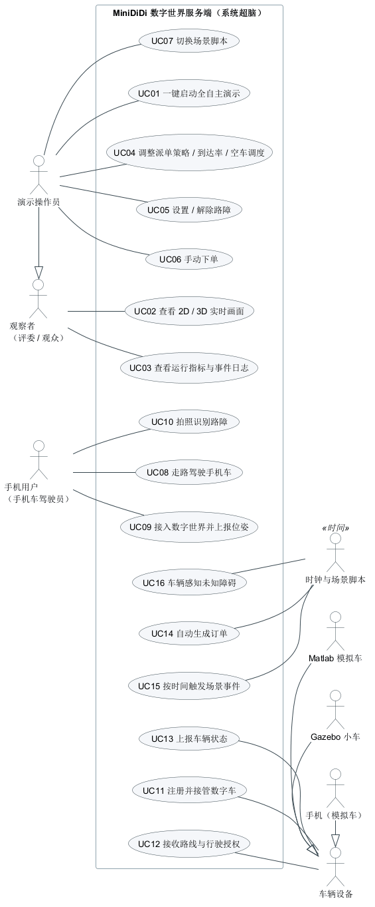
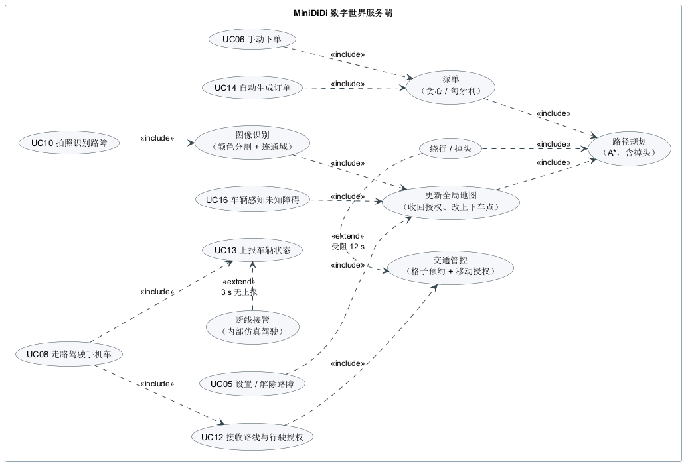

# 需求规格说明

> 本文档说明 MiniDiDi 系统"要做什么"，是设计、测试和验收的依据。"怎么做"见 [软件设计说明](design.md)。
> 需求编号：FR = 功能需求，NFR = 非功能需求，UC = 用例。每条需求都能在第 8 节追踪到实现和测试。

## 1. 引言

### 1.1 目的

明确系统的参与者、用例、功能与性能要求和验收标准，作为组内分工、接口约定、测试设计和期末验收的共同依据。

### 1.2 范围

MiniDiDi 是一个在缩微城市中运行的多智能体无人出租车系统。系统包括：

- **数字世界服务端**（系统超脑）：地图、智能体、订单、派单、路径规划、交通管控、感知建图、图像识别、设备接入；
- **网页前端**：2D 实时地图与控制面板、3D 视图；
- **Matlab 模拟车**：5 辆，作为数字车的数字孪生；
- **安卓手机 App**：行人智能体，位姿估计、叫车、拍照识别；
- **Gazebo 桥接**（进阶）、**Python 模拟设备**（协议参考实现与后备车队）。

### 1.3 术语

| 术语 | 含义 |
|---|---|
| 数字世界（DW） | 服务端中的虚拟城市及其中的所有智能体，即"系统超脑" |
| 智能体（Agent） | 世界中会动的对象：出租车（taxi）或自由智能体（手机行人） |
| 数字孪生 | 外部设备驱动的车在服务端中的镜像，位姿由设备上报 |
| 格子 | 地图的基本单元，1 m × 1 m |
| 行驶授权（permit） | 服务端允许某车驶入的格子范围；车必须在授权终点前停住 |
| 派单 | 把等待中的订单分配给空车 |
| 空车调度 | 没有订单时把空车提前调往需求多的区域 |
| 未知障碍 | 真实世界中存在、但系统地图上没有的障碍，要靠车辆感知发现 |
| 场景脚本 | 按仿真时间自动触发事件的 JSON 文件，用于全自主演示 |
| PDR | 行人航位推算：计步 × 步长 × 航向，推算行走轨迹 |

### 1.4 参考资料

1. 课程 PPT：《综合设计与实践 C》任务说明（必做、挑战、考核要求）。
2. GB/T 8567—2006《计算机软件文档编制规范》、GB/T 9385—2008《计算机软件需求规格说明规范》。
3. 本仓库：[立项申请书](proposal.md)、[接口协议说明](protocol.md)、[架构设计说明](architecture.md)。

## 2. 总体描述

### 2.1 产品视角

系统运行在一个局域网内：一台笔记本运行服务端、浏览器、Matlab 车队；手机和（可选的）Gazebo 工作站通过无线路由器接入。
部署结构见 [软件设计说明第 3 节](design.md#3-部署视图)。

### 2.2 参与者

| 参与者 | 类型 | 说明 |
|---|---|---|
| 观察者（评委 / 观众） | 人 | 只看 2D/3D 画面和指标，不操作 |
| 演示操作员 | 人 | 继承观察者；启动系统，调试时修改配置、设置路障、手动下单、切换场景。**考核过程中不操作** |
| 乘客 | 人 | 通过手机 App 叫车 |
| 手机用户（行人智能体） | 人 + 设备 | 拿着手机走动，手机位姿同步到数字世界；可拍照识别路障 |
| 车辆设备 | 外部系统 | 抽象参与者，具体为 Matlab 模拟车、Gazebo 小车、实体小车 / 其他设备 |
| 时钟与场景脚本 | 时间 | 按仿真时间触发订单生成、场景事件和感知扫描 |

### 2.3 运行环境

| 组成 | 要求 |
|---|---|
| 服务端 | Windows 10/11、Linux 或 macOS；JDK 17 或更新 |
| 网页 | Chrome / Edge / Firefox 新版（3D 需要 WebGL） |
| Matlab 模拟车 | MATLAB R2020b 或更新，不需要工具箱 |
| 手机 App | 安卓 8.0（API 26）或更新，有加速度计、陀螺仪、磁力计 |
| 模拟设备 | Python 3.8 或更新，只用标准库 |
| Gazebo（进阶） | Ubuntu 24.04 + ROS 2 Jazzy + Gazebo Harmonic |

### 2.4 约束

1. **全自主**：启动后即自主运行，考核过程中不可人工切换模式、设置或遥控。
2. **整体可集成**：各模块必须能接在一起运行，孤立模块不计分。
3. **技术路线 1**：HTML + JS + CSS 前端，Java 服务端 + REST。
4. **代码托管**：gitee 私有库。
5. **离线可用**：演示现场不保证能上网，所有程序不得依赖在线资源（CDN、在线地图、云服务）。

### 2.5 假设与依赖

- 演示现场有一台自带的无线路由器，所有设备在同一网段，路由器未开启终端隔离。
- 教室内收不到卫星信号，手机位姿主要靠惯性元件推算。

## 3. 用例模型

### 3.1 用例图

### 3.2 用例清单

| 编号 | 用例 | 参与者 | 优先级 |
|---|---|---|---|
| UC01 | 一键启动全自主演示 | 演示操作员 | 必做 |
| UC02 | 查看 2D / 3D 实时画面 | 观察者 | 必做（3D 为挑战） |
| UC03 | 查看运行指标与事件日志 | 观察者 | 必做 |
| UC04 | 调整派单策略 / 到达率 / 空车调度 | 演示操作员 | 必做 |
| UC05 | 设置 / 解除路障 | 演示操作员 | 必做 |
| UC06 | 手动下单 | 演示操作员 | 必做 |
| UC07 | 切换场景脚本 | 演示操作员 | 必做 |
| UC08 | 叫车 | 乘客、手机用户 | 挑战 |
| UC09 | 接入数字世界并上报位姿 | 手机用户 | 必做 |
| UC10 | 拍照识别路障 | 手机用户 | 挑战 |
| UC11 | 注册并接管数字车 | 车辆设备 | 必做 |
| UC12 | 接收路线与行驶授权 | 车辆设备 | 必做 |
| UC13 | 上报车辆状态 | 车辆设备 | 必做 |
| UC14 | 自动生成订单 | 时钟 | 必做 |
| UC15 | 按时间触发场景事件 | 时钟与场景脚本 | 必做 |
| UC16 | 车辆感知未知障碍 | 时钟 | 挑战 |

### 3.3 主要用例描述

**UC01 一键启动全自主演示**

| 项 | 内容 |
|---|---|
| 参与者 | 演示操作员 |
| 前置条件 | 已安装 JDK 17+；（可选）MATLAB、Python 3；所有设备连在同一路由器上 |
| 主成功场景 | 1. 操作员运行 `scripts/start_demo.bat`（或 `.sh`）。2. 系统启动服务端并加载 `demo` 场景脚本。3. 系统检测到 MATLAB，启动 5 辆 Matlab 模拟车，分别注册并接管 car-1 … car-5。4. 系统启动模拟手机。5. 系统打开浏览器的 2D 主界面和 3D 视图（自动巡游）。6. 场景脚本按时间自动触发路障、未知障碍、早晚高峰、订单潮，约 6 分钟一轮、循环播放 |
| 扩展 | 3a. 没装 MATLAB：改用 Python 模拟车（同一协议），提示操作员。3b. MATLAB 启动较慢：在设备接入前由服务端内部仿真驾驶，系统不停摆 |
| 后置条件 | 系统持续运行，直到操作员按 Ctrl+C 或关闭窗口；期间不需要任何人工操作 |

**UC08 叫车**

| 项 | 内容 |
|---|---|
| 参与者 | 乘客（手机用户） |
| 前置条件 | 手机 App 已连接服务端，小地图已显示 |
| 主成功场景 | 1. 乘客在小地图上点选目的地，点"叫车"。2. App 取离手机最近、且不在手机脚下的车道格作为上车点，调用 `POST /api/tasks`。3. 服务端创建订单（WAITING），返回订单号。4. 下一次派单（≤ 2 s）时订单被派给一辆空车（ASSIGNED）。5. 车辆接驾、乘客上车（PICKED）、送达（DELIVERED）。6. App 和网页实时显示车辆位置与订单状态 |
| 扩展 | 2a. 目的地不是车道格：服务端返回错误原因，App 提示。4a. 上车点被障碍切断、任何车都到不了：派单时就近改上车点 |

**UC11 / UC12 注册接管数字车，按授权行驶**

| 项 | 内容 |
|---|---|
| 参与者 | 车辆设备（Matlab / Gazebo / 实体小车） |
| 前置条件 | 服务端运行中，设备能连上 TCP 9000 |
| 主成功场景 | 1. 设备发送 `register`（kind、希望绑定的 agentId）。2. 服务端绑定一辆数字车，回复 `welcome`（初始位姿、车辆参数），下发 `path` 和 `permit`。3. 设备沿路线行驶，投影长度始终不超过 `stopS`，10 Hz 上报 `state`。4. 服务端镜像设备位姿，延伸授权、派单、改路线时下发新的 `path` / `permit` |
| 扩展 | 1a. 请求的车被另一个活跃设备占用：改派一辆空闲车。3a. 行人走进已授权的格子或出现障碍：服务端下发 `stopS` 更小的 `permit`，设备必须立即减速停车。3b. 设备断开或 3 s 无消息：服务端内部仿真接管该车；设备重连后重新注册即可恢复 |
| 后置条件 | 任意两车的授权格不相交，设备遵守授权就不会相撞；越权行驶会被计数 |

**UC16 车辆感知未知障碍**

| 项 | 内容 |
|---|---|
| 参与者 | 时钟（每 0.1 s） |
| 前置条件 | 场景脚本在真实世界中放置了系统地图上没有的障碍 |
| 主成功场景 | 1. 每辆车做一次模拟激光雷达扫描（48 束、3 m）。2. 命中点按系统已知信息分类，未知的命中并入占据栅格。3. 某格占据概率超过 0.8，确认为障碍，写入全局地图。4. 已授权经过这一格的车收回授权，路线经过它的车重规划，单行道被堵死时掉头。5. 障碍消失后，被射线穿过的格子概率降到 0.2 以下，从地图上撤掉 |
| 扩展 | 2a. 命中点靠近已知的车或行人：作为动态目标，不写入地图。3a. 单次误检：概率达不到阈值，不改动地图 |
| 后置条件 | 车撞障碍次数（barrierHits）为 0 |

**UC10 拍照识别路障（端云互动）**

| 项 | 内容 |
|---|---|
| 参与者 | 手机用户 |
| 主成功场景 | 1. 用户点"拍照"，手机拍摄缩略图并上传 `POST /api/vision/detect`。2. 服务端（不是手机）做颜色分割、开运算、连通域、针孔模型测距，得到路障所在格子。3. 路障写入全局地图，车辆绕行；同时登记到真实世界 120 s。4. App 显示识别结果 |
| 扩展 | 2a. 没有识别到目标：返回"没有发现路障"，地图不变。2b. 上传的不是图片：返回错误原因 |

## 4. 功能需求

### 4.1 数字世界与仿真

| 编号 | 需求 | 优先级 | 来源 |
|---|---|---|---|
| FR-01 | 系统不接任何外部设备时能独立、完整地运行 | 必做 | PPT 必做 |
| FR-02 | 至少 5 辆数字车（默认 8 辆，可配置） | 必做 | PPT 必做 |
| FR-03 | 订单按泊松过程随机生成，到达率可配置；起终点按需求模型抽样（默认全城均匀） | 必做 | PPT 必做 |
| FR-04 | 车辆完成接驾 → 上车（停留 2 s）→ 送客 → 下车（2 s）的完整流程 | 必做 | PPT 必做 |
| FR-05 | 地图从 JSON 文件加载，启动时校验车道连通性，有死路时报出位置 | 必做 | 设计 |
| FR-06 | 同一随机种子 + 同一配置可复现；订单序列只由种子决定 | 必做 | 评估需要 |

### 4.2 优化与决策

| 编号 | 需求 | 优先级 | 来源 |
|---|---|---|---|
| FR-10 | 路径规划基于最优化方法：A* 求遵守车道方向的最短路（含转弯代价） | 必做 | PPT 必做 |
| FR-11 | 派单支持贪心与匈牙利算法两种策略，可在运行中切换 | 必做 | PPT 必做 |
| FR-12 | 单行道前方被堵死时借对向车道掉头；上下车点被切断时就近改点 | 挑战 | 感知建图需要 |
| FR-13 | 空车调度：按分区需求预测把空车调往缺车区域，可开关 | 挑战 | 自选挑战 |

### 4.3 交通管控与安全

| 编号 | 需求 | 优先级 | 来源 |
|---|---|---|---|
| FR-20 | 车辆不得与其他车辆、建筑、路障、障碍发生碰撞 | 必做 | PPT 必做 |
| FR-21 | 每个格子同一时刻只授权给一辆车；车只能驶入已授权的格子 | 必做 | 设计 |
| FR-22 | 车辆只有在能完整通过路口时才进入路口（不堵路口） | 必做 | 设计 |
| FR-23 | 行人走进车辆已授权的格子时，立即收回该车授权，车停在行人前 | 必做 | 手机接入 |
| FR-24 | 受阻超过 3 s 优先通行，超过 12 s 绕行，不出现死锁 | 必做 | 设计 |
| FR-25 | 独立的碰撞监测：分别统计车车碰撞、撞墙、撞障碍、行人接触、越权行驶 | 必做 | 验证需要 |

### 4.4 设备接入与数字孪生

| 编号 | 需求 | 优先级 | 来源 |
|---|---|---|---|
| FR-30 | 提供 TCP（9000）设备接入，每行一条 JSON；UDP（9001）可选用于状态上报 | 必做 | PPT 服务端模块 |
| FR-31 | 设备注册后绑定一辆数字车（matlab / gazebo / generic）或新建行人智能体（phone） | 必做 | PPT 必做 |
| FR-32 | 服务端向设备下发路线、行驶授权、周边车辆（5 Hz）、模拟激光雷达扫描（5 Hz） | 必做 | 设计 |
| FR-33 | 设备断开或 3 s 无消息时由内部仿真接管；设备重连后恢复 | 必做 | 全自主要求 |
| FR-34 | 同时支持至少 5 辆 Matlab 模拟车 | 必做 | PPT 必做 |

### 4.5 人机交互与可视化

| 编号 | 需求 | 优先级 | 来源 |
|---|---|---|---|
| FR-40 | 网页实时显示地图、车辆（插值动画）、授权格、路线、乘客、目的地、路障、障碍 | 必做 | PPT 必做 |
| FR-41 | 显示运行指标（送达数、平均 / 最长等待、送达效率、空驶率、碰撞计数等）和事件日志 | 必做 | PPT 必做 |
| FR-42 | 可在网页上修改派单策略、到达率、倍速、暂停、空车调度、场景，可设置路障、手动下单 | 必做 | PPT 必做 |
| FR-43 | 3D 视图：城市、车辆、障碍、雷达扫描；自由 / 俯视 / 跟随 / 巡游四种视角 | 挑战 | PPT 挑战 |
| FR-44 | 提供 REST 接口与 SSE 推送，允许跨域访问，其他前端可直接接入 | 必做 | PPT 服务端模块 |

### 4.6 感知、建图与图像识别

| 编号 | 需求 | 优先级 | 来源 |
|---|---|---|---|
| FR-50 | 区分"真实世界"和"系统认知"：未知障碍只能通过车辆感知被发现 | 挑战 | PPT 第 2 页"智能" |
| FR-51 | 每辆车 10 Hz 模拟激光雷达扫描，结果并入占据栅格，确认后写入全局地图，消失后自动撤掉 | 挑战 | PPT 第 2 页 |
| FR-52 | 手机上传照片，服务端识别路障并测距，写入全局地图 | 挑战 | PPT 第 2、14 页 |
| FR-53 | 图像处理并行加速，并能给出加速比 | 挑战 | PPT 第 14 页 |

### 4.7 全自主运行

| 编号 | 需求 | 优先级 | 来源 |
|---|---|---|---|
| FR-60 | 一键启动服务端、车队、模拟手机和浏览器 | 必做 | PPT 考核要求 |
| FR-61 | 场景脚本按仿真时间自动触发：公告、到达率、派单策略、路障、未知障碍、订单 / 订单潮、需求热点、空车调度；可循环播放 | 必做 | PPT 考核要求 |
| FR-62 | 场景脚本加载时逐条校验，出错时指出第几个事件、什么问题 | 必做 | 设计 |
| FR-63 | 手机 App 打开即自动连接上次的服务端 | 必做 | PPT 考核要求 |

### 4.8 Matlab 模拟车

| 编号 | 需求 | 优先级 | 来源 |
|---|---|---|---|
| FR-70 | 5 辆车各用一条 TCP 连接注册为 `matlab` 设备 | 必做 | PPT 必做 |
| FR-71 | 独轮车运动学模型；纯追踪跟踪路线，速度 PI 控制；任何时刻不越过授权停车点 | 必做 | PPT 必做 |
| FR-72 | 前方近距离有车时急停（本地安全兜底）；断线自动重连 | 必做 | 设计 |
| FR-73 | 本地视图显示各车位置、路线和停车点 | 必做 | 设计 |

### 4.9 手机 App

| 编号 | 需求 | 优先级 | 来源 |
|---|---|---|---|
| FR-80 | 读取 GPS / 北斗、加速度计、陀螺仪、磁力计 | 必做 | PPT 必做 |
| FR-81 | 基于惯性元件估计位姿：计步、Weinberg 步长、陀螺仪航向（含零偏估计） | 必做 | PPT 必做 |
| FR-82 | 室外模式融合磁力计航向和卫星定位 | 挑战 | 自选 |
| FR-83 | 设位置、对方向、比例尺、步长标定；10 Hz 以地图坐标上报 | 必做 | PPT 必做 |
| FR-84 | 小地图显示周边车辆；叫车；拍照识别；模拟行走；数据记录（CSV） | 挑战 | 自选 |

### 4.10 Gazebo（进阶）

| 编号 | 需求 | 优先级 | 来源 |
|---|---|---|---|
| FR-90 | 由地图 JSON 生成 Gazebo 世界（道路、楼房）和 5 辆差速小车 | 进阶 | PPT 进阶 |
| FR-91 | 桥接程序为每辆车注册为 `gazebo` 设备，订阅里程计上报状态，按授权发布速度指令 | 进阶 | PPT 进阶 |

## 5. 非功能需求

| 编号 | 类别 | 需求 | 度量方法 |
|---|---|---|---|
| NFR-01 | 安全 | 长时间（≥ 60 分钟）、高密度（16 车，16 单/分）运行，车车碰撞、撞墙、撞障碍均为 0 | `tools/run_evaluation.py` 安全性实验 |
| NFR-02 | 实时性 | 仿真 20 Hz；网页快照 10 Hz；设备授权更新延迟不超过 1 个墙钟节拍（50 ms） | 配置 + 代码审查 |
| NFR-03 | 性能 | 16 车时单次派单（匈牙利算法 + 距离场）耗时 < 5 ms；离线仿真速度 > 100 倍实时 | 实验 CSV 中 `dispatchMs`、`simSecPerWallSec` |
| NFR-04 | 可靠性 | 任一设备断线不影响系统运行，3 s 内由内部仿真接管 | `WorldTest.deviceTakesOverAndFallsBack`、集成测试 |
| NFR-05 | 可用性 | 一条命令（或双击）启动全部程序；网页无需安装插件 | 部署手册 + 现场演练 |
| NFR-06 | 可移植性 | 服务端在 Windows / Linux / macOS 上运行，只需 JDK；网页、手机核心零第三方依赖 | 构建脚本、依赖清单 |
| NFR-07 | 离线 | 演示现场断网时所有功能可用（不加载 CDN、在线地图） | 断网运行检查 |
| NFR-08 | 可维护性 | 核心逻辑与网络代码分层，可单独单元测试；服务端 ≥ 25 项、手机核心 ≥ 60 项单元测试全部通过 | `mvn test`、`gradlew test` |
| NFR-09 | 可扩展性 | 新派单策略、新场景、新设备类型无需改动交通管控和协议 | 设计说明"扩展点" |
| NFR-10 | 文档 | 覆盖立项 → 需求 → 设计 → 测试 → 部署 → 效果评估全流程；UML 图符合规范 | 文档清单 `docs/README.md` |

## 6. 外部接口需求

| 接口 | 端口 | 说明 |
|---|---|---|
| 设备接入（TCP，每行一条 JSON） | 9000 | register / state / ping / event ↔ welcome / path / permit / world / scan / error |
| 状态上报（UDP，可选） | 9001 | 每个数据报一条或多条 state |
| REST + SSE（HTTP） | 8080 | 地图、快照、推送、配置、场景、路障、下单、图像识别、事件日志 |

消息格式、字段含义和授权语义以 [接口协议说明](protocol.md) 为准。修改协议必须同步修改协议文档、`tools/mock_devices.py`、`matlab/`、`phone/` 四处。

## 7. 验收标准

### 7.1 必做（"良"）

- [ ] 一键启动后不做任何操作，系统连续运行 ≥ 30 分钟，碰撞计数全部为 0（FR-20、FR-60、NFR-01）
- [ ] 至少 5 辆 Matlab 模拟车同时接入，网页车辆列表显示驱动为"Matlab"（FR-34、FR-70）
- [ ] 订单持续生成并被送达，送达数持续增长（FR-03、FR-04）
- [ ] 网页实时显示地图、车辆、订单、指标；修改派单策略后立即生效（FR-40 – FR-42）
- [ ] 手机 App 接入后在地图上显示为行人，拿着走动时位置随之移动；走到车前车会停下（FR-23、FR-80 – FR-83）
- [ ] 拔掉任意一个设备，对应车辆在 3 s 内由内部仿真接管，系统不停（FR-33）
- [ ] 文档齐全（NFR-10）

### 7.2 挑战（"优"）

- [ ] 3D 视图与 2D 视图同步显示（FR-43）
- [ ] 场景脚本放出的未知障碍被车辆发现、写入地图，车辆绕行或掉头，障碍消失后自动撤掉（FR-50、FR-51）
- [ ] 手机拍照后路障出现在地图上，车辆绕行（FR-52）；图像处理有并行加速数据（FR-53）
- [ ] 有派单算法、空车调度的对比实验数据和结论（FR-11、FR-13）
- [ ] （进阶）Gazebo 中 5 辆车接入并同步（FR-90、FR-91）

## 8. 需求追踪矩阵

| 需求 | 设计（代码位置） | 验证（测试 / 实验） |
|---|---|---|
| FR-01、FR-02 | `world/World`、`sim/SimulationEngine` | `WorldTest.denseTrafficRunsWithoutCollisionsOrDeadlock` |
| FR-03、FR-06 | `world/TaskGenerator`、`world/Demand` | `RebalanceTest.ordersFollowDemandHotspots`；评估实验（配对） |
| FR-04 | `World.handleArrivals` | 集成测试（送达数增长） |
| FR-05 | `map/MapLoader`、`map/GridMap` | `PlanningTest.defaultMapHasNoDeadEnds` |
| FR-10 | `plan/AStarPlanner`、`plan/Route` | `PlanningTest.astarFindsLegalShortestPaths`、`laneRulesAreEnforced`、`routeGeometryIsContinuousAndInsideRoads` |
| FR-11 | `dispatch/*` | `DispatchTest`（3 项）；评估第 1 组实验 |
| FR-12 | `AStarPlanner.planUTurn`、`World.planToNearby` | `PerceptionTest.carTurnsAroundWhenItsLaneIsCutOff` |
| FR-13 | `world/Rebalancer` | `RebalanceTest`（3 项）；评估第 2 组实验 |
| FR-20 – FR-22、FR-24 | `traffic/TrafficController` | `WorldTest.denseTrafficRunsWithoutCollisionsOrDeadlock`、`carsNeverEnterRoadblocks`；评估第 4 组实验 |
| FR-23 | `TrafficController.enforceAuthority / revokeBefore` | `WorldTest.taxisStopForPedestriansInsideTheirAuthority`；`PhoneSim` 端到端 |
| FR-25 | `world/CollisionMonitor`、`world/Metrics` | 所有测试与实验均断言计数为 0 |
| FR-30 – FR-34 | `device/*`、`world/DeviceBridge` | `WorldTest.deviceTakesOverAndFallsBack`；集成测试（5 车 + 断线接管） |
| FR-40 – FR-44 | `web/`、`api/HttpApi` | 网页冒烟测试（无控制台错误）；人工检查 |
| FR-50、FR-51 | `world/Perception` | `PerceptionTest`（6 项）；评估第 3 组实验 |
| FR-52、FR-53 | `vision/*` | `VisionTest`（5 项）；`MapClientTest.detectPhotoUploadsTheImageAndParsesTheResult`；评估第 5 组实验 |
| FR-60 – FR-63 | `scripts/start_demo.*`、`world/Scenario*`、`phone/.../AppCore` | `ScenarioTest`（4 项）；集成测试 |
| FR-70 – FR-73 | `matlab/` | `test_simcar_offline.m`（**待在 MATLAB 中实测**） |
| FR-80 – FR-84 | `phone/app/.../core/*` | 手机核心 65 项单元测试；`PhoneSim` 端到端；真机实验（**待实测**） |
| FR-90、FR-91 | `gazebo/` | 桥接包单元测试 9 项；ROS 2 Jazzy + Gazebo Harmonic 无界面模式联调（测试报告 4.5 节）；带界面版本待测 |
