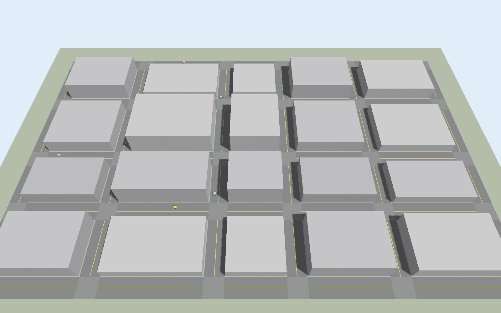
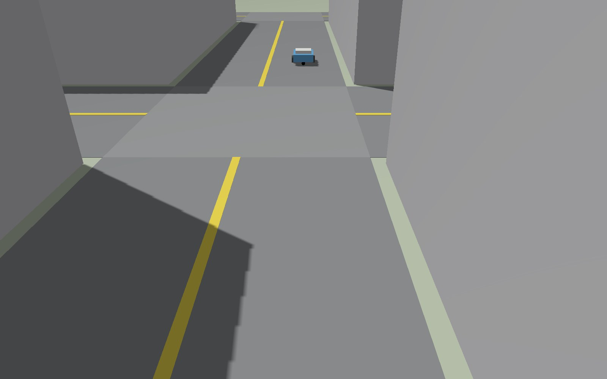

# Gazebo 接入（进阶挑战）

PPT 的进阶要求："Gazebo 中至少 5 辆车"。这里把 Gazebo（Harmonic）里的 5 辆差速小车按 [设备协议](../docs/protocol.md)
注册为 `gazebo` 设备，每辆成为数字世界中一辆数字车的**数字孪生**：服务端派单、规划、发授权，Gazebo 里的物理小车照着开，
位姿再实时同步回服务端。和 Matlab 车队用的是同一套协议、同一套控制逻辑。

> **验证情况**：在云端用 RoboStack（conda）装的 ROS 2 Jazzy + Gazebo Harmonic 8.6 上，以**无界面的服务器模式**（`gz sim -s`）
> 实测通过——5 辆车全部接入、按授权行驶、零碰撞零越权（数据和截图见第 6 节）。**带界面的 Gazebo 窗口和 Ubuntu 上 apt 安装的版本还没有实测**，
> 组员第一次运行时如果遇到问题，请把报错补充到第 7 节。

## 1. 文件

| 文件 | 作用 |
|---|---|
| `gen_world.py` | 读数字世界的地图 JSON，生成 Gazebo 世界 `worlds/minicity.sdf`（地面、道路、路口、中心黄线、楼房、N 辆小车）和 `config/ros_gz_bridge.yaml`（话题映射）。只用 Python 标准库 |
| `worlds/minicity.sdf` | 生成好的世界（默认地图、5 辆车），可以直接用 |
| `config/ros_gz_bridge.yaml` | ros_gz_bridge 配置：每辆车的 `cmd_vel`（ROS → Gazebo）和 `odometry`（Gazebo → ROS），外加 `/clock` |
| `minididi_bridge/` | ROS 2 Python 包（ament_python）：桥接节点、launch 文件、测试 |
| `minididi_bridge/minididi_bridge/follower.py` | 路径跟踪控制器：纯追踪 + 速度控制，严格遵守 `stopS`（与 `tools/mock_devices.py`、`matlab/SimCar.m` 同一逻辑） |
| `minididi_bridge/minididi_bridge/backends.py` | 车辆后端接口 + 纯 Python 运动学后端（不装 ROS 也能用） |
| `minididi_bridge/minididi_bridge/ros_backend.py` | ROS 2 + Gazebo 后端：订阅里程计、发布 `cmd_vel`、调用 Gazebo 传送服务、延迟补偿 |
| `minididi_bridge/minididi_bridge/fleet.py` | 车队主循环：每车一条 TCP 连接，20 Hz 控制、10 Hz 上报、断线重连 |
| `minididi_bridge/launch/minididi.launch.py` | 一键启动：Gazebo + ros_gz_bridge + 桥接节点 |

## 2. 工作原理

```
数字世界服务端 ──TCP 9000（register / welcome / path / permit / world）──▶ minididi_bridge（每车一条连接）
      ▲                                                                   │ 纯追踪 + stopS 限速 → (v, ω)
      └──────────────── state（x, y, θ, v，10 Hz）◀──────────────────────┤
                                                                          │ /car_N/cmd_vel      ▲ /car_N/odom
                                                              ros_gz_bridge（ROS 2 ⇄ Gazebo 话题）
                                                                          ▼                     │
                                                 Gazebo：DiffDrive 插件驱动车轮；OdometryPublisher 发布世界坐标位姿
```

- **坐标完全相同**：Gazebo 世界坐标与数字世界地图坐标一致（x 向东、y 向北、米，原点在地图西南角），不需要任何换算。
- **两个插件**：`DiffDrive` 订阅 `/model/car_N/cmd_vel` 驱动左右轮；`OdometryPublisher` 发布 `/model/car_N/odometry`——
  这是**世界坐标系**下的位姿（不是车轮积分出来的相对里程计），直接上报给服务端。
- **传送**：小车出生在地图南边外侧的"停车场"里。收到 `welcome` 后，桥接程序调用 Gazebo 的 `/world/minicity/set_pose` 服务，
  把小车放到数字孪生当前的位姿，然后从那里接着开。
- **延迟补偿**：里程计经 ros_gz_bridge 传过来有几十毫秒延迟，1.5 m/s 下 0.1 s 就是 0.15 m，会把停车余量吃掉。
  后端用最新速度把位姿外推到"现在"（外推时间 = 消息的"年龄" + `latency` 参数，默认 0.05 s）。
- **安全**：服务端保证任意两车的授权格不相交；控制器保证投影长度不超过 `stopS`；Gazebo 里车与车、车与楼房之间有真实的物理碰撞，
  所以如果控制出了问题，Gazebo 画面里会直接看到撞车，服务端的碰撞监测也会计数。

## 3. 安装（Ubuntu 24.04 + ROS 2 Jazzy + Gazebo Harmonic）

Gazebo 对显卡要求较高，请在组里配置最好的电脑上装 Ubuntu 24.04（双系统，不要用虚拟机）。

```bash
# 1. ROS 2 Jazzy 的软件源（国内可以把 packages.ros.org 换成 mirrors.tuna.tsinghua.edu.cn/ros2）
sudo apt install -y software-properties-common curl
sudo add-apt-repository -y universe
sudo curl -sSL https://raw.githubusercontent.com/ros/rosdistro/master/ros.key -o /usr/share/keyrings/ros-archive-keyring.gpg
echo "deb [arch=$(dpkg --print-architecture) signed-by=/usr/share/keyrings/ros-archive-keyring.gpg] http://packages.ros.org/ros2/ubuntu $(. /etc/os-release && echo $UBUNTU_CODENAME) main" \
  | sudo tee /etc/apt/sources.list.d/ros2.list
sudo apt update

# 2. ROS 2 + ros_gz（会自动装上配套的 Gazebo Harmonic）+ colcon
sudo apt install -y ros-jazzy-desktop ros-jazzy-ros-gz python3-colcon-common-extensions
echo "source /opt/ros/jazzy/setup.bash" >> ~/.bashrc && source ~/.bashrc
gz sim --versions          # 应显示 8.x
```

ROS 官方文档的安装步骤会更新（例如改用 `ros2-apt-source` 包配置软件源），以 <https://docs.ros.org/en/jazzy/Installation.html> 为准。

**不是 Ubuntu 也可以**：用 [RoboStack](https://robostack.github.io/)（conda）安装，本仓库的实测就是这样做的：

```bash
micromamba create -n ros -c conda-forge -c robostack-jazzy python=3.11 ros-jazzy-ros-base ros-jazzy-ros-gz colcon-common-extensions
micromamba activate ros
```

## 4. 构建

```bash
mkdir -p ~/ros2_ws/src && cd ~/ros2_ws/src
ln -s ~/ZongC/gazebo/minididi_bridge .      # 软链接到仓库里的包（也可以把整个仓库放进 src/）
cd ~/ros2_ws && colcon build
source install/setup.bash
```

改了地图或车的数量后，先重新生成世界再构建：`python3 ~/ZongC/gazebo/gen_world.py --cars 5 && colcon build`。

## 5. 运行

1. 在服务端电脑上启动数字世界（可以是另一台 Windows 电脑）：`scripts/start_server.sh --scenario demo`，记下局域网地址。
2. 在 Ubuntu 上：

   ```bash
   ros2 launch minididi_bridge minididi.launch.py host:=192.168.1.20        # 带 Gazebo 界面
   ros2 launch minididi_bridge minididi.launch.py gz_args:="-r -s"          # 不开界面（服务器模式，省资源）
   ros2 launch minididi_bridge minididi.launch.py start:=6                  # 和 Matlab 车队同时用：绑定 car-6 … car-10
   ```

3. 打开网页 `http://<服务端>:8080`，车辆列表中 car-1 … car-5 的驱动显示为"Gazebo"。

launch 参数：`host`、`port`（默认 9000）、`cars`（默认 5，要与生成世界时一致）、`start`（第一辆车的编号）、`latency`（延迟补偿，默认 0.05 s）、
`world`、`bridge_config`、`gz_args`（默认 `-r`）。桥接节点另有参数 `lead`（执行滞后，默认 0.08 s，`ros2 run` 时用 `-p lead:=0.1` 修改）。
调试时设置环境变量 `MINIDIDI_TRACE=trace.csv`，桥接程序会把每个控制周期的位姿、指令、s、stopS、横向偏差写成 CSV。也可以分开启动三个部分：

```bash
gz sim -r ~/ros2_ws/install/minididi_bridge/share/minididi_bridge/worlds/minicity.sdf
ros2 run ros_gz_bridge parameter_bridge --ros-args -p config_file:=$HOME/ZongC/gazebo/config/ros_gz_bridge.yaml
ros2 run minididi_bridge bridge --ros-args -p host:=192.168.1.20 -p cars:=5
```

### 不装 ROS / Gazebo 的验证

桥接程序的控制和协议部分与后端无关，可以换成纯 Python 运动学模型直接接到服务端，检查协议和控制逻辑（Windows 也能跑）：

```bash
PYTHONPATH=gazebo/minididi_bridge python3 -m minididi_bridge --cars 5 --duration 90     # 仓库根目录，先启动服务端
cd gazebo/minididi_bridge && python3 -m unittest discover -s test -v                    # 单元测试 9 项
```

## 6. 实测结果

测试环境：云端 4 核虚拟机（无显卡），RoboStack 安装的 ROS 2 Jazzy + Gazebo Harmonic（gz-sim 8.6.0），
`ros2 launch minididi_bridge minididi.launch.py gz_args:="-r -s"`（服务器模式）；数字世界运行 `demo` 场景，
car-1 … car-5 由 Gazebo 驱动，car-6 … car-8 由内部仿真驱动。

| 项目 | 结果 |
|---|---|
| 接入 | 5 辆车启动后 1.5 s 内全部注册并接管 car-1 … car-5，网页上驱动显示为"Gazebo" |
| 运行时长 / 送达订单 | 240 s / 19 单（同时经历了场景里的封路、2 处未知障碍被发现、3 次掉头） |
| 车车碰撞 / 撞墙 / 撞障碍 / 越权行驶 | **0 / 0 / 0 / 0** |
| 最小车距 / 最小离墙（服务端统计） | 0.282 m / 0.106 m |
| 投影越过授权停车点 stopS 的最大值 | 0.000 m |
| 离路线的最大横向偏差 | 0.092 m |
| Gazebo 实时因子 | ≈ 1.0 |
| 退出 | Ctrl+C（SIGINT）后桥接节点打印统计并正常退出 |

调试过程中发现并解决的问题（物理仿真里才会出现，运动学模型里没有）：

| 问题 | 原因 | 解决 | 效果 |
|---|---|---|---|
| 车会越过授权停车点约 0.08 m | 里程计经 ros_gz_bridge 有几十毫秒延迟；指令到车轮真正减速也有滞后 | 位姿按最新速度外推到当前时刻（`latency`）；刹车时预留 v × `lead` 的距离 | 越界 0.08 → 0.000 m |
| 转弯时横向偏差 0.15 m，离墙只剩 0.05 m | DiffDrive 插件的角加速度上限（8 rad/s²）让车进弯时角速度建立太慢 | 角加速度上限提到 25 rad/s²、线加速度 4 m/s² | 偏差 0.15 → 0.09 m，离墙 0.05 → 0.11 m |
| Gazebo 很忙时车停在停车场、位置乱跳 | 传送服务超时后改用了里程计（停车场的位置） | 传送未确认前一直重试，期间只报目标位姿、只发零速度 | 不会再把错误位置报给服务端 |
| Ctrl+C 时报错、统计不输出 | ROS 上下文关闭后还在发布停车指令 | 先输出统计，发布失败时忽略 | 正常退出 |

纯 Python 运动学后端（不装 ROS）接入同一服务端运行 90 s：5 车全部接管，最大越界 0.000 m，零碰撞、零越权。
桥接包单元测试 9 项（控制器 6 项、世界生成器 3 项）全部通过。

下面两张图由世界里临时加的相机传感器在无界面模式下渲染（Xvfb + Mesa 软件渲染）：





> 小提示：分开启动各部分时，`kill` 掉 `ros2 run` 或 `xvfb-run` 只会结束包装进程，真正的 `parameter_bridge`、`gz sim`
> 可能还留在后台，下次运行时同名话题会有两个发布者、车的位置乱跳。用 launch 文件启动，或者用 `setsid` 启动后按进程组结束。

## 7. 常见问题

| 现象 | 处理 |
|---|---|
| 网页上车辆驱动不是"Gazebo" | 看桥接节点日志有没有"已连接""接管"；`host` 是否正确；服务端电脑防火墙是否放行 9000 |
| 小车接管后不动 | `ros2 topic echo /car_1/odom` 有没有数据（没有：ros_gz_bridge 没起来或话题名不对）；`gz topic -l` 里有没有 `/model/car_1/cmd_vel` |
| 小车一直停在停车场 | 传送失败：世界里要有 `UserCommands` 插件（`gen_world.py` 已加）；`gz service -l` 里应有 `/world/minicity/set_pose` |
| Gazebo 实时因子明显小于 1 | 服务端按真实时间运行，Gazebo 跟不上会让车"慢半拍"：关掉界面（`gz_args:="-r -s"`）、减少车数，或换更好的电脑 |
| 多台电脑上 Gazebo 话题串了 | 设置 `export GZ_PARTITION=minididi`（每台电脑不同），或 `GZ_IP=127.0.0.1` 只在本机通信 |
| 改了地图后楼房位置不对 | 重新运行 `gen_world.py` 再 `colcon build`（launch 用的是 install 目录里的世界文件） |

## 8. 可以继续做的

- 给小车加 `gpu_lidar` 传感器，用 Gazebo 的真实激光雷达代替服务端的模拟扫描，上报障碍（感知建图的"端"侧）；
- 用 Gazebo 的相机传感器拍照，调用 `POST /api/vision/detect`，把图像识别也接进来；
- 用 MPC 代替纯追踪，在物理仿真里比较跟踪误差。
