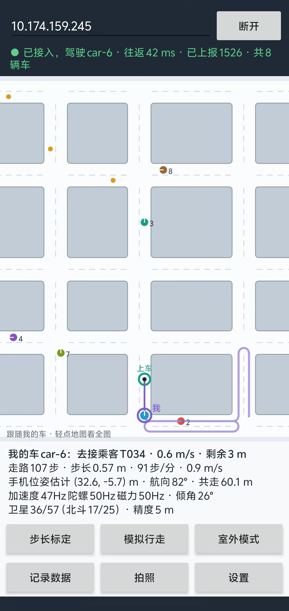
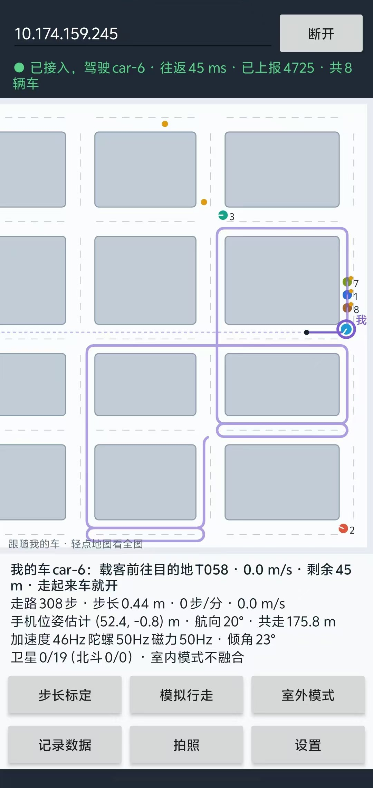

# MiniDiDi 手机 App（安卓）

按课程要求，这个 App 把一部安卓手机变成一辆**模拟车**："以人携带手机运动来模拟车辆的运动"。连上服务端后，手机绑定数字世界里的一辆出租车（默认 `car-6`），由拿着手机的人来驾驶它：

- **走路就是踩油门**：人走得快，车开得快；人站住，车就停。车沿服务端规划的路线行驶，接单、送客都和其他车一样。
- 手机用自带的加速度计、陀螺仪、磁力计和卫星定位（GPS、北斗等）做惯性位姿估计，每秒 10 次把车的位姿报给服务端，和数字世界里的这辆车保持同步。


*上图是小地图的绘制效果，左边是默认的"跟随我的车"视图，右边是全图。带紫色外圈、标着"我"的是手机驾驶的 6 号车，它正载着乘客开往红圈标出的目的地。紫色实线是服务端已经放行的路段，黑点是授权停车点，再往后的浅色虚线是还没放行的路线。淡紫色粗线是车走过的轨迹。M1~M5 是 Matlab 车（这里用 Python 模拟），7、8 是服务端内部仿真的车，橙点是等车的乘客，红叉是路障。这张图是用 App 自己的绘图代码在电脑上渲染出来的，不是真机截图。*

| 真机：去接乘客（室外模式，卫星参与融合） | 真机：人站住，车也停下 |
|---|---|
|  |  |

*上面两张是 2026-10-27 在 vivo S20（安卓 15）上的截图：手机开热点、笔记本连上后运行服务端，App 驾驶 car-6。左图人在走（91 步/分、0.9 m/s），车以弯道限速 0.6 m/s 开往上车点；右图人站住（0 步/分），车速为 0，顶栏一直显示往返延迟（40 ms 左右）。*

| 功能 | 说明 |
|---|---|
| 接入数字世界 | 注册为手机设备（`kind = phone`），绑定一辆数字车（默认 `car-6`）；每秒上报 10 次，断线自动重连，显示往返时延 |
| 走路驾驶 | 走路速度 × 驾驶比例 = 期望车速；车沿服务端规划的路线前进，遵守交通管控（不越过授权停车点） |
| 惯性位姿估计 | 行人航位推算（PDR）：计步、估算步长、用陀螺仪定航向 |
| 室外修正（可选） | 用磁力计定北，用卫星定位修正漂移，并显示北斗卫星数 |
| 标定 | 步长标定；驾驶比例在"设置"里改 |
| 小地图 | 城市、所有车辆、等车的乘客、路障，以及我的车的路线、授权停车点和轨迹 |
| 拍照识别 | 拍一张前方路障的照片，服务端识别出来写进地图，出租车随即绕行（端云互动） |
| 模拟行走 | 手机平放在桌上也能演示：自动按设定的步长和步频"走路"，车就开起来 |
| 记录数据 | 导出 CSV（车与手机位姿 10 Hz、原始传感器 50 Hz），配有 MATLAB 分析脚本 |

App 只用 Java 和安卓自带的 API，没有引入任何第三方库。也不依赖 Google 服务，所以国产手机都能用。

## 1. 编译和安装

**最简单的办法：直接下载 CI 编译好的 APK。** 每次推送代码后，GitHub Actions 都会自动编译一个调试版 APK：打开仓库的 [Actions 页面](https://github.com/fuzeliang1/ZongC/actions/workflows/ci.yml)，点最新一次成功（绿色 ✓）的运行，在页面底部 Artifacts 里下载 `MiniDiDi-phone-debug-apk`，解压得到 `app-debug.apk`，发到手机上安装（需要允许"安装未知应用"；下载需要登录 GitHub，附件保留 30 天）。

要修改 App 代码时，再按下面的步骤用 Android Studio 编译：

需要一部安卓 8.0 或更新版本的手机，电脑上装好 [Android Studio](https://developer.android.google.cn/studio)（2024.2 或更新的版本，自带 JDK）。

1. 打开 Android Studio，选 **Open**，然后选仓库里的 `phone` 文件夹。注意不是仓库根目录。
2. 第一次打开时会自动下载 Gradle 8.9 和安卓构建插件，需要几分钟。弹出提示要安装 SDK Platform 35 时，点同意。如果国内网络下载太慢：
   - 打开 `settings.gradle.kts`，把里面三处阿里云镜像的注释去掉；
   - 打开 `gradle/wrapper/gradle-wrapper.properties`，把 `distributionUrl` 改成 `https\://mirrors.cloud.tencent.com/gradle/gradle-8.9-bin.zip`。
3. 手机上打开开发者选项和 USB 调试。方法是：设置 → 关于手机，连续点 7 次"版本号"，然后在开发者选项里打开"USB 调试"。小米、华为等手机的开发者选项在"更多设置"或"系统"里。用数据线连上电脑后，点工具栏上的绿色 ▶。
4. 如果不方便连数据线，可以点菜单 **Build → Build App Bundle(s) / APK(s) → Build APK(s)**，把生成的 `app/build/outputs/apk/debug/app-debug.apk` 发到手机上安装。安装时需要允许"安装未知应用"。

也可以用命令行编译：在 `phone` 目录下运行 `./gradlew assembleDebug`（Windows 上是 `gradlew.bat assembleDebug`）。这需要先设置好 `ANDROID_HOME` 环境变量，或者在 `local.properties` 里写上 `sdk.dir`。

## 2. 使用（演示流程）

### 2.1 接入数字世界

1. 在电脑上启动服务端（`scripts/start_server`），让手机和电脑连同一个 Wi-Fi。校园网有时会把设备互相隔离，最稳妥的办法是用手机开热点，让电脑连上。
2. 查电脑的 IP。服务端启动时会打印出来，例如 `局域网地址: http://192.168.43.120:8080`。
3. Windows 第一次运行 Java 时，防火墙会弹出提示。"专用网络"和"公用网络"两个都要勾选允许，否则手机连不上 9000 和 8080 端口。
4. 打开 App 并允许"精确位置"权限（只有卫星定位用得到它，不给也能用）。输入电脑 IP，点"连接"。顶栏变成绿色的"● 已接入，驾驶 car-6"就说明连上了。这时网页地图上 6 号车的编号前会多一个 P（手机驾驶），车由你来开。
5. 以后再打开 App 会**自动连接**上次的服务端，不用再点"连接"（考核要求启动后全自主运行）。不需要时可以在"设置"里关掉。

想驾驶别的车，在"设置"里改"车号"。Matlab 车队默认占用 car-1 ~ car-5，所以手机默认驾驶 car-6；车号已被其他设备占用时，服务端会另分配一辆空闲的车，以顶栏显示的为准。

### 2.2 标定（每次演示前做一次）

| 步骤 | 怎么做 |
|---|---|
| 步长标定 | 建议每个演示的人都做一次。先量出一段 10 m 的直线，点"步长标定"→"开始"，用平常的步伐走完，再点"完成标定"，输入 10 |
| 驾驶比例 | 在"设置"里修改，默认 1：人走 1 m，车开 1 m。车的最高速度是 1.5 m/s，人正常走路约 1.2 m/s；走得慢、想让车开快一点，可以设成 1.5~2 |

不需要"设位置""对方向"：车在地图上的位置由服务端规划的路线决定，人在教室里往哪个方向走都可以。

### 2.3 走起来

- 像平时看手机一样拿着手机（屏幕朝上、机头朝前）正常走路，车就沿着路线开起来；停下脚步约 2 s 后车就停下（最后一步之后 1.6 s 才判定为停步，再用不到 1 s 刹停）。屏幕上方粗体的一行显示车的状态，例如"我的车 car-6：去接乘客 · 1.1 m/s · 剩余 23 m"。
- 车遵守交通管控：前方有车、有路障或者路口没放行时，车停在授权停车点前，屏幕显示"等待放行（前方有车或障碍）"，这时人走得再快车也不会动。放行后接着走就行。
- 订单由服务端自动派给这辆车，和其他车一样接客、送客；没有订单时空车巡游。人只管"开不开、开多快"。
- **拍照识别**：在前方地上放一个橙色锥桶（或红色、黄色的醒目物体），竖着拿手机对准它，点"拍照"，在相机里拍一张并确认。照片上传到服务端，服务端识别出路障、估算它在你前方多远，再按驾驶比例换算到车前方的地图格子上写入全局地图（网页上出现橙色锥桶，"图像识别"面板显示照片和识别框），附近的出租车随即绕行。路障在数字世界里保留 2 分钟，期间再拍到会续期。只用相机返回的缩略图，所以不需要相机和存储权限。距离按锥桶高 0.7 m 估算。
- **模拟行走**：把手机平放在桌上，点"模拟行走"，App 就以每秒 1.8 步、每步 0.65 m 的节奏自动"走路"，车随之开起来。适合在讲台上演示。
- **室外模式**：在操场这类开阔的地方打开。这时用磁力计定北、用卫星定位修正漂移，屏幕上会显示参与定位的卫星数和北斗卫星数。在室内请关闭，因为室内磁场干扰大，也基本收不到卫星。
- **记录数据**：点"记录数据"开始，再点一次结束。文件保存在手机存储的 `Download/MiniDiDi` 文件夹里（安卓 10 及以上）。拷到电脑后，用 MATLAB 运行 `analysis/plot_phone_log.m` 画图（需要 R2019a 或更新的版本）。
- 平时轻点小地图，可以在"跟随我的车"和"全图"之间切换。

请让 App 一直留在前台，屏幕会保持常亮。切到其他 App 后，安卓会停止向后台 App 发送传感器数据，车就会停下。断开连接（或断网超过 3 s）后，这辆车由数字世界的内部仿真接管，继续完成手上的订单。

## 3. 原理（写报告时可以参考）

### 3.1 走路即油门（`RouteFollower`）

人不可能沿着地图上的街道走（教室只有十来米），所以分工是：**路线由服务端规划，快慢由人决定**。

1. 服务端给这辆车下发路线 `path`（折线，点间距不超过 0.25 m，转弯处是半径 0.5 m 的圆弧）和授权 `permit.stopS`：沿路线最远能走到哪里（弧长，米）。
2. 手机每 0.1 s 推进一次沿路线的弧长 $s$：

$$v_{\text{want}} = v_{\text{walk}}\cdot k,\qquad v_{\text{cap}} = \min\Big(v_{\max},\ \sqrt{2a_{\text{dec}}\,(s_{\text{stop}}-s)},\ v_{\text{turn}}(s)\Big)$$

$$v \leftarrow \operatorname{clamp}\big(\min(v_{\text{want}}, v_{\text{cap}}),\ v - a_{\text{dec}}\Delta t,\ v + a_{\text{acc}}\Delta t\big),\qquad s \leftarrow \min(s + v\,\Delta t,\ s_{\text{stop}})$$

   其中 $v_{\text{walk}}$ = 步长 × 步频（停下 1.6 s 没迈步就是 0），$k$ 是驾驶比例。第二项是"在授权停车点前刹得住"的刹车曲线；$v_{\text{turn}}(s)$ 让车在进弯前减到 0.6 m/s。$v_{\max}=1.5$ m/s、$a_{\text{acc}}=1.0$、$a_{\text{dec}}=1.5$ m/s² 都来自服务端的 `welcome`，与数字车一致。
3. 上报的位姿就是折线上弧长 $s$ 处的点和切线方向。任何时候 $s \le s_{\text{stop}}$，所以手机车和其他车一样**不会越权**；授权被收回（前方突然出现路障）时立即采用新的 `stopS`，不倒车。
4. 换了新路线时，把车当前的位置投影到新路线上作为起点（距离差不多时取最靠前的一处）；新路线在收到它的 `permit` 之前不走。

Python 模拟设备 `tools/mock_devices.py` 里的 `PhoneCar` 是同一套逻辑，系统集成测试用它代替真手机。

### 3.2 手机坐标系

手机在自己的坐标系 P 里推算位置，单位是真实的米，原点是开始推算的地方，航向的零点是任意的（打开室外模式后对齐到正东）。这个估计显示在 App 的"手机位姿估计"一行，记录在 CSV 里，用来评估惯性推算的精度（课程要求"基于惯性元件估计位姿，精度不作要求"）。驾驶时只用到其中的走路速度。

### 3.3 计步

```
|a| ─减去重力估计（时间常数 2 s）─▶ 两级一阶低通（3 Hz）─▶ 峰谷检测 ─▶ 一步
```

- 计步只用加速度的模长，所以和手机怎么拿无关。
- 一个"峰"要等信号从最高点回落超过一个回滞量才算确认，回滞量取上一步幅值的 25%（限制在 0.2~0.8 m/s² 之间）。
- 峰谷差不到 0.8 m/s²（"计步阈值"）的不算一步，离上一步不到 0.28 s 的也不算。
- 停下 1.6 s 以上再起步时，第一步先记着不算，等第二步出现才两步一起确认。这样拿起手机、放下手机这类单次晃动就不会被误计成一步，车也不会被"晃"得往前窜。

代码见 `StepDetector`。

### 3.4 步长：Weinberg 模型

$$L = K\,(a_{\max}-a_{\min})^{1/4}$$

$a_{\max}-a_{\min}$ 是这一步的峰谷差，默认 $K = 0.45$。走得越用力、步子越大，峰谷差就越大，算出的步长也越大。步长标定的做法是：沿直线走一段已知距离 $D$，然后

$$K = D \Big/ \sum_i (a_{\max,i}-a_{\min,i})^{1/4}$$

走路速度 $v_{\text{walk}} = L \times$ 步频，步频取相邻两步间隔倒数的指数平滑。

### 3.5 航向

人拿着手机时，手机总有点倾斜。我们需要的是"绕竖直轴转了多少"，所以把陀螺仪测到的角速度向量投影到竖直方向上（竖直方向由重力传感器给出）：

$$\dot\psi = (\boldsymbol\omega - \mathbf b)\cdot\hat{\mathbf u}_{\text{up}}$$

这样不管手机平放还是斜着拿，转身多少度，算出的航向就变多少度。手机静止不动（加速度波动小于 0.15 m/s² 并持续 0.8 s）时，陀螺仪的读数就是零偏 $\mathbf b$，用 4 s 时间常数做平滑估计。

室外模式下还用磁力计来修正航向。磁力计航向要先做倾斜补偿：

$$\mathbf E = \frac{\mathbf m\times\hat{\mathbf u}}{\lVert\mathbf m\times\hat{\mathbf u}\rVert},\quad \mathbf N = \hat{\mathbf u}\times\mathbf E,\quad \psi_{\text{mag}} = \operatorname{atan2}(\mathbf f\cdot\mathbf N,\ \mathbf f\cdot\mathbf E) - \delta$$

其中 $\mathbf f$ 是机头方向在水平面上的投影，$\delta$ 是磁偏角（上海约 −6.5°）。然后用 PI 互补滤波把陀螺仪的漂移拉回来：

$$e = \operatorname{wrap}(\psi_{\text{mag}}-\psi),\qquad \psi \mathrel{+}= k_p e\,\Delta t,\qquad b_{\text{mag}} \mathrel{-}= k_i e\,\Delta t\quad(k_p=0.1,\ k_i=k_p^2/2)$$

积分项 $b_{\text{mag}}$ 用来学习走路过程中残留的零偏。走路时手机一直在动，没法用静止的方法估零偏；如果只用比例项，就会留下 $b/k_p$ 的稳态误差。偏差超过 30° 时多半是遇到了磁干扰，这时增益减到四分之一。代码见 `HeadingEstimator`。

### 3.6 卫星定位融合（室外模式）

1. 把经纬度换算成以某个参考点为原点的局部东-北坐标（等距圆柱投影，几公里范围内误差小于 0.1%）。
2. 前 5 次定位只用来确定"卫星坐标与 PDR 坐标之间的偏移"，取平均值，以减小单次定位误差的影响。
3. 之后每次定位都用标量卡尔曼滤波来修正：每走一步，位置方差 $P \mathrel{+}= 0.05 + (0.25L)^2$；定位精度为 $\sigma$ 时，

$$k = \frac{P}{P+\sigma^2},\qquad \mathbf p \mathrel{+}= k(\mathbf z - \mathbf p),\qquad P \leftarrow (1-k)P$$

精度差于 25 m 的定位结果不使用。定位用的是系统的 `GPS_PROVIDER`，没有用 Google 的融合定位（国内手机大多没有 Google 服务）。代码见 `PdrEngine.onLocation`。

### 3.7 参数

| 参数 | 默认值 | 说明 |
|---|---|---|
| 低通截止频率 | 3 Hz | 走路的步频在 1.5~2.5 Hz 之间 |
| 计步阈值 | 0.8 m/s² | 走路不计步就调小，晃手机被误计成步就调大（在"设置"里改） |
| 两步最短间隔 | 0.28 s | 对应最高步频约 3.5 步/秒 |
| 停步判定 | 1.6 s | 超过这个时间没迈步，就认为已经停下，走路速度归零 |
| Weinberg K | 0.45 | 用步长标定自动求 |
| 步长范围 | 0.25~1.2 m | |
| 磁力计增益 $k_p$ | 0.1 /s | 只在室外模式下使用 |
| 驾驶比例 | 1.0 | 人走 1 m，车开几 m（0.1~10） |
| 车的最高速度 / 转弯限速 | 1.5 / 0.6 m/s | 来自服务端，与数字车一致 |
| 模拟行走 | 0.65 m × 1.8 步/秒 | |

## 4. 验证情况

| 项目 | 方法 | 结果 |
|---|---|---|
| 核心算法 | 66 项单元测试（`app/src/test`），用一个"人拿着手机走路"的传感器模拟器（`SyntheticWalker`，按姿态旋转矩阵生成加速度、陀螺、磁力读数，带噪声） | 计步：沿正方形走 57 步，检测 57 步；慢走、快走、手机竖着拿、斜着拿，误差都不超过 1 步；只是拿起放下手机计 0 步 |
| 走路驾驶 | `RouteFollowerTest`：模拟服务端的路线和授权 | 收到授权前不动；任何时候不越过 `stopS`，授权收回时不倒车；车速跟随走路速度、不超过 1.5 m/s，减速度不超过 1.5 m/s²；弯道里不超过 0.6 m/s 且始终在圆弧上；换路线时从投影点接着走 |
| 推算精度（仿真） | 沿 9 m × 9 m 的正方形走一圈 | 回到起点的闭合误差约 0.6 m（占周长的 1.7%） |
| 室外修正（仿真） | 陀螺仪有 0.57°/s 零偏，走 150 s | 不修正时航向偏了 73°；用磁力计 PI 修正后，最大偏差 3.4°，最终偏差几乎为 0 |
| 卫星融合（仿真） | 步长模型偏大 30%，走 5 分钟（335 m），定位噪声 3 m | 不融合时最终误差 33 m；融合后为 2.6 m（全程最大 7.3 m） |
| 端到端 | `scripts/phone_sim`：用同一套核心代码，接入真实运行的服务端 | 绑定 car-6（驾驶方 PHONE，不新增智能体）；站着不动时车不动；走 37 步（23.0 m），车沿路线开了 21.6 m；服务端看到的车位置与手机本地相差平均 0.10 m、最大 0.11 m（约等于 0.1 s 上报间隔内车开过的距离）；停下后车停；断开后这辆车由内部仿真接管 |
| 系统集成 | `tools/system_test.py`：5 辆模拟车 + 1 辆模拟手机车（`PhoneCar`，人走走停停）跑 3 分钟 | 手机车全程保持接入，采样间累计行驶 161 m 以上；全场零碰撞、零越权 |
| 安卓界面层 | GitHub Actions 用真实安卓 SDK（compileSdk 35）编译并产出 APK；小地图的绘图代码在电脑上实际渲染过（就是本页顶部那张图） | 2026-10-27 在 vivo S20（安卓 15）上实测：接入、走路驾驶、拍照识别正常；97 s 记录中往返延迟中位数 34 ms，车从未越过授权停车点（详见 `docs/evaluation.md` 4.6 节） |

需要说明的是，仿真里的传感器是理想的，真机上的噪声、握持方式和磁干扰都会更复杂。真机上已经验证了接入和走路驾驶（见上表），推算精度还需要实测。下面两个实验可以直接放进技术报告（第 2 个已经做了一段不停步的版本，记录在 `docs/eval/phone/`，还差停步的部分）：

1. **惯性推算精度**：在空地上用卷尺量出一个 10 m × 10 m 的正方形，四个角做好标记；先做一次步长标定，打开"记录数据"，沿正方形走 3 圈，每次经过角点时停 2 秒；用 `plot_phone_log.m` 画出 `px, py` 轨迹，量出每一圈的闭合误差和边长误差，再对比室内模式和室外模式。
2. **走路驾驶**：连上服务端，打开"记录数据"，沿直线走 20 m、停 5 s、再走 20 m；用 `plot_phone_log.m` 的"手机车"图对比 `walk_v` 和 `car_v`（车速跟随走路速度的延迟、停步后多久停车），以及 `car_s` 与 `car_stop_s`（车从不越过授权停车点）。

在电脑上运行测试：Android Studio 里右键 `app/src/test/java` → Run Tests，或者运行 `./gradlew test`。端到端仿真需要先启动服务端，然后运行 `scripts/phone_sim.sh`（Windows 上是 `scripts\phone_sim.bat`），不需要 Android SDK。

## 5. 记录文件格式

两个文件里的 `t_s` 都从开始记录的时刻起算，单位是秒，可以直接对齐。缺失的值写作 `NaN`。

**pose_日期_时间.csv**（10 Hz）

| 列 | 含义 |
|---|---|
| t_s | 时间（s） |
| car_x, car_y, car_theta | 上报给服务端的车的位姿（地图米、弧度，逆时针为正）；没绑定车时为 NaN |
| car_v | 车速（m/s） |
| car_s, car_stop_s | 沿当前路线已走的弧长、授权停车点的弧长（m），任何时候 car_s ≤ car_stop_s |
| walk_v | 走路速度（m/s），= 步长 × 步频，停下时为 0 |
| px, py, yaw_p | 手机坐标系里的惯性推算位置（真实米）和航向 |
| yaw_rate | 竖直方向角速度（rad/s） |
| steps, distance, step_len, cadence, walking | 累计步数、累计距离（真实米）、最近一步的步长、步频（步/分）、是否在走路 |
| acc_sig | 计步用的滤波后的加速度信号（m/s²） |
| mag_yaw, tilt_deg | 磁力计给出的地理航向、手机的倾角（平放为 0°） |
| lat, lon, gnss_acc, gnss_used | 最近一次卫星定位的经纬度、精度（m），以及这次定位是否参与了融合 |
| sats_used, bds_used | 参与定位的卫星数、其中的北斗卫星数（没开定位时为 −1） |
| connected, rtt_ms | 是否已接入服务端、往返时延 |

**imu_日期_时间.csv**（约 50 Hz）：`t_s, sensor, x, y, z`。sensor 的取值：1 是加速度计（m/s²），2 是陀螺仪（rad/s），3 是磁力计（µT），4 是重力（m/s²）。坐标轴采用安卓的设备坐标系：x 指向屏幕右侧，y 指向机头，z 垂直屏幕朝外。

## 6. 常见问题

| 现象 | 处理 |
|---|---|
| 连接超时 | 确认手机和电脑在同一个网络（用手机热点最稳），IP 没有输错，服务端已经启动，Windows 防火墙已经允许 Java。也可以先用手机浏览器打开 `http://电脑IP:8080`，能打开网页就说明网络是通的 |
| 连接被拒绝 | 服务端没启动，或者端口不对。默认的设备端口是 9000 |
| 已连接，但地图不显示 | 8080 端口不通（防火墙），顶栏会显示"地图/快照获取失败" |
| 走路不计步，车不动 | 在"设置"里把计步阈值调小（比如 0.5）。另外，把手机放在口袋里时步伐信号比较弱 |
| 晃手机也计步，车往前窜 | 把计步阈值调大（比如 1.2） |
| 在走路，车却不动 | 看粗体那一行：显示"等待放行"说明前方有车或路障，车在授权停车点前等着，放行后会接着开；显示"没有路线"说明服务端还没给这辆车派路线，稍等即可 |
| 车开得太慢 | 车速上限是 1.5 m/s，弯道 0.6 m/s；嫌慢可以在"设置"里把驾驶比例调到 1.5~2 |
| 卫星数一直是 0 | 室内收不到卫星是正常的，到室外开阔的地方等 1~2 分钟。如果系统的"位置信息"开关没打开，App 会提示 |
| 驾驶的不是 car-6 | car-6 正被别的设备驾驶（例如另一部手机），服务端不抢占，另分配了一辆车，以顶栏显示的为准。想换车就在"设置"里改车号。自己断网重连时，旧连接 1 s 没消息就会让出，所以还是原来那辆车 |

## 7. 代码结构

```
phone/
├── app/src/main/java/com/zongc/phone/
│   ├── MainActivity.java     界面（纯代码搭建）、按钮、对话框、每 0.1 s 刷新
│   ├── MiniMapView.java      小地图
│   ├── AppCore.java          全局只有一份：位姿估计、手机车、传感器、连接、数据记录（界面重建时不中断）
│   ├── SensorSource.java     加速度计 / 陀螺仪 / 磁力计 / 重力，约 50 Hz，单独线程
│   ├── GnssSource.java       卫星定位与卫星统计（北斗）
│   ├── LogFiles.java         CSV 文件（保存到 Download/MiniDiDi）
│   ├── Prefs.java            保存设置
│   └── core/                 纯 Java，不依赖安卓，可以在电脑上测试
│       ├── StepDetector.java     计步
│       ├── HeadingEstimator.java 航向（陀螺仪 + 磁力计）
│       ├── PdrEngine.java        惯性位姿估计总装（含卫星融合、标定、模拟行走），输出走路速度
│       ├── RouteFollower.java    手机车：沿服务端路线推进、不越过授权停车点，走路速度就是油门
│       ├── DwConnection.java     TCP 接入（注册、上报、心跳、重连），把服务端消息转给 RouteFollower
│       ├── MapClient.java        HTTP：地图、快照、上传照片（图像识别）
│       ├── VisionResult.java     图像识别结果摘要
│       ├── WorldPoller.java      后台轮询快照
│       ├── MapData.java, WorldSnapshot.java, Endpoint.java
│       └── Json.java, Fmt.java, Geo.java, CsvLog.java, PdrConfig.java, PdrState.java
├── app/src/test/java/        单元测试；SyntheticWalker（传感器模拟器）；tools/PhoneSim（端到端仿真）
└── analysis/plot_phone_log.m MATLAB 分析脚本
```
