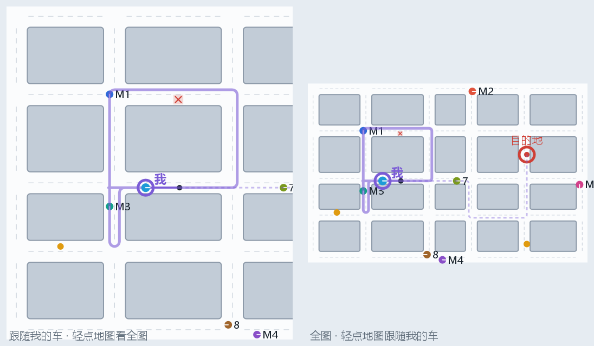

# MiniDiDi 手机 App（安卓）

这个 App 把一部安卓手机变成数字世界里的一个"行人"。手机用自带的加速度计、陀螺仪和磁力计推算自己走到了哪里，每秒 10 次把地图坐标报给服务端。出租车会在你面前停车让行，你也可以在手机上点一个目的地叫车。



*上图是小地图的绘制效果，左边是默认的"跟随我"视图，右边是全图。紫色圆点和箭头是你，紫线是你走过的轨迹。你叫的 6 号车正沿着它的路线赶来接你，绿圈是上车点，红圈是目的地。数字是出租车编号。这张图是用 App 自己的绘图代码在电脑上渲染出来的，不是真机截图。*

| 功能 | 说明 |
|---|---|
| 接入数字世界 | 注册为 `phone-1`，每秒上报 10 次，断线自动重连，显示往返时延 |
| 室内定位 | 行人航位推算（PDR）：计步、估算步长、用陀螺仪定航向 |
| 室外定位（可选） | 用磁力计定北，用卫星定位（GPS、北斗等）修正漂移，并显示北斗卫星数 |
| 标定 | 设位置、对方向、比例尺、步长标定 |
| 小地图 | 城市、出租车、其他手机、订单、路障，以及你的轨迹 |
| 叫车 | 在地图上点一下目的地，服务端就派车来接你 |
| 拍照识别 | 拍一张前方路障的照片，服务端识别出来写进地图，出租车随即绕行（端云互动） |
| 模拟行走 | 手机平放在桌上也能演示，转动手机就是转弯 |
| 记录数据 | 导出 CSV（位姿 10 Hz、原始传感器 50 Hz），配有 MATLAB 分析脚本 |

App 只用 Java 和安卓自带的 API，没有引入任何第三方库。也不依赖 Google 服务，所以国产手机都能用。

## 1. 编译和安装

**最简单的办法：直接下载 CI 编译好的 APK。** 每次推送代码后，GitHub Actions 都会自动编译一个调试版 APK：打开仓库的 [Actions 页面](https://github.com/fuzeliang1/ZongC/actions/workflows/ci.yml)，点最新一次成功（绿色 ✓）的运行，在页面底部 Artifacts 里下载 `MiniDiDi-phone-debug-apk`，解压得到 `app-debug.apk`，发到手机上安装（需要允许"安装未知应用"；下载需要登录 GitHub，附件保留 30 天）。

要修改 App 代码时，再按下面的步骤用 Android Studio 编译：

需要一部安卓 8.0 或更新版本的手机，电脑上装好 [Android Studio](https://developer.android.google.cn/studio)（2024.2 或更新的版本，自带 JDK）。

1. 打开 Android Studio，选 **Open**，然后选仓库里的 `phone` 文件夹。注意不是仓库根目录。
2. 第一次打开时会自动下载 Gradle 8.9 和安卓构建插件，需要几分钟。弹出提示要安装 SDK Platform 35 时，点同意。如果国内网络下载太慢：
   - 打开 `settings.gradle.kts`，把里面三处阿里云镜像的注释去掉；
   - 打开 `gradle/wrapper/gradle-wrapper.properties`，把 `distributionUrl` 改成 `https\://mirrors.cloud.tencent.com/gradle/gradle-8.9-bin.zip`。
3. 手机上打开开发者选项和 USB 调试。方法是：设置 → 关于手机，连续点 7 次"版本号"，然后在开发者选项里打开"USB 调试"。小米、华为等手机的开发者选项在"更多设置"或"系统"里。用数据线连上电脑后，点工具栏上的绿色 ▶。
4. 如果不方便连数据线，可以点菜单 **Build → Build App Bundle(s) / APK(s) → Build APK(s)**，把生成的 `app/build/outputs/apk/debug/app-debug.apk` 发到手机上安装。安装时需要允许"安装未知应用"。

也可以用命令行编译：在 `phone` 目录下运行 `./gradlew assembleDebug`（Windows 上是 `gradlew.bat assembleDebug`）。这需要先设置好 `ANDROID_HOME` 环境变量，或者在 `local.properties` 里写上 `sdk.dir`。

## 2. 使用（演示流程）

### 2.1 接入数字世界

1. 在电脑上启动服务端（`scripts/start_server`），让手机和电脑连同一个 Wi-Fi。校园网有时会把设备互相隔离，最稳妥的办法是用手机开热点，让电脑连上。
2. 查电脑的 IP。服务端启动时会打印出来，例如 `局域网地址: http://192.168.43.120:8080`。
3. Windows 第一次运行 Java 时，防火墙会弹出提示。"专用网络"和"公用网络"两个都要勾选允许，否则手机连不上 9000 和 8080 端口。
4. 打开 App 并允许"精确位置"权限（只有卫星定位用得到它，不给也能用）。输入电脑 IP，点"连接"。顶栏变成绿色的"● 已接入 phone-1"就说明连上了。这时网页地图上会出现一个紫色虚线圆圈，就是你。
5. 以后再打开 App 会**自动连接**上次的服务端，不用再点"连接"（考核要求启动后全自主运行）。不需要时可以在"设置"里关掉。

### 2.2 标定（每次演示前做一次）

| 步骤 | 怎么做 |
|---|---|
| 设位置 | 点"设位置"，再在地图上点你现在站的地方 |
| 对方向 | 把手机像看消息一样拿在胸前，机头朝前，点"对方向"，选你现在面朝的地图方向。也可以选"在地图上点一下我面朝的地方"。在教室里可以事先约定，比如讲台方向就是地图上方 |
| 比例尺 | 在"设置"里修改。教室只有十来米，走不到城市的另一头，可以设成 3~5，这样人走 1 m，地图上就走 3~5 m |
| 步长标定 | 建议每个演示的人都做一次。先量出一段 10 m 的直线，点"步长标定"→"开始"，用平常的步伐走完，再点"完成标定"，输入 10 |

### 2.3 走起来

- 像平时看手机一样拿着手机（屏幕朝上、机头朝前）正常走路，每走一步，地图上的你就前进一步。
- 走到车道上以后，出租车会在你前面停车等待，你离开后它继续行驶。如果你一直站着不走，它等 12 s 后会绕行。
- **叫车**：点"叫车"，再在地图上点目的地。上车点是离你最近的车道格。等车时请站在路边，别站在车道上，否则会挡住来接你的车。屏幕下方会显示订单状态，比如"car-3 正在赶来，还有约 12 m"。
- **拍照识别**：在前方地上放一个橙色锥桶（或红色、黄色的醒目物体），竖着拿手机对准它，点"拍照"，在相机里拍一张并确认。照片上传到服务端，服务端识别出路障、估算它在你前方多远，换算到地图格子上写入全局地图（网页上出现橙色锥桶，"图像识别"面板显示照片和识别框），附近的出租车随即绕行。路障在数字世界里保留 2 分钟，期间再拍到会续期。只用相机返回的缩略图，所以不需要相机和存储权限。距离按锥桶高 0.7 m 估算，记得先设好比例尺。
- **模拟行走**：把手机平放在桌上，点"模拟行走"，你就会以每秒 1.8 步的速度沿手机朝向前进，在桌上转动手机就能转弯。适合在讲台上演示。
- **室外模式**：在操场这类开阔的地方打开。这时用磁力计定北、用卫星定位修正漂移，屏幕上会显示参与定位的卫星数和北斗卫星数。在室内请关闭，因为室内磁场干扰大，也基本收不到卫星。
- **记录数据**：点"记录数据"开始，再点一次结束。文件保存在手机存储的 `Download/MiniDiDi` 文件夹里（安卓 10 及以上）。拷到电脑后，用 MATLAB 运行 `analysis/plot_phone_log.m` 画图（需要 R2019a 或更新的版本）。
- 平时轻点小地图，可以在"跟随我"和"全图"之间切换。

请让 App 一直留在前台，屏幕会保持常亮。切到其他 App 后，安卓会停止向后台 App 发送传感器数据，你在数字世界里就会停在原地。

## 3. 原理（写报告时可以参考）

### 3.1 两个坐标系

手机在自己的坐标系 P 里推算位置，单位是真实的米，航向的零点是任意的。上报给服务端之前，再换算到地图坐标系 M：

$$
\mathbf p_M = \mathbf o_M + s\,R(\varphi)\,(\mathbf p_P - \mathbf o_P),\qquad \theta_M = \theta_P + \varphi
$$

锚点 $\mathbf o_P\leftrightarrow\mathbf o_M$ 由"设位置"确定，旋转角 $\varphi$ 由"对方向"确定，比例尺 $s$ 在"设置"里改。修改任何一个参数之前，程序都会先把"当前位置"设为新的锚点，所以你在地图上的位置不会跳。代码见 `MapFrame`。

### 3.2 计步

```
|a| ─减去重力估计（时间常数 2 s）─▶ 两级一阶低通（3 Hz）─▶ 峰谷检测 ─▶ 一步
```

- 计步只用加速度的模长，所以和手机怎么拿无关。
- 一个"峰"要等信号从最高点回落超过一个回滞量才算确认，回滞量取上一步幅值的 25%（限制在 0.2~0.8 m/s² 之间）。
- 峰谷差不到 0.8 m/s²（"计步阈值"）的不算一步，离上一步不到 0.28 s 的也不算。
- 停下 1.6 s 以上再起步时，第一步先记着不算，等第二步出现才两步一起确认。这样拿起手机、放下手机这类单次晃动就不会被误计成一步。

代码见 `StepDetector`。

### 3.3 步长：Weinberg 模型

$$L = K\,(a_{\max}-a_{\min})^{1/4}$$

$a_{\max}-a_{\min}$ 是这一步的峰谷差，默认 $K = 0.45$。走得越用力、步子越大，峰谷差就越大，算出的步长也越大。步长标定的做法是：沿直线走一段已知距离 $D$，然后

$$K = D \Big/ \sum_i (a_{\max,i}-a_{\min,i})^{1/4}$$

### 3.4 航向

人拿着手机时，手机总有点倾斜。我们需要的是"绕竖直轴转了多少"，所以把陀螺仪测到的角速度向量投影到竖直方向上（竖直方向由重力传感器给出）：

$$\dot\psi = (\boldsymbol\omega - \mathbf b)\cdot\hat{\mathbf u}_{\text{up}}$$

这样不管手机平放还是斜着拿，转身多少度，算出的航向就变多少度。手机静止不动（加速度波动小于 0.15 m/s² 并持续 0.8 s）时，陀螺仪的读数就是零偏 $\mathbf b$，用 4 s 时间常数做平滑估计。

室外模式下还用磁力计来修正航向。磁力计航向要先做倾斜补偿：

$$\mathbf E = \frac{\mathbf m\times\hat{\mathbf u}}{\lVert\mathbf m\times\hat{\mathbf u}\rVert},\quad \mathbf N = \hat{\mathbf u}\times\mathbf E,\quad \psi_{\text{mag}} = \operatorname{atan2}(\mathbf f\cdot\mathbf N,\ \mathbf f\cdot\mathbf E) - \delta$$

其中 $\mathbf f$ 是机头方向在水平面上的投影，$\delta$ 是磁偏角（上海约 −6.5°）。然后用 PI 互补滤波把陀螺仪的漂移拉回来：

$$e = \operatorname{wrap}(\psi_{\text{mag}}-\psi),\qquad \psi \mathrel{+}= k_p e\,\Delta t,\qquad b_{\text{mag}} \mathrel{-}= k_i e\,\Delta t\quad(k_p=0.1,\ k_i=k_p^2/2)$$

积分项 $b_{\text{mag}}$ 用来学习走路过程中残留的零偏。走路时手机一直在动，没法用静止的方法估零偏；如果只用比例项，就会留下 $b/k_p$ 的稳态误差。偏差超过 30° 时多半是遇到了磁干扰，这时增益减到四分之一。代码见 `HeadingEstimator`。

### 3.5 卫星定位融合（室外模式）

1. 把经纬度换算成以某个参考点为原点的局部东-北坐标（等距圆柱投影，几公里范围内误差小于 0.1%）。
2. 前 5 次定位只用来确定"卫星坐标与 PDR 坐标之间的偏移"，取平均值，以减小单次定位误差的影响。
3. 之后每次定位都用标量卡尔曼滤波来修正：每走一步，位置方差 $P \mathrel{+}= 0.05 + (0.25L)^2$；定位精度为 $\sigma$ 时，

$$k = \frac{P}{P+\sigma^2},\qquad \mathbf p \mathrel{+}= k(\mathbf z - \mathbf p),\qquad P \leftarrow (1-k)P$$

精度差于 25 m 的定位结果不使用。定位用的是系统的 `GPS_PROVIDER`，没有用 Google 的融合定位（国内手机大多没有 Google 服务）。代码见 `PdrEngine.onLocation`。

### 3.6 上报

每走一步，位置会突然前进 0.6 m 左右。为了不让地图上的你一跳一跳的，上报的位置会用一阶滤波平滑一下，时间常数 0.35 s，再限制在地图范围以内。速度取 步长 × 步频 × 比例尺，角速度取 $\dot\psi$。

### 3.7 参数

| 参数 | 默认值 | 说明 |
|---|---|---|
| 低通截止频率 | 3 Hz | 走路的步频在 1.5~2.5 Hz 之间 |
| 计步阈值 | 0.8 m/s² | 走路不计步就调小，晃手机被误计成步就调大（在"设置"里改） |
| 两步最短间隔 | 0.28 s | 对应最高步频约 3.5 步/秒 |
| 新一段行走的判定 | 1.6 s | 超过这个时间没迈步，就认为已经停下 |
| Weinberg K | 0.45 | 用步长标定自动求 |
| 步长范围 | 0.25~1.2 m | |
| 磁力计增益 $k_p$ | 0.1 /s | 只在室外模式下使用 |
| 平滑时间常数 | 0.35 s | |
| 模拟行走 | 0.65 m × 1.8 步/秒 | |

## 4. 验证情况

| 项目 | 方法 | 结果 |
|---|---|---|
| 核心算法 | 65 项单元测试（`app/src/test`），用一个"人拿着手机走路"的传感器模拟器（`SyntheticWalker`，按姿态旋转矩阵生成加速度、陀螺、磁力读数，带噪声） | 计步：沿正方形走 57 步，检测 57 步；慢走、快走、手机竖着拿、斜着拿，误差都不超过 1 步；只是拿起放下手机计 0 步 |
| 推算精度（仿真） | 沿 9 m × 9 m 的正方形走一圈 | 回到起点的闭合误差约 0.6 m（占周长的 1.7%） |
| 室外修正（仿真） | 陀螺仪有 0.57°/s 零偏，走 150 s | 不修正时航向偏了 73°；用磁力计 PI 修正后，最大偏差 3.4°，最终偏差几乎为 0 |
| 卫星融合（仿真） | 步长模型偏大 30%，走 5 分钟（335 m），定位噪声 3 m | 不融合时最终误差 33 m；融合后为 2.6 m（全程最大 7.3 m） |
| 端到端 | `scripts/phone_sim`：用同一套核心代码，接入真实运行的服务端 | 服务端看到的位置与手机本地相差平均约 0.1 m，最大 0.3 m；行人突然站到出租车前方第 3 格或第 5 格时，车都停在了行人前面（车身与行人之间至少还有 0.13 m），行人离开后车恢复行驶；叫车后订单被派出；断开连接后，手机智能体从数字世界中消失 |
| 安卓界面层 | GitHub Actions 用真实安卓 SDK（compileSdk 35）编译通过并产出 APK；小地图的绘图代码在电脑上实际渲染过（就是本页顶部那张图） | **还没有在真机上运行过**。第一次编译或运行如果遇到问题，请把报错发给负责人 |

需要说明的是，仿真里的传感器是理想的，真机上的噪声、握持方式和磁干扰都会更复杂。所以真机精度需要实测。下面这个实验可以直接放进技术报告：

1. 在空地上用卷尺量出一个 10 m × 10 m 的正方形，四个角做好标记；
2. 先做一次步长标定，然后在起点"设位置""对方向"，打开"记录数据"；
3. 沿正方形走 3 圈，每次经过角点时停 2 秒；
4. 用 `plot_phone_log.m` 画出轨迹，量出每一圈的闭合误差和边长误差，再对比室内模式和室外模式。

在电脑上运行测试：Android Studio 里右键 `app/src/test/java` → Run Tests，或者运行 `./gradlew test`。端到端仿真需要先启动服务端，然后运行 `scripts/phone_sim.sh`（Windows 上是 `scripts\phone_sim.bat`），不需要 Android SDK。

## 5. 记录文件格式

两个文件里的 `t_s` 都从开始记录的时刻起算，单位是秒，可以直接对齐。缺失的值写作 `NaN`。

**pose_日期_时间.csv**（10 Hz）

| 列 | 含义 |
|---|---|
| t_s | 时间（s） |
| x, y, theta | 上报给服务端的地图位姿（地图米、弧度，逆时针为正） |
| v, w | 速度（地图米/秒）、竖直方向角速度（rad/s） |
| raw_x, raw_y | 平滑之前的地图位置 |
| px, py, yaw_p | 手机内部坐标系里的位置（真实米）和航向 |
| steps, distance, step_len, cadence, walking | 累计步数、累计距离（真实米）、最近一步的步长、步频（步/分）、是否在走路 |
| acc_sig | 计步用的滤波后的加速度信号（m/s²） |
| mag_yaw, tilt_deg | 磁力计给出的地理航向、手机的倾角（平放为 0°） |
| lat, lon, gnss_acc, gnss_used | 最近一次卫星定位的经纬度、精度（m），以及这次定位是否参与了融合 |
| sats_used, bds_used | 参与定位的卫星数、其中的北斗卫星数（没开定位时为 −1） |
| connected, rtt_ms | 是否已接入服务端、往返时延 |

**imu_日期_时间.csv**（约 50 Hz）：`t_s, sensor, x, y, z`。sensor 的取值：1 是加速度计（m/s²），2 是陀螺仪（rad/s），3 是磁力计（µT），4 是重力（m/s²）。坐标轴采用安卓的设备坐标系：x 指向屏幕右侧，y 指向机头，z 垂直屏幕朝外。

## 6. 常见问题

| 现象 | 处理 |
|---|---|
| 连接超时 | 确认手机和电脑在同一个网络（用手机热点最稳），IP 没有输错，服务端已经启动，Windows 防火墙已经允许 Java。也可以先用手机浏览器打开 `http://电脑IP:8080`，能打开网页就说明网络是通的 |
| 连接被拒绝 | 服务端没启动，或者端口不对。默认的设备端口是 9000 |
| 已连接，但地图不显示 | 8080 端口不通（防火墙），顶栏会显示"地图/快照获取失败" |
| 走路不计步 | 在"设置"里把计步阈值调小（比如 0.5）。另外，把手机放在口袋里时步伐信号比较弱 |
| 晃手机也计步 | 把计步阈值调大（比如 1.2） |
| 方向越走越偏 | 重新"对方向"。室内的陀螺仪漂移一般是每分钟几度；室外可以打开室外模式 |
| 卫星数一直是 0 | 室内收不到卫星是正常的，到室外开阔的地方等 1~2 分钟。如果系统的"位置信息"开关没打开，App 会提示 |
| 叫车后车一直不来 | 所有车都在忙时，订单会排队等待。车来了却停在半路，多半是你站在了它要走的车道上 |
| 换了编号 | 网络断开后如果马上重连，旧连接可能还没超时（3 s），服务端会给你分配新编号，以顶栏显示的为准 |

## 7. 代码结构

```
phone/
├── app/src/main/java/com/zongc/phone/
│   ├── MainActivity.java     界面（纯代码搭建）、按钮、对话框、每 0.1 s 刷新
│   ├── MiniMapView.java      小地图
│   ├── AppCore.java          全局只有一份：位姿估计、传感器、连接、数据记录（界面重建时不中断）
│   ├── SensorSource.java     加速度计 / 陀螺仪 / 磁力计 / 重力，约 50 Hz，单独线程
│   ├── GnssSource.java       卫星定位与卫星统计（北斗）
│   ├── LogFiles.java         CSV 文件（保存到 Download/MiniDiDi）
│   ├── Prefs.java            保存设置
│   └── core/                 纯 Java，不依赖安卓，可以在电脑上测试
│       ├── StepDetector.java     计步
│       ├── HeadingEstimator.java 航向（陀螺仪 + 磁力计）
│       ├── PdrEngine.java        位姿估计总装（含卫星融合、标定、模拟行走）
│       ├── MapFrame.java         P → 地图坐标换算
│       ├── DwConnection.java     TCP 接入（注册、上报、心跳、重连）
│       ├── MapClient.java        HTTP：地图、快照、叫车、上传照片（图像识别）
│       ├── VisionResult.java     图像识别结果摘要
│       ├── WorldPoller.java      后台轮询快照
│       ├── MapData.java, WorldSnapshot.java, Endpoint.java
│       └── Json.java, Fmt.java, Geo.java, CsvLog.java, PdrConfig.java, PdrState.java
├── app/src/test/java/        单元测试；SyntheticWalker（传感器模拟器）；tools/PhoneSim（端到端仿真）
└── analysis/plot_phone_log.m MATLAB 分析脚本
```
